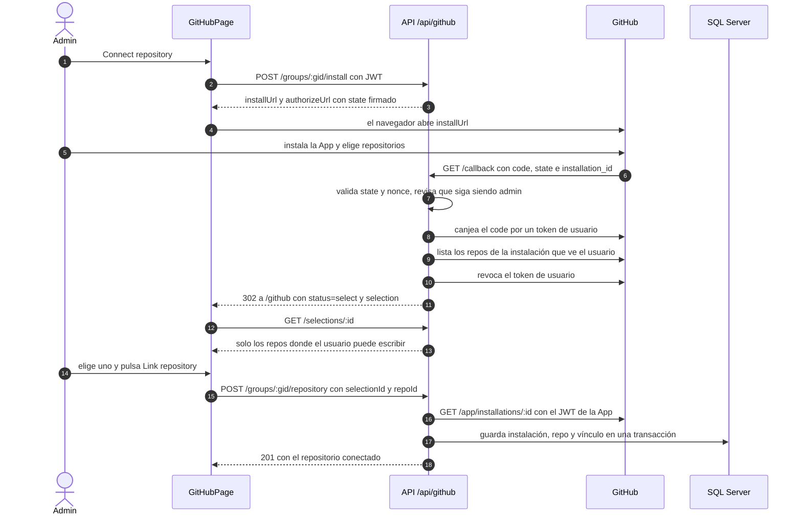
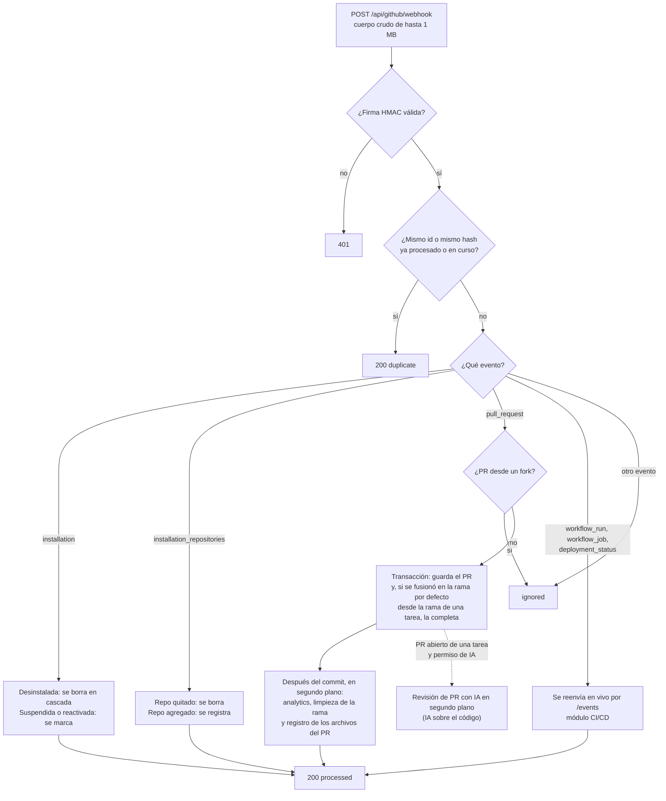
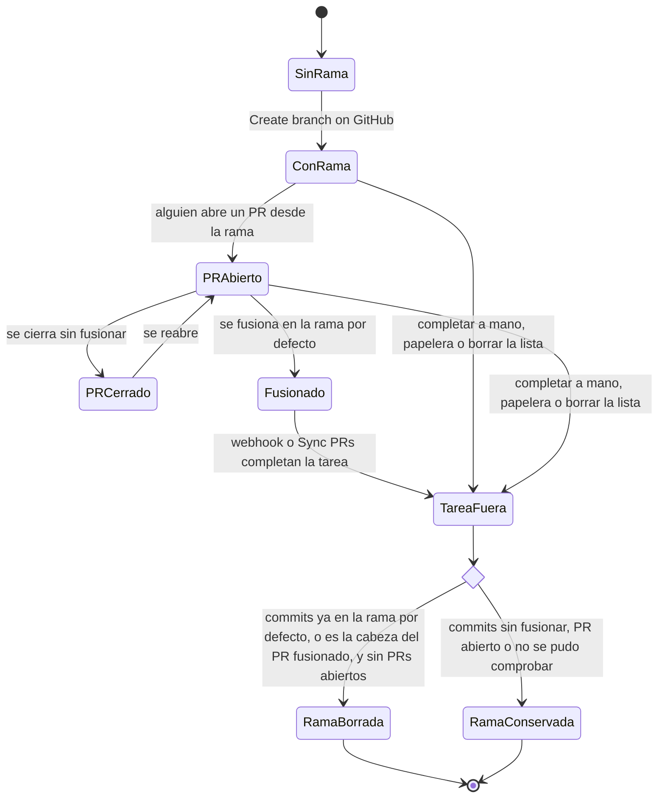
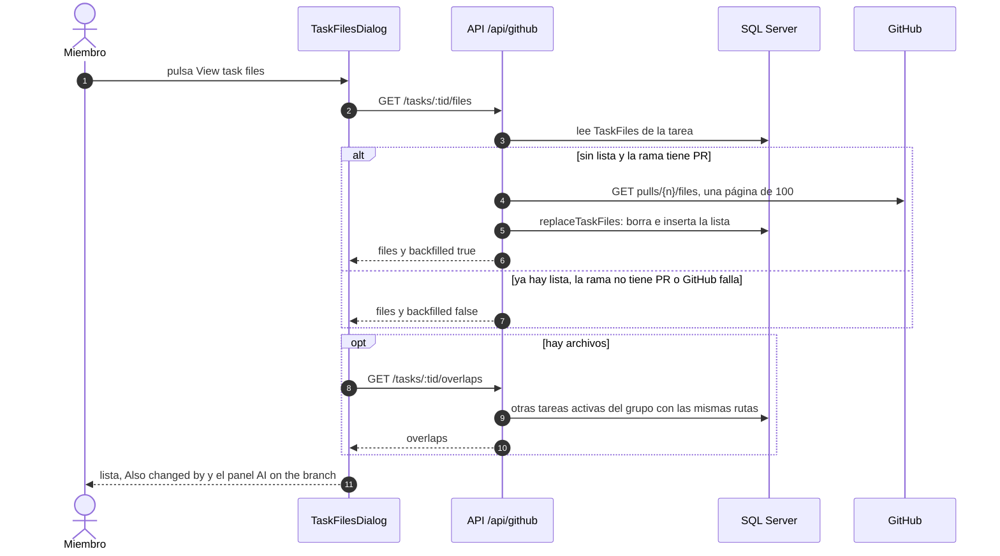

# GitHub: flujos

**En una frase:** el admin conecta el repo con un `state` firmado que GitHub devuelve al callback; luego cada tarea puede tener su rama, y cuando su PR se fusiona en la rama por defecto, el webhook completa la tarea y borra la rama si es seguro; mientras el PR está abierto, el mismo webhook dispara la revisión con IA, y la lista de archivos de la tarea se pide a GitHub al abrir «Task files».

## Diagrama 1: conectar el repositorio

## Diagrama 2: un webhook llega a la API

Si el proceso tarda más de 8 s, la API responde 202 y sigue. Si falla, la entrega queda `failed` y responde 500. El registro de archivos y la revisión con IA corren después de la transacción y no cambian la respuesta.

## Diagrama 3: vida de la rama de una tarea

## Diagrama 4: ver los archivos de una tarea

## Paso a paso

**Conectar el repositorio** (Diagrama 1)
1. El admin pulsa «Connect repository» (instalar) o «I already installed the App» (solo autorizar).
2. La API firma un `state` de 10 min, ligado al admin, al grupo y a un nonce de un solo uso.
3. GitHub vuelve al callback; la API valida el `state` y que la persona siga siendo admin.
4. Con un token de usuario de corta vida lista los repos y deja solo aquellos donde puede escribir.
5. Revoca ese token y redirige a `/github?status=select`. La selección dura 10 min.
6. El admin elige el repo y pulsa «Link repository»; `POST /repository` lo vincula en una transacción. Si había otro, borra sus ramas de tareas.

**Si el dueño cambia la instalación en github.com** (por ejemplo, da acceso a otro repo)
1. GitHub vuelve al callback sin `state` («Redirect on update»).
2. La API no canjea ni vincula nada: solo redirige a `/github?status=updated`.
3. Si quien vuelve es admin del grupo activo, la página reinicia el flujo normal con `state` y abre la selección.

**Crear la rama de una tarea**
1. Un miembro pulsa «Create branch on GitHub» en la tarea.
2. La API arma `tm/<slug del nombre>-<8 caracteres del tid>` y lee el último commit de la rama por defecto.
3. Crea la rama en GitHub y guarda la fila en `TaskBranches`. Si la rama ya existía y no es de otra tarea, la adopta.
4. Si falla el guardado, borra la rama que acaba de crear.

**PR fusionado → tarea completada** (Diagrama 2)
1. GitHub manda `pull_request`; en desarrollo pasa por smee.
2. La API verifica la firma y registra la entrega.
3. En una sola transacción guarda el PR y completa la tarea, si corresponde.
4. Después del commit, sin hacer esperar a GitHub: registra la finalización en analytics, limpia la rama y pide la lista de archivos del PR para `TaskFiles`.

**Archivos de la tarea** (Diagrama 4)
1. Al completar la tarea por webhook, el paso 4 de arriba intenta guardar la lista. Según el código no llega a guardarse: al repo que pasa el webhook le falta el dueño (la URL queda `/repos/undefined/...`) y la tarea ya salió de `Tasks`, así que la FK de `TaskFiles` lo rechaza. Solo queda un `console.warn`. «Sync PRs» ni lo intenta.
2. Un miembro pulsa «View task files» en una tarea activa con rama.
3. `GET /tasks/:tid/files` devuelve la lista guardada. Si está vacía y la rama tiene un PR (el más reciente, en cualquier estado), la pide a GitHub, la guarda y responde `backfilled: true`: el diálogo muestra «recovered from GitHub».
4. Una lista guardada no se vuelve a pedir, aunque el PR reciba más commits. Un PR sin archivos se vuelve a consultar cada vez que se abre el diálogo.
5. Si hay archivos, el diálogo pide `/overlaps` y marca en ámbar «Also changed by: …». Si eso falla, la lista se muestra igual.

**Revisión de PR con IA** (Diagrama 2)
1. Llega `pull_request` con `opened`, `synchronize`, `ready_for_review` o `reopened` y la entrega queda `processed` (un duplicado no la dispara).
2. `prReview` sigue sin hacer esperar al webhook si hay `AI_SERVER_URL`, el PR está abierto y no es borrador, su rama es la de una tarea del repo vinculado y el grupo tiene «Allow AI analysis».
3. Reserva el commit en `AiReviews`, pide el diff a GitHub, llama a `review-pr` del servidor de IA local y publica una revisión `COMMENT` en el PR. Paso a paso completo en [IA sobre el código](10-ia-sobre-el-codigo.md).

**Sincronizar PRs**
1. Un miembro pulsa «Sync PRs» (una vez cada 30 s).
2. La API actualiza el nombre y la rama por defecto del repo si cambiaron en GitHub.
3. Consulta los PRs de hasta 30 ramas (primero las que no tienen PR o lo tienen abierto) y aplica cada uno como el webhook, salvo el registro de archivos y la revisión con IA.

**Analizar el repositorio con IA:** ver el [flujo del chat](05-chat-ia.md). Se lanza con «Analyze with AI», con «Propose tasks» o pidiendo un plan en el chat. Exige `ai_analysis_enabled`, y al modelo (Gemma 4 local en Ollama, o Groq si se usa el respaldo; lo fija `LLM_PROVIDER`) va un resumen del repo, no el código.

## Qué ve el usuario si algo falla

| Código | Cuándo | Mensaje |
|---|---|---|
| `INVALID_STATE` | El `state` venció, ya se usó o es falso | «The connection link expired or was already used. Click “Connect repository” again.» |
| `NOT_GROUP_ADMIN` | Dejó de ser admin durante la conexión | «You are no longer an admin of this group, so the repository could not be connected.» |
| `ACCESS_DENIED` | Canceló la autorización en GitHub | «The authorization was cancelled on GitHub.» |
| `INSTALLATION_NOT_FOUND` | Su cuenta no ve esa instalación | «Your GitHub account has no access to that App installation.» |
| `NO_REPOSITORIES` | La instalación no tiene repos | «The installation has no access to any repository.» |
| `NO_WRITABLE_REPOSITORIES` | Solo tiene lectura en los repos | «Your GitHub account has no write access to any repository in the installation…» |
| (sin código) `status=pending` | Una organización debe aprobar la instalación | «The installation is pending: an organization owner must approve it on GitHub…» |
| `SELECTION_NOT_FOUND` (404) | La selección venció o ya se usó | «The repository selection expired (it lasts 10 minutes) or was already used. Click “Connect repository” again.» |
| `REPO_NOT_ACCESSIBLE` (403) | La App perdió acceso al repo | «The GitHub App has no access to that repository.» |
| `INSTALLATION_SUSPENDED` (409) | La instalación está suspendida | «The GitHub App installation is suspended.» |
| `REPO_EMPTY` (409) | El repo no tiene commits | «The repository is empty: make a first commit before creating branches.» |
| `BRANCH_CONFLICT` (409) | La rama ya es de otra tarea | «A branch with that name is already linked to another task.» |
| `FILE_TOO_LARGE` (413) | Archivo de más de 1 MB | «The file is larger than 1 MB and cannot be shown here. Open it on GitHub.» |
| `FILE_NOT_FOUND` (404) | El archivo no está en esa rama | «The file does not exist on this branch.» |
| `RATE_LIMITED` (429) | Sincronizar dos veces en 30 s | «It was synced a moment ago. Wait about 30 seconds and try again.» |
| `GITHUB_RATE_LIMITED` (503) | Se gastó el presupuesto de GitHub; trae `Retry-After` | «The GitHub API usage limit was reached. Try again later.» |
| `GITHUB_NOT_CONFIGURED` (503) | Faltan variables de la App en el `.env` | «The GitHub integration is not configured on the server.» |
| `DB_BUSY` (503) | Bloqueos en la BD tras los reintentos | «The server is busy. Try again in a few seconds.» |
| `AI_ANALYSIS_DISABLED` | Analizar sin el permiso del admin | «AI analysis is turned off for this project. A group admin can turn it on from the GitHub page (“Allow AI analysis”).» |
| `RATE_LIMITED` (chat) | Más de un análisis por minuto | «You can only ask for one analysis per minute.» |
| Limpieza `error` | GitHub no contestó a tiempo al limpiar la rama | «Could not confirm what happened to branch … on GitHub; it may still be there.» |
| `TASK_NOT_FOUND` (404) | Abrir «Task files» de una tarea que ya se completó (por ejemplo, por el webhook, sin recargar la página) | «The task no longer exists.» |
| `REPO_NOT_CONNECTED` (409) | Recuperar la lista de archivos sin repo conectado | «This group has no GitHub repository connected.» |
| Otro error de «Task files» | Falla `/files` | «Could not load the task files.» |
| (sin código) lista vacía | La tarea no tiene lista y no se pudo recuperar (sin PR, o GitHub falló) | «This task has no recorded files yet. They are recorded automatically when the pull request of its branch is merged.» |
| `TASK_NO_BRANCH`, `NOTHING_TO_REVIEW`, `NO_OPEN_PR`, `AI_SERVER_*` | Auditar, generar pruebas o revisar el PR | Un texto genérico, como «Could not audit the branch.»; detalle en [IA sobre el código](10-ia-sobre-el-codigo.md) |

Un webhook fallido no se ve en la interfaz: la entrega queda `failed` y GitHub no la reintenta sola. Se arregla con «Sync PRs» o reenviándola desde la configuración de la App en GitHub.

El registro de archivos tampoco avisa si falla: solo deja un `console.warn` en la API. Una revisión de IA fallida sí queda en `AiReviews` y el panel la muestra («The last review failed (…).»).

Cuando un webhook completa una tarea, `/tasks` no se actualiza en vivo: el cambio se ve al recargar ([limitaciones conocidas](../01-proyecto/cierre-del-proyecto.md#limitaciones-conocidas)).

## Para saber más

- Casos de uso y permisos: [04-casos-de-uso/07-github.md](../04-casos-de-uso/07-github.md)
- Tablas y reglas: [03-base-de-datos/07-github.md](../03-base-de-datos/07-github.md)
- Auditar, generar pruebas y revisar PRs con IA: [10-ia-sobre-el-codigo.md](10-ia-sobre-el-codigo.md)
- Todos los códigos de error y su solución: [guía de la GitHub App, §10](../07-guias/guia-github-app.md#10-solución-de-problemas)
- Diagramas originales de la Fase 3: [capítulo de la Fase 3](../08-fases/fase-03-integracion-github/README.md#diagramas)
- Limitaciones conocidas: [cierre de la línea de Pablo y estado](../01-proyecto/cierre-del-proyecto.md#limitaciones-conocidas)
