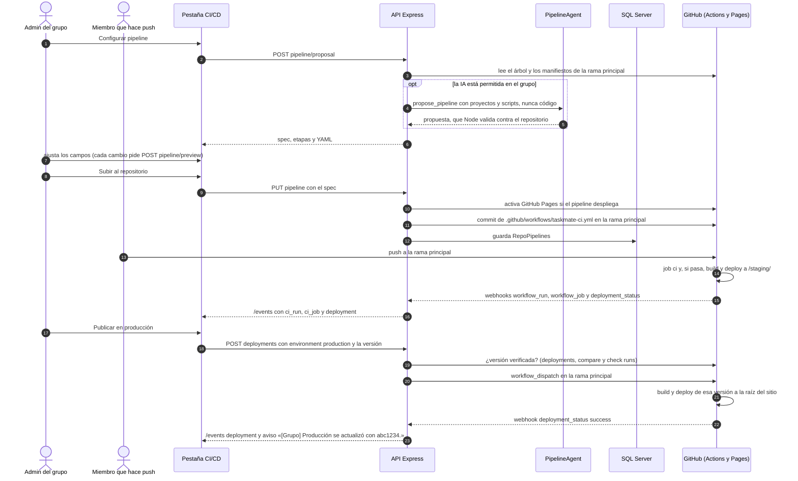
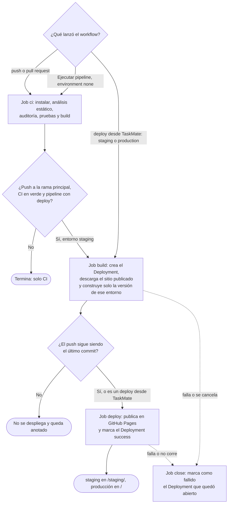
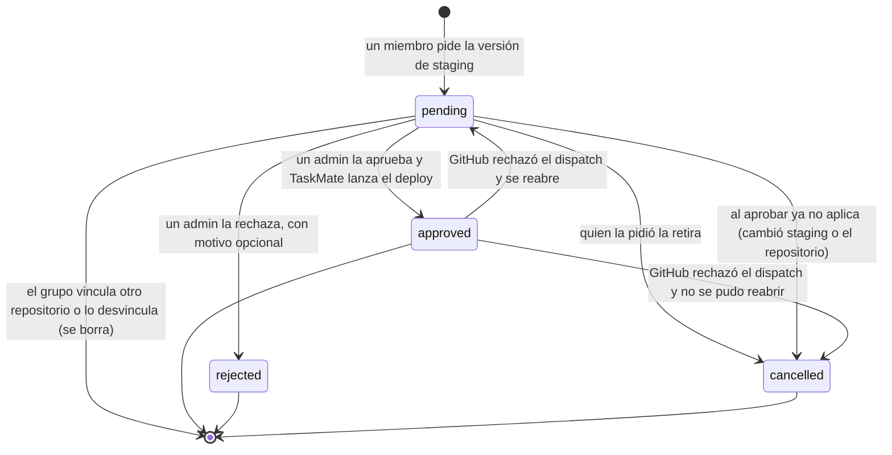

# CI/CD: flujos

**En una frase:** el admin configura y sube el pipeline, cada push corre el CI, un push a la rama principal que pasa el CI se publica solo en staging, y producción se publica desde TaskMate (directo por el admin, o por solicitud de un miembro que el admin aprueba).

## Flujo principal: del pipeline a producción

## Qué jobs corren en cada caso

## Ciclo de vida de una solicitud de producción

## Paso a paso

1. El admin abre **GitHub → CI/CD** y pulsa **«Configurar pipeline»**.
2. TaskMate lee la rama principal y detecta los proyectos (Node.js, Python o sitio estático, hasta 2 niveles de carpetas). Si el grupo permite la IA y no hay pipeline guardado, propone la IA; si falla, queda la propuesta detectada con una nota.
3. Cada cambio en el diálogo se valida en el servidor y regenera el YAML.
4. **«Subir al repositorio»**: TaskMate activa Pages (si hay deploy), hace el commit del workflow y guarda `RepoPipelines`.
5. Cada push y cada PR corren el job `ci`. Un push a la rama principal que pasa el CI se publica en staging.
6. GitHub avisa por webhook. La API lo reenvía por `/events` y la pantalla se recarga.
7. El admin pulsa **«Publicar en producción»**. Un miembro pulsa **«Solicitar producción»** y espera la aprobación.
8. Antes de desplegar, TaskMate comprueba que la versión esté verificada: ya publicada antes, o en la rama principal con el job «CI (…)» en verde.
9. El deploy construye solo esa versión y conserva el otro entorno tal como está publicado (si GitHub ya no guarda el sitio publicado, reconstruye también el otro entorno). El historial queda en GitHub Deployments.
10. **Rollback:** el admin elige una de las 10 versiones anteriores de producción y se despliega igual que en el paso 9.

## Qué ve el usuario si algo falla

| Código (HTTP) | Mensaje en pantalla |
|---------------|---------------------|
| `APP_PERMISSIONS_MISSING` (409) | «La GitHub App todavía no tiene los permisos de CI/CD en este repositorio. Quien la instaló debe aceptarlos en GitHub.» |
| `PIPELINE_UNSUPPORTED` (422) | «No se encontró un proyecto de Node.js, Python ni un sitio estático en el repositorio.» |
| `INVALID_PIPELINE` (400) | «La configuración del pipeline no es válida para este repositorio.» |
| La IA falló (sin código de error) | Nota: «No se pudo usar la IA (…); esta es la propuesta de la detección automática.» |
| `AI_ANALYSIS_DISABLED` (409) | «El análisis con IA está desactivado para este repositorio. Un administrador puede activarlo en la página GitHub.» |
| `PAGES_UNAVAILABLE` (409) | «GitHub Pages no está disponible para este repositorio con su plan actual (en repositorios privados requiere GitHub Pro).» |
| `BRANCH_PROTECTED` (409) | «La rama principal está protegida y solo acepta cambios por pull request, así que TaskMate no puede subir el pipeline.» |
| `WORKFLOW_CONFLICT` (409) | «Ya existe un workflow .github/workflows/taskmate-ci.yml que no creó TaskMate. Renómbralo o bórralo para continuar.» |
| `PIPELINE_NOT_CONFIGURED` (409) | «Este repositorio todavía no tiene un pipeline de TaskMate.» |
| `BRANCH_WORKFLOW_OUTDATED` (409) | «Esa rama no tiene el workflow actual de TaskMate: actualízala con la rama principal (merge o rebase) y vuelve a intentarlo.» |
| `WORKFLOW_DISABLED` (409) | «El workflow de TaskMate está desactivado en GitHub. Actívalo en la pestaña Actions del repositorio y vuelve a intentarlo.» |
| `RUN_NOT_RERUNNABLE` (409) | «Solo se pueden re-ejecutar ejecuciones terminadas con jobs fallidos (y de menos de un mes).» |
| `LOG_NOT_AVAILABLE` (404) | «El log todavía no está disponible (el job sigue corriendo) o ya expiró.» |
| `NOT_GROUP_ADMIN` (403) | «Solo el administrador del grupo puede hacer esto.» |
| `DEPLOY_NOT_CONFIGURED` (409) | «El pipeline de este repositorio no tiene deploy.» |
| `VERSION_NOT_VERIFIED` (409) | «Ese commit no pasó el CI de TaskMate, así que no se puede desplegar.» |
| `VERSION_NOT_STAGING` (409) | «Solo se puede pedir publicar en producción la versión que está en staging.» |
| `DEPLOY_REQUEST_PENDING` (409) | «Ya hay una solicitud pendiente para ese entorno.» |
| `DEPLOY_REQUEST_DECIDED` (409) | «Otro administrador ya respondió esa solicitud.» |
| `DEPLOY_REQUEST_STALE` (409) | «La solicitud quedó desactualizada (cambió la versión de staging o el repositorio) y se canceló; pide de nuevo.» |
| `NOT_REQUESTER` (403) | «Solo quien pidió el deploy puede cancelar la solicitud.» |
| `RATE_LIMITED` (429) o `GITHUB_RATE_LIMITED` (503) | «Demasiadas solicitudes. Espera un momento e inténtalo de nuevo.» o «Se alcanzó el límite de uso de la API de GitHub. Inténtalo más tarde.» |

Los mensajes salen de `src/components/github/githubUtils.js`. Lista completa, con causas y soluciones: [guía de CI/CD, sección 11](../07-guias/guia-cicd.md#11-solución-de-problemas).

## Para saber más

- Arquitectura del módulo: [02-arquitectura/08-cicd.md](../02-arquitectura/08-cicd.md)
- Tablas `RepoPipelines` y `DeployRequests`: [03-base-de-datos/08-cicd.md](../03-base-de-datos/08-cicd.md)
- El workflow generado, job por job: [fase-04-pipeline-cicd/README.md](../08-fases/fase-04-pipeline-cicd/README.md#el-workflow-generado-job-por-job)
- Limitaciones conocidas: [cierre-del-proyecto.md](../01-proyecto/cierre-del-proyecto.md#github-y-cicd)
