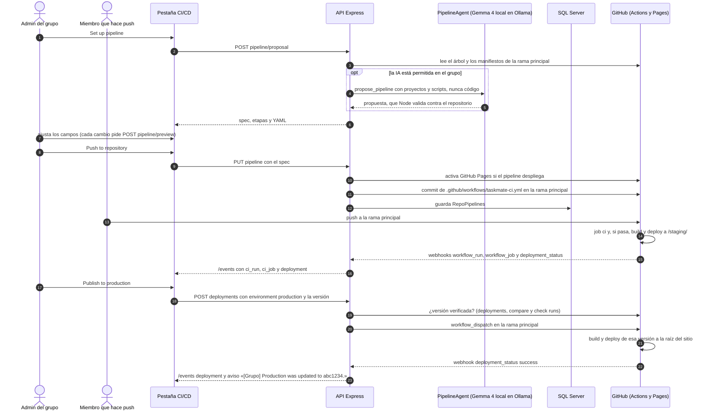
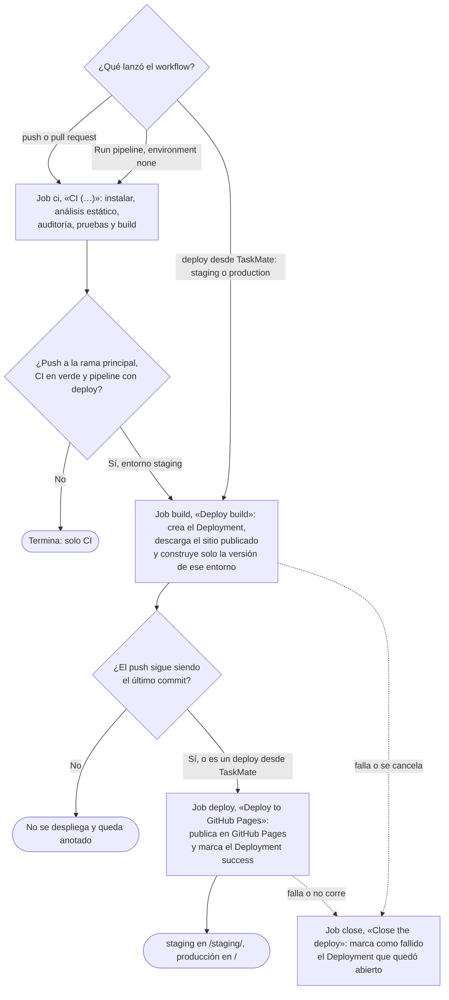
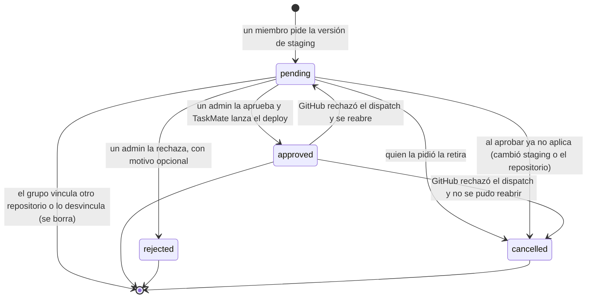
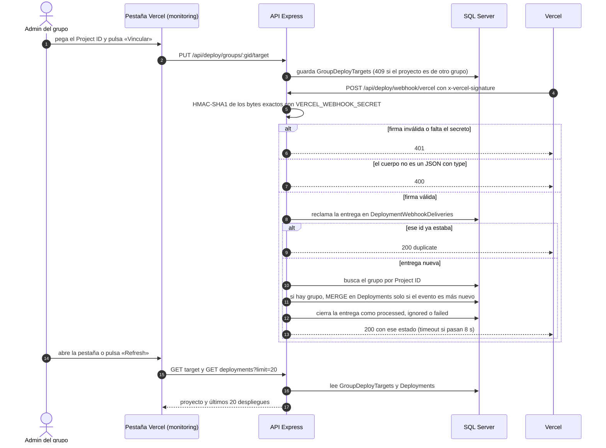

# CI/CD: flujos

**En una frase:** el admin configura y sube el pipeline, cada push corre el CI, un push a la rama principal que pasa el CI se publica solo en staging, y producción se publica desde TaskMate (directo por el admin, o por solicitud de un miembro que el admin aprueba); aparte, Vercel avisa cada cambio de un despliegue con un webhook firmado y TaskMate lo guarda para mostrarlo en la pestaña «Vercel (monitoring)».

## Flujo principal: del pipeline a producción

## Qué jobs corren en cada caso

Los nombres de jobs y pasos están en inglés desde el 19 nov 2026 (salvo el paso «Pruebas»). Un workflow subido antes conserva los nombres en español («Build del deploy», «Deploy a producción desde TaskMate») hasta que el admin vuelva a subir el pipeline; TaskMate reconoce los dos títulos de deploy.

## Ciclo de vida de una solicitud de producción

## Paso a paso

1. El admin abre **GitHub → CI/CD** y pulsa **«Set up pipeline»**.
2. TaskMate lee la rama principal y detecta los proyectos (Node.js, Python o sitio estático, hasta 2 niveles de carpetas). Si el grupo permite la IA y no hay pipeline guardado, propone la IA (Gemma 4 local en Ollama, o Groq si se usa el respaldo; lo fija `LLM_PROVIDER`); si falla, queda la propuesta detectada con una nota.
3. Cada cambio en el diálogo se valida en el servidor y regenera el YAML.
4. **«Push to repository»**: TaskMate activa Pages (si hay deploy), hace el commit del workflow y guarda `RepoPipelines`.
5. Cada push y cada PR corren el job `ci`. Un push a la rama principal que pasa el CI se publica en staging.
6. GitHub avisa por webhook. La API lo reenvía por `/events` y la pantalla se recarga.
7. El admin pulsa **«Publish to production»**. Un miembro pulsa **«Request production»** y espera la aprobación.
8. Antes de desplegar, TaskMate comprueba que la versión esté verificada: ya publicada antes, o en la rama principal con el job «CI (…)» en verde.
9. El deploy construye solo esa versión y conserva el otro entorno tal como está publicado (si GitHub ya no guarda el sitio publicado, reconstruye también el otro entorno). El historial queda en GitHub Deployments.
10. **Rollback:** el admin elige una de las 10 versiones anteriores de producción y se despliega igual que en el paso 9.

## Qué ve el usuario si algo falla

| Código (HTTP) | Mensaje en pantalla |
|---------------|---------------------|
| `APP_PERMISSIONS_MISSING` (409) | «The GitHub App does not have the CI/CD permissions on this repository yet. Whoever installed it must accept them on GitHub.» |
| `PIPELINE_UNSUPPORTED` (422) | «No Node.js project, Python project or static site was found in the repository.» |
| `INVALID_PIPELINE` (400) | «The pipeline configuration is not valid for this repository.» |
| La IA falló (sin código de error) | Nota: «The AI could not be used (it …); this is the automatic detection proposal.» |
| `AI_ANALYSIS_DISABLED` (409) | «AI analysis is turned off for this repository. An admin can turn it on from the GitHub page.» |
| `PAGES_UNAVAILABLE` (409) | «GitHub Pages is not available for this repository on its current plan (private repositories need GitHub Pro).» |
| `BRANCH_PROTECTED` (409) | «The main branch is protected and only accepts changes through pull requests, so TaskMate cannot push the pipeline.» |
| `WORKFLOW_CONFLICT` (409) | «A .github/workflows/taskmate-ci.yml workflow already exists that TaskMate did not create. Rename or delete it to continue.» |
| `PIPELINE_NOT_CONFIGURED` (409) | «This repository does not have a TaskMate pipeline yet.» |
| `BRANCH_WORKFLOW_OUTDATED` (409) | «That branch does not have the current TaskMate workflow: update it from the main branch (merge or rebase) and try again.» |
| `WORKFLOW_DISABLED` (409) | «The TaskMate workflow is disabled on GitHub. Enable it in the repository Actions tab and try again.» |
| `RUN_NOT_RERUNNABLE` (409) | «Only finished runs with failed jobs (and less than a month old) can be re-run.» |
| `LOG_NOT_AVAILABLE` (404) | «The log is not available yet (the job is still running) or has expired.» |
| `NOT_GROUP_ADMIN` (403) | «Only the group admin can do this.» |
| `DEPLOY_NOT_CONFIGURED` (409) | «This repository pipeline has no deploy step.» |
| `VERSION_NOT_VERIFIED` (409) | «That commit did not pass TaskMate CI, so it cannot be deployed.» |
| `VERSION_NOT_STAGING` (409) | «Only the version currently on staging can be requested for production.» |
| `DEPLOY_REQUEST_PENDING` (409) | «There is already a pending request for that environment.» |
| `DEPLOY_REQUEST_DECIDED` (409) | «Another admin already answered that request.» |
| `DEPLOY_REQUEST_STALE` (409) | «The request became outdated (the staging version or the repository changed) and was cancelled; ask again.» |
| `NOT_REQUESTER` (403) | «Only the person who asked for the deploy can cancel the request.» |
| `RATE_LIMITED` (429) o `GITHUB_RATE_LIMITED` (503) | «Too many requests. Wait a moment and try again.» o «The GitHub API usage limit was reached. Try again later.» |

Los mensajes salen de `src/components/github/githubUtils.js`. Lista completa, con causas y soluciones: [guía de CI/CD, sección 11](../07-guias/guia-cicd.md#11-solución-de-problemas).

## Monitoreo de Vercel: del webhook a la pestaña

**Qué evento guarda qué estado:**

| Evento de Vercel | `state` guardado | En la pestaña |
|------------------|------------------|---------------|
| `deployment.created` | `queued` | «Queued» |
| `deployment.building` | `building` | «Building» |
| `deployment.succeeded`, `deployment.ready`, `deployment.promoted` | `ready` | «Deployed» |
| `deployment.error` | `error` | «Failed», con el mensaje de Vercel |
| `deployment.canceled` | `canceled` | «Cancelled» |
| Cualquier otro tipo, o sin id de despliegue o de proyecto | — | No se guarda: la entrega queda `ignored` |

**Paso a paso:**

1. El admin abre **GitHub → Vercel (monitoring)**, pega el Project ID de Vercel (Settings → General) y pulsa **«Vincular»**. TaskMate guarda el vínculo sin consultar a Vercel.
2. En Vercel (Settings → Webhooks) se registra `https://<host público>/api/deploy/webhook/vercel` con los eventos `deployment.*`, y su secreto va en `VERCEL_WEBHOOK_SECRET` de la API. En local hace falta un túnel público; smee solo reenvía el webhook de GitHub.
3. Cada cambio de un despliegue llega firmado. La API verifica la firma sobre los bytes exactos (por eso la ruta usa `express.raw`, antes de `express.json`).
4. La API reclama la entrega con el `id` del evento (o el SHA-256 del cuerpo). Si ya estaba, responde `duplicate` y no hace nada más.
5. Traduce el evento: el estado sale del tipo; el entorno es `production` si el `target` es `production` y, si no, `preview`; la rama y el SHA salen de `meta.githubCommitRef` y `meta.githubCommitSha`; la URL lleva `https://`; el mensaje de error solo se guarda si falló.
6. Busca el grupo por el Project ID. Si ningún grupo lo vinculó, la entrega queda `ignored` y no se guarda el despliegue.
7. Guarda el despliegue con el repositorio del grupo (si hay) y solo si el evento es más nuevo que lo guardado: un reintento o un evento fuera de orden no hace retroceder el estado.
8. Responde 200 con el estado de la entrega, o `timeout` a los 8 s (el trabajo sigue y el resultado queda en la bitácora).
9. Los miembros ven el cambio al abrir la pestaña o al pulsar **«Refresh»**: no hay aviso por `/events`.

**Qué responde el webhook a Vercel:**

| Respuesta | Cuándo |
|-----------|--------|
| 401 `UNAUTHENTICATED` («Invalid webhook signature») | La firma no es válida, falta la cabecera o falta `VERCEL_WEBHOOK_SECRET` |
| 400 `VALIDATION_ERROR` («Invalid JSON payload») | El cuerpo firmado no es un objeto JSON con `type` de texto |
| 500 `INTERNAL_ERROR` | La base de datos falló al reclamar la entrega (desde el 26 nov 2026 se atrapa; antes la petición se quedaba sin respuesta) |
| 200 `duplicate` | Ese id ya se recibió, aunque haya terminado en `failed`: no se reprocesa |
| 200 `ignored` | No es un evento de despliegue o el proyecto no está vinculado |
| 200 `processed` | Se guardó, o se descartó por ser más viejo que lo guardado |
| 200 `failed` | Falló al guardar. El error queda en la bitácora; como la respuesta es 200, Vercel no reintenta |
| 200 `timeout` | Pasaron 8 s; el procesamiento sigue |

Si la base de datos falla justo al reclamar la entrega, el handler atrapa el error y responde 500 `INTERNAL_ERROR`, como el webhook de GitHub ([correcciones del 26 nov](../01-proyecto/cierre-del-proyecto.md#correcciones-del-26-nov-2026)). Una entrega que falla después de reclamarla sigue sin reintentarse ([limitaciones conocidas](../01-proyecto/cierre-del-proyecto.md#limitaciones-conocidas)).

**Qué ve el usuario en la pestaña si algo falla:**

| Código (HTTP) | Mensaje en pantalla |
|---------------|---------------------|
| `VALIDATION_ERROR` (400) | «The request is not valid.» (por ejemplo, un Project ID con caracteres fuera de `[A-Za-z0-9_-]`) |
| `CONFLICT` (409) | «Could not link the Vercel project.»: el proyecto ya está en otro grupo, pero la interfaz no tiene un mensaje propio para eso |
| `RATE_LIMITED` (429) | «Too many requests. Wait a moment and try again.» (vincular: 10 por minuto) |
| Error al cargar o al desvincular | El mensaje del código o, si no tiene, «Could not load the deployments.» o «Could not unlink the project.» |

Para simular un despliegue sin cuenta de Vercel (firmar un evento a mano): [ENTORNO-LOCAL.md](../09-linea-christian/ENTORNO-LOCAL.md).

## Para saber más

- Arquitectura del módulo: [02-arquitectura/08-cicd.md](../02-arquitectura/08-cicd.md)
- Tablas `RepoPipelines`, `DeployRequests` y las de Vercel: [03-base-de-datos/08-cicd.md](../03-base-de-datos/08-cicd.md)
- El workflow generado, job por job: [fase-04-pipeline-cicd/README.md](../08-fases/fase-04-pipeline-cicd/README.md#el-workflow-generado-job-por-job)
- Limitaciones conocidas: [cierre-del-proyecto.md](../01-proyecto/cierre-del-proyecto.md#limitaciones-conocidas)
