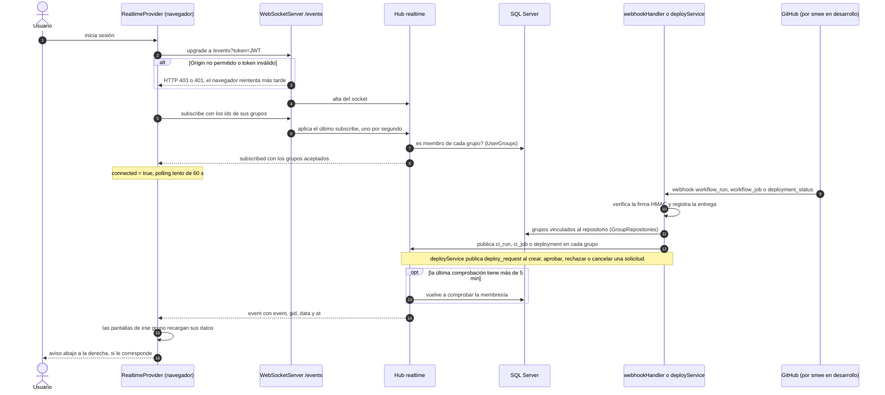
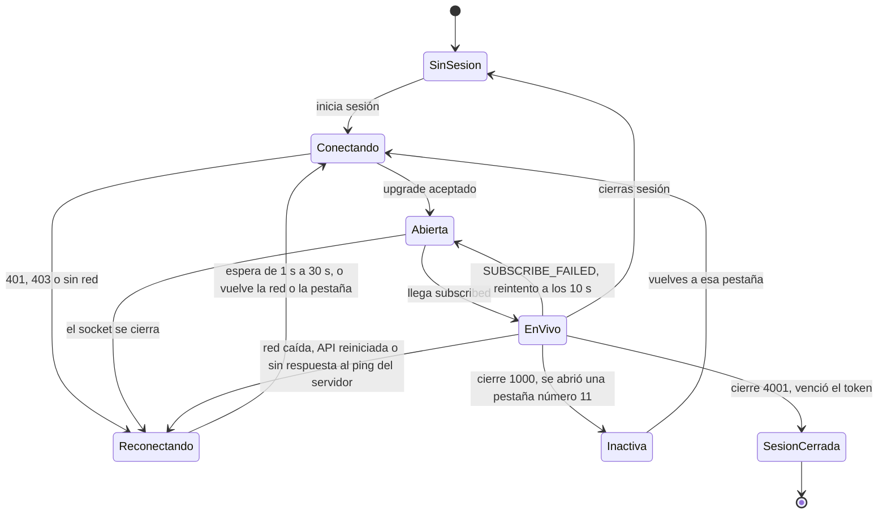
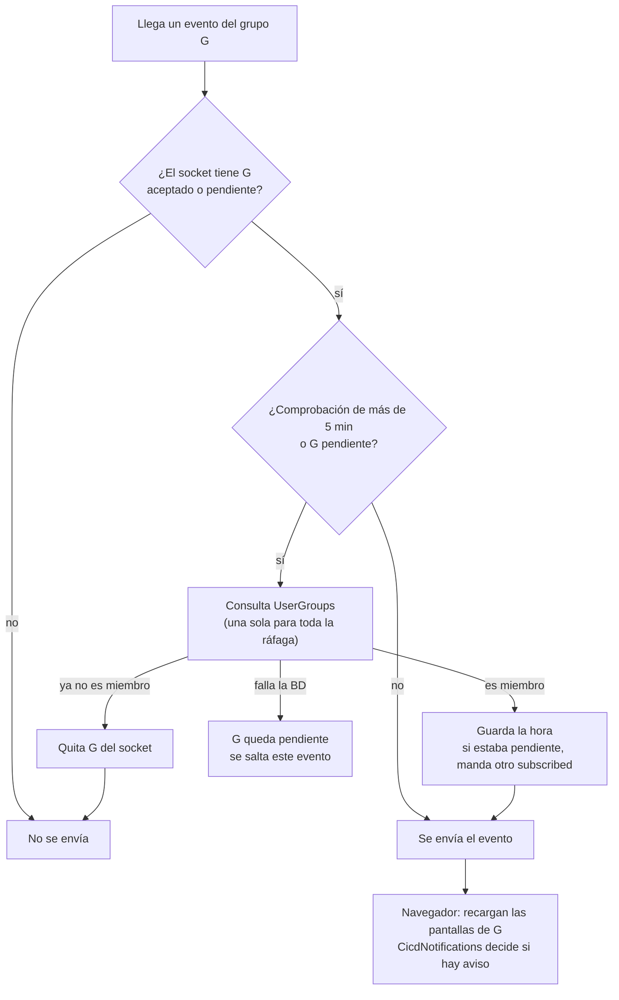

# Tiempo real y avisos: flujos

**En una frase:** el navegador se suscribe a sus grupos por `/events`; cuando GitHub avisa de una ejecución o de un deploy (o cambia una solicitud de producción), la API reparte el evento a los miembros, las pantallas se recargan y puede aparecer un aviso.

## Flujo principal: de GitHub al aviso

## Ciclo de vida de la conexión

- **EnVivo** es `connected = true`: las pantallas de CI/CD consultan cada 60 s como red de seguridad; en los demás estados, cada 10–15 s (solo mientras algo corre y con la pestaña visible).
- **Reconectando** no se rinde nunca: espera 1 s, luego ×1,5 por intento hasta 30 s, más hasta 1 s al azar.

## Qué decide el hub con cada evento

Los eventos de un mismo grupo llegan en orden: mientras uno espera su comprobación, los siguientes hacen fila detrás.

## Paso a paso

1. Al iniciar sesión, `RealtimeProvider` abre `/events` con el JWT en `?token=`.
2. Antes del upgrade, el servidor revisa el `Origin` y el token.
3. Si la lista de grupos está vacía (por ejemplo, tras recargar), el navegador la pide a la API.
4. El navegador manda `subscribe` con sus grupos: al conectar, al reconectar y cuando cambian.
5. El hub deja los grupos donde es miembro y responde `subscribed`.
6. GitHub manda un webhook; la API verifica la firma, registra la entrega y busca los grupos del repositorio.
7. La API publica el evento en cada grupo; `deploy_request` lo publica sin pasar por GitHub.
8. El hub re-verifica la membresía si hace falta y envía el evento a cada socket del grupo.
9. Las pantallas de ese grupo recargan, agrupando ráfagas (1 s la lista, 800 ms detalle y entornos).
10. `CicdNotifications` decide el aviso; el de una ejecución terminada espera 3 s por si antes llega el del deploy.
11. Si el socket se cae, se reconecta solo y, al confirmar la suscripción, las pantallas se recargan una vez.

## Qué ve el usuario si algo falla

| Situación | Código | Qué ve el usuario |
|---|---|---|
| `Origin` no permitido | HTTP 403 en el upgrade | Sin avisos en vivo; el navegador reintenta y las pantallas consultan cada 10–15 s |
| Sin token o token inválido | HTTP 401 en el upgrade | Igual que arriba. Si el token ya no sirve, la API REST también da 401 y TaskMate vuelve a «Sign In» |
| El token vence con el socket abierto | Cierre 4001 | TaskMate cierra la sesión y vuelve a «Sign In» |
| El navegador manda un mensaje de más de 64 KB | Cierre 1009 | El socket se reconecta solo. En `/events` no pasa en la práctica: el navegador solo manda `ping` y los ids de sus grupos |
| Más de 20 `subscribe` en un minuto | `RATE_LIMITED` con `retryAfterMs` | Nada: sigue la suscripción anterior y la nueva se reenvía entre 1,1 s y 60 s después |
| Falla inesperada al suscribir | `SUBSCRIBE_FAILED` | Nada visible: las pantallas pasan a consultar cada 10–15 s y se reintenta a los 10 s |
| La BD falla al comprobar la membresía | `subscribed` con `pending` | Se pierden los eventos de ese grupo hasta que la comprobación pasa; entonces las pantallas se recargan una vez |
| Se cae la red, se reinicia la API o el socket no responde al ping del servidor (cada 30 s) | Socket cerrado | Reconexión automática; al volver, las pantallas se recargan una vez |
| Se abre una pestaña número 11 | Cierre 1000 «Too many connections» | La pestaña más vieja deja de recibir avisos y consulta a GitHub; se reconecta al volver a ella |
| Te sacan de un grupo | — | Puedes recibir sus eventos hasta 5 min más; luego dejan de llegar |
| Webhook con firma inválida | HTTP 401 | Nadie recibe nada |
| Webhook de un repositorio sin grupo | Entrega `ignored` | Nadie recibe nada |

## Para saber más

- Arquitectura: [02-arquitectura/09-tiempo-real-y-avisos.md](../02-arquitectura/09-tiempo-real-y-avisos.md)
- Quién ve cada aviso: [04-casos-de-uso/09-tiempo-real-y-avisos.md](../04-casos-de-uso/09-tiempo-real-y-avisos.md)
- Cómo se ven: [05-interfaz/09-tiempo-real-y-avisos.md](../05-interfaz/09-tiempo-real-y-avisos.md)
- Webhooks, ejecuciones y deploys: [08-cicd.md](08-cicd.md)
- El chat por `/chat`: [05-chat-ia.md](05-chat-ia.md)
- Pruebas: `taskmate-api/tests/realtime.test.js`, `taskmate-api/tests/api/websocket.test.js`, `src/components/realtime/__tests__/Realtime.test.jsx`
- Limitaciones conocidas: [cierre del proyecto](../01-proyecto/cierre-del-proyecto.md#limitaciones-conocidas)
