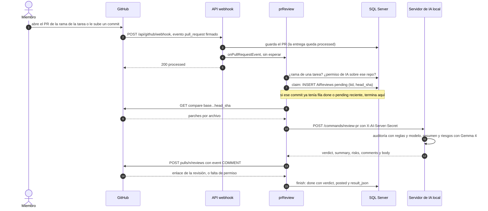
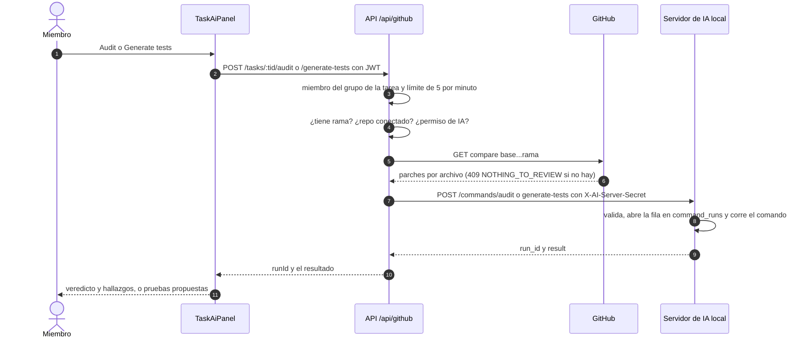
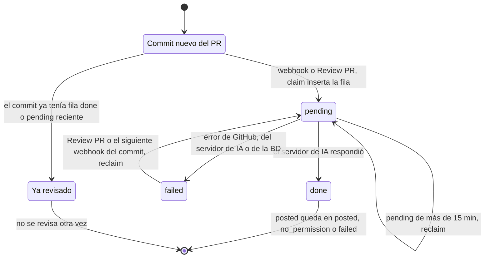

# IA sobre el código: flujos

**En una frase:** cada commit nuevo del PR de una tarea llega por webhook y, con el permiso de IA del grupo, se revisa en segundo plano en el servidor de IA local y se publica en GitHub como comentario; «Audit» y «Generate tests» hacen el mismo viaje a pedido, sin guardar nada en TaskMate.

## Diagrama 1: revisión automática de un PR

## Diagrama 2: auditar la rama o generar pruebas

## Diagrama 3: vida de una revisión en `AiReviews`

## Paso a paso

**Revisión automática del PR** (Diagrama 1)
1. Un miembro abre el PR de la rama de una tarea (`tm/…`) o le sube un commit. GitHub manda `pull_request`; en desarrollo pasa por smee.
2. La API verifica la firma y guarda el PR. Solo si la entrega quedó `processed` (un repetido no) llama a `prReview`, sin esperar, y responde.
3. `prReview` sigue solo si la acción es `opened`, `synchronize`, `ready_for_review` o `reopened`; hay `AI_SERVER_URL`; el PR está abierto y no es borrador; la rama es de una tarea; y su grupo tiene el permiso de IA sobre ese mismo repo. Si no, no hace nada y no avisa.
4. Reserva la fila `pending` de (tarea, commit). Si ya existía `failed`, o `pending` desde hace más de 15 minutos, la vuelve a `pending` y sigue (desde el 26 nov 2026); si estaba `done` o `pending` reciente, termina.
5. Pide a GitHub el compare entre la base del PR y el commit, y manda al servidor de IA (`review-pr`) los parches, el título y la descripción del PR.
6. El servidor corre la auditoría y una llamada más al modelo para escribir, en inglés, un resumen de 2–3 frases y hasta 5 riesgos. Los hallazgos altos y medios con línea se vuelven comentarios en línea (máximo 30); el resto va en el cuerpo. Todo va escapado y con los secretos tapados.
7. La API publica la revisión `COMMENT` sobre ese commit. Si GitHub rechaza un comentario en línea (422), reintenta sin ellos.
8. Cierra la fila: `done` con el veredicto, `posted` y el resultado, o `failed` con el código del error. Los fallos solo quedan en la bitácora de la API.

**Auditar la rama** (Diagrama 2)
1. El miembro pulsa «Audit».
2. La API comprueba la membresía, el límite, la rama, el repo y el permiso de IA.
3. Toma como base la rama destino del PR o, sin PR, la rama por defecto; pide el compare y manda los parches.
4. El servidor solo mira archivos de código, como mucho 15, y solo sus líneas añadidas. Salta las rutas bajo `node_modules`, `vendor`, `dist`, `build`, `venv` y `migrations`.
   - **Reglas fijas:** credenciales en el código, llaves de AWS o privadas, `debugger`, `breakpoint`, `except` sin tipo, `==` suelto, `var`, `console.log`, `TODO` y anidación de 4 niveles o más.
   - **Modelo local**, con una lista fija por archivo: números mágicos, mutación de la entrada, función larga, lógica duplicada y nombres poco claros, más «other». Como mucho 8 hallazgos por archivo, y solo sobre líneas del diff.
5. Veredicto: `fail` solo si una regla fija da un hallazgo alto (las de credenciales y llaves); `warn` si hay algo alto o medio; si no, `pass`.
6. El resultado vuelve al navegador. No se guarda en TaskMate; queda en `command_runs` del servidor de IA.

**Generar pruebas** (Diagrama 2)
1. El miembro pulsa «Generate tests». Mismas comprobaciones y mismo diff que «Audit».
2. El servidor salta los archivos que ya son pruebas, los borrados y los que no son `.py`, `.js`, `.jsx`, `.ts` o `.tsx`; trata como mucho 5.
3. Por cada uno propone un archivo de pruebas con la convención del repo (`tests/test_<nombre>.py`, o `__tests__/<nombre>.test.<ext>` junto al archivo) y sus casos.
4. En Python valida la sintaxis con `ast.parse` y exige un `def test_`; en JS solo exige `test()` o `it()` («not checked»).
5. Nada se ejecuta ni se sube a la rama: el miembro copia lo que le sirva.

**Revisar el PR a mano**
1. Con el PR abierto, el miembro pulsa «Review PR».
2. La API exige un PR abierto según lo que TaskMate tiene guardado y el permiso de IA.
3. Lee el PR en GitHub para saber su último commit y su base. Sin `AI_SERVER_URL` responde 503 `AI_SERVER_DISABLED` antes de reservar nada; si no, sigue como la revisión automática desde el paso 4.
4. Devuelve la última revisión guardada. Si ese commit ya tenía una revisión `done` o una `pending` reciente, es esa; una `failed` se repite.

## Qué ve el usuario si algo falla

«Genérico» es el texto del botón que se pulsó: «Could not audit the branch.», «Could not generate the tests.» o «Could not review the pull request.». La interfaz no tiene texto propio para esos códigos.

| Código | Cuándo | Mensaje |
|---|---|---|
| `AI_ANALYSIS_DISABLED` (409) | El admin no activó «Allow AI analysis» o lo apagó con el diálogo abierto | «AI analysis is turned off for this repository. An admin can turn it on from the GitHub page.» |
| `RATE_LIMITED` (429) | Más de 5 acciones de IA en un minuto, sumando las tres | «Too many requests. Wait a moment and try again.» |
| `TASK_NOT_FOUND` (404) | La tarea ya no existe (completada o borrada) | «The task no longer exists.» |
| Sin repositorio | El grupo ya no tiene repositorio: la tarea deja de tener rama vinculada y la API responde `TASK_NO_BRANCH` o `NO_OPEN_PR` | Genérico |
| `INSTALLATION_SUSPENDED` (409) | La instalación de la App está suspendida | «The GitHub App installation is suspended.» |
| `TASK_NO_BRANCH` (409) | La tarea no tiene rama (el panel no aparece sin rama) | Genérico |
| `NOTHING_TO_REVIEW` (409) | La rama no tiene cambios frente a su base | Genérico |
| `NO_OPEN_PR` (409) | «Review PR» sin un PR abierto según TaskMate | Genérico |
| `AI_SERVER_DISABLED` (503) | La API no tiene `AI_SERVER_URL` | Genérico |
| `AI_SERVER_TIMEOUT` (504) | El servidor de IA tardó más de 180 s (`AI_SERVER_TIMEOUT_MS`) | Genérico |
| `AI_SERVER_UNAVAILABLE` (502) | No se pudo conectar con el servidor de IA | Genérico |
| `AI_SERVER_AUTH` (502) | El servidor respondió 401: `AI_SERVER_SECRET` no coincide | Genérico |
| `AI_SERVER_BAD_REQUEST` (400) | El servidor rechazó la petición (400 o 422), según el código, por ejemplo el parche de un archivo con más de 200 000 caracteres | Genérico |
| `AI_SERVER_NOT_IMPLEMENTED` (501) | El servidor no tiene ese comando | Genérico |
| `AI_SERVER_ERROR` (502) | Cualquier otro error del servidor de IA | Genérico |
| Revisión `failed` | La última revisión guardada falló | «The last review failed (<código>).» |
| `posted = no_permission` | La App no tiene «Pull requests: write» | «Not posted on GitHub: the GitHub App needs the “Pull requests: write” permission.» |
| `posted = failed` | GitHub rechazó la revisión por otro motivo | «Could not post on GitHub.» |

Con «Review PR», cualquier error después de reservar la fila (del compare de GitHub o del servidor de IA) deja ese commit `failed`, y otro «Review PR» lo repite. `AI_SERVER_DISABLED` se comprueba antes de reservar y no deja fila.

Los errores de GitHub al pedir el diff (por ejemplo `GITHUB_RATE_LIMITED`) usan los mismos mensajes que el [módulo GitHub](07-github.md#qué-ve-el-usuario-si-algo-falla).

La revisión del webhook nunca muestra un error en la interfaz: lo que falla queda en la fila (`failed` con su código) y en la bitácora de la API. Un commit con revisión `failed` se repite con «Review PR» o con el siguiente webhook de ese commit, y uno con una `pending` que quedó colgada, pasados 15 minutos (desde el 26 nov 2026; antes hacía falta subir otro commit). Y al fusionar el PR la tarea se completa y sus revisiones se borran de TaskMate ([limitaciones conocidas](../01-proyecto/cierre-del-proyecto.md#limitaciones-conocidas)).

## Para saber más

- Casos de uso y permisos: [04-casos-de-uso/10-ia-sobre-el-codigo.md](../04-casos-de-uso/10-ia-sobre-el-codigo.md)
- Tablas y reglas: [03-base-de-datos/10-ia-sobre-el-codigo.md](../03-base-de-datos/10-ia-sobre-el-codigo.md)
- Pantallas: [05-interfaz/10-ia-sobre-el-codigo.md](../05-interfaz/10-ia-sobre-el-codigo.md)
- Arquitectura del módulo: [02-arquitectura/10-ia-sobre-el-codigo.md](../02-arquitectura/10-ia-sobre-el-codigo.md)
- El webhook y la rama de la tarea: [flujos de GitHub](07-github.md)
- Limitaciones conocidas: [cierre de la línea de Pablo y estado](../01-proyecto/cierre-del-proyecto.md#limitaciones-conocidas)
