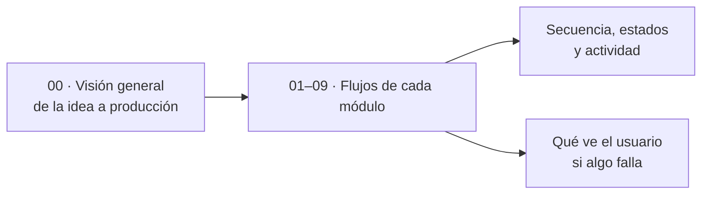

# 06 · Flujos

**En una frase:** el paso a paso de cada operación de TaskMate, con diagramas de secuencia, de estados y de actividad, y qué ve el usuario cuando algo falla.

## Páginas generales

| Página | Qué explica |
|---|---|
| [Visión general](00-general.md) | El recorrido completo de un proyecto: la IA lo crea, el equipo trabaja y una versión llega a producción (y vuelve atrás) |

## Páginas por módulo

Cada página tiene tres diagramas, un «Paso a paso» y «Qué ve el usuario si algo falla».

| Módulo | Flujos que documenta |
|---|---|
| [1 · Usuarios y acceso](01-usuarios-y-acceso.md) | Iniciar sesión y usar el token, crear cuenta, ciclo de la sesión en el navegador |
| [2 · Grupos y roles](02-grupos-y-roles.md) | Agregar un miembro y darle un rol, ciclo de vida de un grupo, qué decide la API al salir |
| [3 · Tareas](03-tareas.md) | Completar una tarea, ciclo de vida de una tarea, guardar una edición |
| [4 · Hitos y calendario](04-hitos-y-calendario.md) | Conectar dos hitos y propagar el avance, vida de un hito y de una flecha, el trigger |
| [5 · Chat con IA](05-chat-ia.md) | De la idea al proyecto guardado, vida del plan, cómo decide el orquestador qué responder |
| [6 · Analytics](06-analytics.md) | Pedir recomendaciones por `/insights`, vida de un registro de `TaskAnalytics`, qué muestra el panel |
| [7 · GitHub](07-github.md) | Conectar el repositorio, un webhook que llega a la API, vida de la rama de una tarea |
| [8 · CI/CD](08-cicd.md) | Del pipeline a producción, qué jobs corren en cada caso, vida de una solicitud de producción |
| [9 · Tiempo real y avisos](09-tiempo-real-y-avisos.md) | De GitHub al aviso, ciclo de la conexión `/events`, qué decide el hub con cada evento |

## Diagramas e imágenes

- Los diagramas de estas páginas son bloques Mermaid.
- Su copia en PNG está en [`imagenes/`](imagenes/), con el nombre `<página>-<n>.png` (n = orden del diagrama en la página).

## Para saber más

- Qué conecta cada pieza: [02-arquitectura](../02-arquitectura/README.md).
- Qué tablas cambia cada paso: [03-base-de-datos](../03-base-de-datos/README.md).
- Limitaciones conocidas: [cierre del proyecto](../01-proyecto/cierre-del-proyecto.md#limitaciones-conocidas).
- [Índice de la documentación](../README.md).
