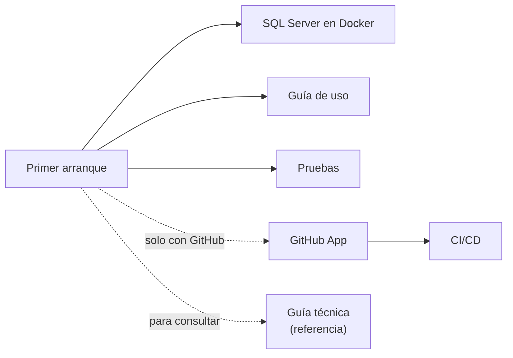

# 07 · Guías

**En una frase:** las guías prácticas de TaskMate: instalarlo desde cero, usarlo según tu rol, correr las pruebas, montar SQL Server, registrar la GitHub App, usar el CI/CD y la referencia técnica.

## Guías

Esta carpeta no tiene páginas por módulo. Empieza por el primer arranque.

| Guía | Para qué sirve |
|---|---|
| [Primer arranque](primer-arranque.md) | De `git clone` a TaskMate corriendo, con **tus propios** secretos, cuando nadie te pasó una `.env` |
| [Guía de uso por rol](guia-de-uso.md) | Qué puede hacer un miembro, un líder y un admin en cada pantalla |
| [Pruebas](pruebas.md) | Correr las cuatro suites (API, frontend, IA y BD), el lint y el build; 1960 pruebas al 5 nov 2026 |
| [SQL Server en Docker](base-de-datos-docker.md) | La imagen, el contenedor `taskmate-sql`, las migraciones y la BD desechable para las pruebas |
| [GitHub App](guia-github-app.md) | Registrar la App (permisos de las Fases 3 y 4), smee, `.env`, migrar y el checklist E2E |
| [CI/CD](guia-cicd.md) | Configurar, ejecutar y publicar el CI/CD del repositorio del grupo desde TaskMate |
| [Guía técnica](guia-tecnica.md) | Referencia: carpetas, versiones, rutas REST, WebSockets, variables de entorno, puertos y convenciones |

## Lo más buscado

- Todas las variables de entorno: [guía técnica, §7](guia-tecnica.md#7-variables-de-entorno).
- Puertos: [guía técnica, §8](guia-tecnica.md#8-puertos).
- Estructura de carpetas del repositorio: [guía técnica, §3](guia-tecnica.md#3-estructura-de-carpetas).
- Permisos y eventos de la GitHub App: [guía de la GitHub App, §4](guia-github-app.md#4-registrar-la-github-app).
- Problemas comunes al arrancar: [primer arranque](primer-arranque.md#problemas-comunes).

## Diagramas e imágenes

- Los diagramas de estas guías son bloques Mermaid.
- Su copia en PNG está en [`imagenes/`](imagenes/), con el nombre `<página>-<n>.png` (n = orden del diagrama en la página).

## Para saber más

- Cómo está hecho TaskMate: [02-arquitectura](../02-arquitectura/README.md).
- Limitaciones y pendientes: [cierre del proyecto](../01-proyecto/cierre-del-proyecto.md#limitaciones-conocidas).
- [Índice de la documentación](../README.md).
