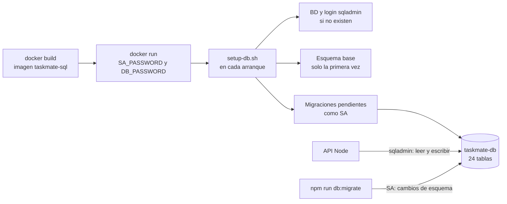

# SQL Server en Docker para TaskMate

**En una frase:** cómo construir la imagen de SQL Server 2019, crear el contenedor `taskmate-sql`, conectar la API, aplicar las migraciones y levantar una BD desechable para las pruebas.

## Resumen
- La imagen sale de `taskmate-api/Dockerfile` y trae el esquema y las migraciones copiados **al construirla**.
- El contenedor se llama `taskmate-sql` y publica el puerto solo en `127.0.0.1:1433`.
- En cada arranque, `setup-db.sh` deja la BD al día sin repetir lo que ya está hecho.
- La API entra con `sqladmin` (solo lee y escribe datos); las migraciones, con `SA`.
- Las pruebas de BD usan otro contenedor, desechable ([sección 6](#6-bd-desechable-para-pruebas)).



## Dónde está en el código

Todo vive en `taskmate-api/`:

| Archivo | Qué hace |
|---------|----------|
| `Dockerfile` | SQL Server 2019 + `mssql-tools`; copia el esquema base, las migraciones y `setup-db.sh` **al construir la imagen** |
| `setup-db.sh` | Arranque idempotente: crea la BD y el login de la app si no existen, crea el esquema base solo la primera vez, aplica las migraciones pendientes y protege `dbo.SchemaMigrations` |
| `taskmate_tables.sql` | Esquema base (versión 0, 14 tablas) |
| `migrations/NNN_*.sql` | Cambios posteriores (001–008), versionados, cada uno con su `.down.sql`; se registran en `dbo.SchemaMigrations` |
| `migrations/run-migrations.sh` | Aplica las migraciones con `sqlcmd` dentro del contenedor (lo llama `setup-db.sh`) |
| `migrations/runner.js` | Lo mismo desde el host con Node: `npm run db:migrate`, `status`, `down`, `reapply` |

## 1. Construir la imagen

```bash
cd taskmate-api
docker build -t taskmate-sql .
```

En Macs con Apple Silicon agrega `--platform linux/amd64` al `docker build` y al `docker run` (la imagen es amd64).

## 2. Crear el contenedor

```bash
docker run -d --name taskmate-sql \
  -e ACCEPT_EULA=Y \
  -e SA_PASSWORD='<password-fuerte-para-sa>' \
  -e DB_PASSWORD='<password-fuerte-para-la-app>' \
  -p 127.0.0.1:1433:1433 taskmate-sql
docker logs -f taskmate-sql   # esperar "Setup complete. Keeping container running."
```

`127.0.0.1:` deja el puerto 1433 accesible solo desde tu máquina (con `-p 1433:1433` Docker lo publica en todas las interfaces).

- `DB_PASSWORD` es la contraseña del login de la app y debe ser **la misma** que `DB_PASSWORD` en la `.env` de la raíz. `SA_PASSWORD` es la que se usa después como `MIGRATION_DB_PASSWORD`.
- Ambas deben cumplir la política de SQL Server (8+ caracteres con mayúsculas, minúsculas, números o símbolos); si no, el arranque falla y el contenedor se detiene.
- Opcionales: `DB_NAME` (por defecto `taskmate-db`) y `DB_USERNAME` (por defecto `sqladmin`).
- El nombre `taskmate-sql` no es opcional: `start.sh` solo hace `docker start taskmate-sql` y falla si el contenedor no existe.

Qué deja listo el primer arranque:
- La BD `taskmate-db` y el login `sqladmin` con **mínimo privilegio**: solo `db_datareader` + `db_datawriter` (no puede cambiar el esquema ni escribir en `dbo.SchemaMigrations`).
- El esquema base y las migraciones 001–008, aplicadas como `SA`: **24 tablas** en total.

Los reinicios posteriores no repiten nada: cada paso se salta si ya está hecho. Los datos viven dentro del contenedor: `docker rm taskmate-sql` los borra.

## 3. Configurar `.env`

En la `.env` de la raíz (plantilla completa en `taskmate-api/.env.example`):

```env
DB_SERVER=localhost
DB_PORT=1433
DB_NAME=taskmate-db
DB_USERNAME=sqladmin                  # la API nunca usa sa
DB_PASSWORD=<password-de-la-app>      # el mismo DB_PASSWORD del docker run
MIGRATION_DB_USERNAME=sa              # solo para npm run db:migrate
MIGRATION_DB_PASSWORD=<password-de-sa>
```

## 4. Migraciones

| Versión | Archivo | Qué cambia |
|---------|---------|------------|
| 001 | `001_schema_fixes.sql` | Índices en todas las FK, restricciones UNIQUE que faltaban (si hay duplicados la omite con un `WARNING`, sin borrar datos), FK compuestas, `TaskAnalytics` como historial y la tabla `AnalyticsConfig` |
| 002 | `002_github.sql` | Fase 3: `GitHubInstallations`, `GitHubRepositories`, `GroupRepositories`, `TaskBranches`, `PullRequests`, `GitHubWebhookDeliveries` |
| 003 | `003_triggers.sql` | Triggers de porcentaje de los hitos (versión con cursores) |
| 004 | `004_repair_group_admins.sql` | Arreglo de datos: un grupo cuyo admin ya no es miembro recibe otro admin |
| 005 | `005_unicode_membership_github.sql` | Textos `VARCHAR` → `NVARCHAR`, `UserGroups.joined_at`, `GroupRepositories.ai_analysis_enabled`, protección contra reenvíos de webhooks |
| 006 | `006_bfs_progress_triggers.sql` | Triggers de porcentaje en versión BFS (recorren toda la cadena, hasta 20 niveles) |
| 007 | `007_cicd.sql` | Fase 4: `RepoPipelines` y `DeployRequests` |
| 008 | `008_task_created_at.sql` | `created_at` y `created_seq` en `Tasks`, `Complete` y `DeleteTask`: el orden «Creation Date» de `/tasks` |

Las migraciones se copian a la imagen **al construirla** (`Dockerfile`: `COPY migrations/`), así que un contenedor creado con una imagen anterior no tiene las nuevas:
- Imagen de antes de la Fase 3: le faltan 001–008.
- Imagen de antes de `007_cicd.sql` (Fase 4, octubre de 2026): faltan las tablas de CI/CD, y hasta vincular o desvincular un repositorio falla, porque también borra en `DeployRequests`.
- Imagen de antes de `008_task_created_at.sql` (4 nov 2026), como la de `taskmate-sql` (a su BD ya se le aplicó el 5 nov 2026): falta `Tasks.created_at`, y `GET /api/tasks` responde 500 («Invalid column name 'created_at'»), así que la pantalla de tareas no carga.

En los dos casos: migrar la BD desde el host (sección 5) o crear el contenedor de nuevo con una imagen actual (empieza con una BD vacía).

Comandos (desde `taskmate-api/`, con `MIGRATION_DB_USERNAME` y `MIGRATION_DB_PASSWORD` en el entorno o en `.env`):

| Comando | Qué hace |
|---------|----------|
| `npm run db:migrate` | Aplica las pendientes (`node migrations/runner.js up`); `--to <versión>` para hasta una versión |
| `node migrations/runner.js status` | Lista las migraciones: `[x]` aplicada, `[ ]` pendiente. Al día deben salir 001–008 con `[x]` |
| `node migrations/runner.js down` | Revierte la última (`--steps N` o `--to <versión>` para más) |
| `node migrations/runner.js reapply <versión>` | Vuelve a ejecutar una migración ya aplicada (todas son idempotentes), p. ej. la 001 después de corregir duplicados |
| `node migrations/runner.js up --with-base` | En una BD vacía, crea primero las tablas base |

Cada migración corre en **una transacción** junto con su registro en `dbo.SchemaMigrations`: si falla, no queda nada a medias. Revertir 002 o 007 borra sus tablas **con sus datos**; revertir la 005 convierte los textos a `VARCHAR` y pierde los caracteres fuera de Latin-1; revertir la 008 borra las fechas de creación de las tareas.

## 5. Migrar una BD que ya existía

Para aplicar las migraciones que falten sin perder datos. **Hazlo antes de levantar una API más nueva que tu BD:** la API no aplica migraciones, `./start.sh` solo hace `docker start taskmate-sql` y el contenedor solo trae las migraciones de su imagen. En `taskmate-sql` ya están aplicadas 001–008 (la 008, el 5 nov 2026).

1. **Respalda los triggers actuales** (solo si a tu BD le falta la 003). La 003 los reemplaza por la versión del repositorio, y la BD de desarrollo podría tener una versión distinta:
   ```bash
   read -s "SA_PW?Contraseña SA: "; echo     # zsh (en bash: read -s -p "Contraseña SA: " SA_PW; echo)
   docker exec -i -e SQLCMDPASSWORD="$SA_PW" taskmate-sql /opt/mssql-tools/bin/sqlcmd -S localhost -U SA \
     -d taskmate-db -y 0 -Q "SET NOCOUNT ON; SELECT name, OBJECT_DEFINITION(object_id) FROM sys.triggers" \
     > "$HOME/triggers-backup.sql"
   ```
2. **Aplica las migraciones** (las ya aplicadas se saltan; con 001–007 aplicadas solo corre la 008) y verifica:
   ```bash
   read -s "SA_PW?Contraseña SA: "; echo     # solo si saltaste el paso 1 (en bash: read -s -p "Contraseña SA: " SA_PW; echo)
   cd taskmate-api
   MIGRATION_DB_USERNAME=sa MIGRATION_DB_PASSWORD="$SA_PW" npm run db:migrate
   MIGRATION_DB_USERNAME=sa MIGRATION_DB_PASSWORD="$SA_PW" node migrations/runner.js status   # 001–008 con [x]
   unset SA_PW
   ```
   Paso a paso completo: [guía de la GitHub App, §7](guia-github-app.md#7-migrar-la-bd-de-desarrollo).
3. **Opcional: baja los privilegios del login de la app.** En contenedores creados antes de la Fase 3, `sqladmin` es `db_owner`. Ejecuta como `SA` las mismas sentencias que `setup-db.sh` (comentario «Least privilege») o crea el contenedor de nuevo con la imagen actual.

## 6. BD desechable para pruebas

Las pruebas de BD (`npm run test:db`, 9 suites / 114 pruebas) ejecutan las migraciones arriba y abajo y escriben datos. Corren **solo** contra un contenedor aparte: nunca contra `taskmate-sql` ni con la etiqueta `taskmate-sql:latest`. Su conexión sale únicamente de las variables `TEST_DB_*` (nunca de `DB_*` ni de `.env`).

```bash
# a) Imagen y contenedor desechables en el puerto 14333
docker build -t taskmate-sql:test taskmate-api
docker run -d --name taskmate-sql-test \
  -e ACCEPT_EULA=Y \
  -e SA_PASSWORD='<SA-fuerte>' \
  -e DB_PASSWORD='<app-fuerte>' \
  -p 127.0.0.1:14333:1433 taskmate-sql:test
docker logs -f taskmate-sql-test      # esperar "Setup complete. Keeping container running."

# b) Credenciales de la BD de prueba en un archivo fuera del repositorio
cat > "$HOME/taskmate-testdb.env" <<'EOF'
TEST_DB_SERVER=localhost
TEST_DB_PORT=14333
TEST_DB_NAME=taskmate-db
TEST_DB_USERNAME=sqladmin
TEST_DB_PASSWORD=<app-fuerte>
TEST_DB_SA_PASSWORD=<SA-fuerte>
EOF
chmod 600 "$HOME/taskmate-testdb.env"

# c) Ejecutar: la app se conecta con el login de mínimo privilegio y las migraciones corren como sa
cd taskmate-api
TEST_DB_ENV_FILE="$HOME/taskmate-testdb.env" npm run test:db    # 9 suites / 114 pruebas

# d) Borrar el contenedor y la imagen de prueba
docker rm -f taskmate-sql-test && docker rmi taskmate-sql:test
```

En lugar de `TEST_DB_SA_PASSWORD` se pueden dar `TEST_DB_MIGRATION_USERNAME` y `TEST_DB_MIGRATION_PASSWORD`. Las variables también se pueden exportar en la terminal en vez de usar `TEST_DB_ENV_FILE`. Detalle de las suites: [taskmate-api/tests/README.md](../../taskmate-api/tests/README.md).

## Para saber más
- Primera instalación completa, con tus propias contraseñas, y cómo cargar datos de un respaldo `.bak`: [primer arranque](primer-arranque.md) (pasos 6 y 7).
- Todas las suites de pruebas: [pruebas](pruebas.md).
- Modelo de datos y diagrama ER: [base de datos](../03-base-de-datos/00-general.md).
- Tablas, migraciones y triggers en resumen: [guía técnica, §6](guia-tecnica.md#6-base-de-datos).
