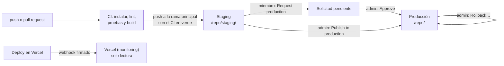

# Guía: CI/CD del repositorio desde TaskMate

**En una frase:** cómo el grupo configura, ejecuta y publica el CI/CD de **su** repositorio de GitHub sin salir de TaskMate: **GitHub** (barra de navegación) → pestaña **CI/CD**; y cómo ve sus despliegues de Vercel en la pestaña **Vercel (monitoring)**.

## Resumen
- El admin configura el pipeline (detectado por TaskMate o propuesto por la IA) y TaskMate sube `.github/workflows/taskmate-ci.yml`.
- El CI corre en cada push y cada pull request; un push a la rama principal con el CI en verde publica **staging** en GitHub Pages.
- **Producción** la publica el admin: directo, aprobando la solicitud de un miembro o con un rollback.
- Los miembros ven ejecuciones y logs, ejecutan el CI y piden producción; los avisos llegan en vivo en cualquier pantalla.
- Aparte, si el grupo despliega en **Vercel**, el admin vincula el proyecto y la pestaña **Vercel (monitoring)** lista sus despliegues. Es solo lectura: TaskMate no despliega en Vercel ([sección 13](#13-monitoreo-de-despliegues-de-vercel)).
- Estado: las secciones 1–12 (GitHub Pages) están implementadas y verificadas al cierre de la línea de Pablo (3 nov 2026). La interfaz pasó al inglés el 19 nov 2026 y esta guía cita los textos tal como se ven ahora. La sección 13 es de la línea de Christian, vive en la rama `test/e2e` y no se ha probado con una cuenta real de Vercel.

> Complemento del [capítulo de la Fase 4](../08-fases/fase-04-pipeline-cicd/README.md), la última fase de la línea de Pablo. Limitaciones conocidas: [cierre de la línea de Pablo y estado](../01-proyecto/cierre-del-proyecto.md#limitaciones-conocidas).

---

## Índice

1. [Antes de empezar](#1-antes-de-empezar)
2. [Configurar el pipeline (admin)](#2-configurar-el-pipeline-admin)
3. [Ver las ejecuciones](#3-ver-las-ejecuciones)
4. [Ejecutar, re-ejecutar y cancelar](#4-ejecutar-re-ejecutar-y-cancelar)
5. [Ver logs y errores](#5-ver-logs-y-errores)
6. [Entornos: staging y producción](#6-entornos-staging-y-producción)
7. [Publicar en producción: solicitar, aprobar y rechazar](#7-publicar-en-producción-solicitar-aprobar-y-rechazar)
8. [Rollback de producción](#8-rollback-de-producción)
9. [Notificaciones](#9-notificaciones)
10. [Quién puede hacer qué](#10-quién-puede-hacer-qué)
11. [Solución de problemas](#11-solución-de-problemas)
12. [Límites y preguntas frecuentes](#12-límites-y-preguntas-frecuentes)
13. [Monitoreo de despliegues de Vercel](#13-monitoreo-de-despliegues-de-vercel)

---

## 1. Antes de empezar

- **Repositorio conectado:** el grupo debe tener su repositorio de GitHub conectado (Fase 3: `/github` → «Connect repository»). Sin repositorio, la pestaña **CI/CD** aparece deshabilitada.
- **Permiso de escritura para conectar:** quien conecta el repositorio debe tener permiso **push, maintain o admin** sobre él en GitHub. TaskMate solo ofrece esos repositorios; si no puedes escribir en ninguno, verás «Your GitHub account has no write access to any repository in the installation. Only someone who can write to a repository can connect it.». El motivo: conectar le da al grupo el acceso de la App a ese repositorio (crear ramas, subir el workflow, publicar producción y hacer rollback), así que alguien con solo lectura no debe poder hacerlo.
- **Permisos de CI/CD aceptados:** la TaskMate App necesita permisos que la Fase 3 no pedía (Actions, Workflows, Pages, Deployments, Checks, Administration). Si la instalación todavía no los aceptó, TaskMate muestra «The GitHub App does not have the CI/CD permissions on this repository yet. Whoever installed it must accept them on GitHub.» Cómo aceptarlos: [guía de la GitHub App](guia-github-app.md#aceptar-permisos-nuevos-en-una-instalación-existente).
- **Qué tipo de proyecto:** TaskMate reconoce, hasta 2 carpetas de profundidad:
  - **Node.js con npm:** una carpeta con `package.json` (los scripts que existan: `lint`, `test`, `build`…).
  - **Python:** `requirements*.txt` o `pyproject.toml`.
  - **Sitio estático:** un `index.html` en la carpeta, o en `public/`, `docs/` o `site/`.
- **Para publicar el sitio (deploy):** solo sitios estáticos (HTML, Vite o Create React App) en **GitHub Pages**. Las APIs y los proyectos Python tienen CI (instalar, análisis estático, pruebas) pero no deploy. Con Vite, el script `build` debe terminar en un `vite build` simple ([detalle](#2-configurar-el-pipeline-admin)); un sitio estático nunca se publica desde una carpeta que contenga otro proyecto (p. ej. la raíz de un repositorio con `api/` adentro). En repositorios **privados** Pages requiere GitHub Pro, Team o Enterprise; con GitHub Free el repositorio debe ser **público**.
- **Rama principal:** TaskMate sube el pipeline con un commit directo a la rama principal. Si la rama solo acepta cambios por pull request, ver `BRANCH_PROTECTED` en [Solución de problemas](#11-solución-de-problemas).
- **Rol:** configurar el pipeline, publicar en producción, aprobar y hacer rollback es del **administrador del grupo** (quien creó el grupo, o a quien se le pasó). Los demás miembros ven todo, pueden ejecutar el CI y pueden pedir que la versión de staging pase a producción.

---

## 2. Configurar el pipeline (admin)

1. Elige el grupo con el selector de grupo de la barra (junto al logo); en **GitHub** abre la pestaña **CI/CD**.
2. En la tarjeta **CI/CD pipeline** pulsa **«Set up pipeline»**. El diálogo «Set up CI/CD pipeline» muestra «Analyzing the repository…» y lee la rama principal.
3. Lee la propuesta y las notas en azul (por qué se eligió o se dejó fuera algo). El chip de abajo a la izquierda dice de dónde viene:
   - **«Detected»**: «TaskMate reviewed the repository and proposes this pipeline. Adjust it before pushing.»
   - **«Proposed by AI»**: si el grupo tiene activado «Allow AI analysis», la primera propuesta la hace la IA («The AI is reviewing the repository…» y luego «The AI reviewed the repository and proposes this pipeline. Adjust it before pushing.», con su explicación, en inglés, como nota).
   - **«Saved»**: la configuración que ya está en el repositorio (al editar): «This is the current pipeline configuration. Change it and push it again.»
4. **Project:** si el repositorio tiene varios (p. ej. `frontend` y `api`), elige cuál construye el pipeline. Un repositorio tiene **un** pipeline de TaskMate.
5. **Build, tests and static analysis:**

   | Node.js | Python | Sitio estático |
   |---------|--------|----------------|
   | **Node.js version** (20, 22, 24, 26; se toma de `.nvmrc`, `.node-version` o `engines`) | **Python version** (3.10–3.14; de `.python-version` o `requires-python`) | No se compila: «A static site is not built: CI only checks that its index.html exists.» |
   | **Install dependencies:** `npm ci` (si hay `package-lock.json`) o `npm install` | **Install dependencies:** `pip install -r <requirements>`, `pip install .` o «No install step» | |
   | **Static analysis (lint):** un script del `package.json` o «No lint» | **Static analysis with Ruff** (interruptor; los errores salen con archivo y línea) | |
   | **Dependency audit (npm audit)** (interruptor; viene activa si no hay lint) | **Tests with pytest** (interruptor; los fallos salen con archivo y línea) | |
   | **Tests** y **Build:** un script del `package.json` o «No tests» / «No build» | | |

   Los scripts que inician un servidor o se quedan vigilando cambios (`dev`, `start`, `preview`, `vite` sin `build`, `nodemon`, `--watch`…) aparecen **deshabilitados** con «(starts a server or watches for changes: never finishes)»: en el CI colgarían el job.
6. **Deploy:**
   - Node.js: interruptor **«Deploy to GitHub Pages»**, **Site type** (Vite → `dist`, Create React App → `build`, o «Static (relative paths)») y **Published folder**. Con Vite y CRA TaskMate ajusta la ruta base sola; con «Static (relative paths)» el sitio debe usar **rutas relativas**, porque se sirve bajo `/<repo>/` y `/<repo>/staging/`.
   - **Vite:** TaskMate le agrega `--base=…` al script `build`, y npm se lo pasa al **último** comando del script. Por eso el script debe terminar en un `vite build` simple, sin `--base` propio: sirven `vite build` o `tsc && vite build`; no sirven `vite build && cp …` (el `--base` le llegaría a `cp`) ni `vite build --base=/x/`. Si tu script no cumple, la propuesta no trae deploy y lo explica en una nota; elegir Vite a mano da «The pipeline configuration is not valid for this repository.». Ajusta el script o usa «Static (relative paths)».
   - Sitio estático: **Site folder** (la que tiene el `index.html`). Nunca una carpeta que contenga otro proyecto Node.js o Python del repositorio: publicarla expondría ese código. Si tu `index.html` está en la raíz junto a `api/`, TaskMate propone `docs/` o `site/` si existe, o no propone el sitio y lo dice en una nota.
   - Python: no hay deploy («Python projects are not deployed to GitHub Pages (static sites only).»).
7. **Stages:** la lista se actualiza con cada cambio (TaskMate valida y regenera en el servidor): Install dependencies, Static analysis, Dependency audit, Pruebas, Build, Check the site y Deploy to GitHub Pages, según el proyecto. La etapa de pruebas sigue llamándose «Pruebas». **«Show the YAML file»** muestra exactamente lo que se subirá.
8. **«Propose with AI»** (aparece si el grupo tiene activado «Allow AI analysis» en la pestaña Repository; si no, el diálogo dice «Turn on “Allow AI analysis” in the Repository tab so the AI can propose the pipeline.»): pide una propuesta nueva a la IA para el proyecto elegido. Se envía la lista de proyectos y scripts del repositorio, **nunca el código fuente**, al modelo que use el servicio Python del chat: Groq por defecto, o el modelo local (Gemma 4 en Ollama) con `LLM_PROVIDER=ollama`. El diálogo sigue diciendo «…is sent to Groq…» en ambos casos. La IA solo elige entre las opciones que TaskMate detectó (y conoce las reglas de Vite y de los sitios estáticos de arriba); TaskMate valida su respuesta como cualquier otra; si no sirve, tarda o la IA no está disponible, verás la propuesta detectada con «The AI could not be used (it …); this is the automatic detection proposal.». Se ajusta igual que cualquier propuesta.
9. Lee el aviso: «On push, TaskMate will commit to **main** with `.github/workflows/taskmate-ci.yml` and will enable GitHub Pages to publish from GitHub Actions.»
10. Pulsa **«Push to repository»**. Verás «Pipeline pushed to the repository. GitHub will run it in a few seconds.», el enlace **«View commit»** y la URL del sitio («GitHub Pages site:»). Cierra el diálogo («Close»): en **Runs** aparece la primera corrida.

Después, la tarjeta muestra el tipo de proyecto, las etapas, «Configured by *usuario* · *fecha*», el enlace al archivo del workflow y el sitio («Site:»). Para cambiar algo: **«Edit pipeline»** (el chip **«Saved»** indica que estás viendo la configuración actual; **«Detected»** o **«Proposed by AI»**, una propuesta nueva) y vuelve a subir. Si el archivo sería idéntico, TaskMate no hace otro commit («The pipeline was already in the repository with this same configuration.»).

**Avisos de la tarjeta sobre el workflow:**
- «The repository workflow comes from an older TaskMate version and lacks the latest improvements (queued deploys, no rebuilding the other environment).»: el archivo lo escribió una plantilla anterior (la línea `# taskmate-pipeline: 1`). El admin pulsa **«Edit pipeline» → «Push to repository»** (la configuración guardada sirve tal cual) y TaskMate lo reemplaza por la plantilla actual (`# taskmate-pipeline: 2`).
- «The TaskMate workflow is no longer in the repository, so the pipeline does not run.»: alguien lo borró en GitHub. El admin lo vuelve a subir igual.

> - Si el repositorio ya publicaba GitHub Pages **desde una rama** (p. ej. `gh-pages`), al subir un pipeline con deploy TaskMate cambia la fuente a **GitHub Actions**: desde entonces el sitio lo publica el pipeline.
> - Si alguien edita el workflow a mano en GitHub, funciona, pero TaskMate lo reemplaza la próxima vez que un admin suba el pipeline.
> - Un workflow subido **antes del 19 nov 2026** sigue siendo `# taskmate-pipeline: 2` y no muestra aviso, pero sus jobs, pasos y mensajes del log siguen en español («Build del deploy», «Deploy a GitHub Pages», «Instalar dependencias»…). Para tenerlos en inglés, el admin vuelve a subir el pipeline: como el archivo cambia, TaskMate hace un commit nuevo.

---

## 3. Ver las ejecuciones

En **Runs** están todas las ejecuciones de GitHub Actions del repositorio (las del pipeline de TaskMate y las de otros workflows), de la más nueva a la más vieja.

- **Cada fila:** estado (✔ Succeeded, ✖ Failed, reloj Queued, círculo girando Running, Cancelled), título, workflow y número, evento (**Push**, **Pull request**, **Manual**, **Scheduled**…), rama, commit, quién la lanzó, hace cuánto y duración.
- **Títulos:** el mensaje del commit; «TaskMate CI/CD» en «Run pipeline»; «Deploy to production from TaskMate» o «Deploy to staging from TaskMate» en los deploys. Los deploys de workflows anteriores conservan su título: «Deploy a producción/staging desde TaskMate» (subidos antes del 19 nov 2026) o «Deploy a production desde TaskMate» (anteriores a `67dd910`, 22 oct 2026).
- **Filtros:** **All workflows** y **Status** (All statuses, Running, Queued, Succeeded, Failed, Cancelled). **«Show more»** carga las siguientes 20. El botón ↻ («Refresh») actualiza.
- **Expandir una fila:** enlace **«View the run on GitHub»**, controles ([sección 4](#4-ejecutar-re-ejecutar-y-cancelar)) y los **jobs** con sus pasos y duraciones. El CI se llama «CI (Node.js)», «CI (Python)» o «CI (static site)» («CI (sitio estático)» en workflows anteriores); un deploy tiene además «Deploy build» (construye la versión) y «Deploy to GitHub Pages» (la publica), y «Close the deploy» solo aparece si algo falló o se canceló.
- **En vivo:** la lista y el detalle se actualizan solos cuando GitHub avisa. Mientras algo corre, además se revisan cada minuto por si se perdió un aviso (cada 10–15 s si se perdió la conexión en vivo), solo con la pestaña del navegador visible. Al reconectarse, la pantalla se recarga una vez para ponerse al día.

Qué dispara el CI de TaskMate: **cada push a cualquier rama**, **cada pull request** y **«Run pipeline»**. El deploy a staging solo ocurre con un push a la rama principal que pasa el CI. Las ejecuciones que pueden desplegar (push a la rama principal y deploys desde TaskMate) **esperan su turno en orden**: un push a la rama principal puede aparecer «Queued» mientras termina el deploy anterior. Ninguna se descarta.

---

## 4. Ejecutar, re-ejecutar y cancelar

| Acción | Dónde | Cuándo aparece | Qué hace |
|--------|-------|----------------|----------|
| **Run pipeline** | Botón junto a los filtros | El repositorio tiene pipeline de TaskMate | Pide la **Branch** (por defecto la principal) y, con **Run**, corre solo el CI: instalar, análisis estático, pruebas y build. **No despliega.** Confirma con «Done: the pipeline will run on “*rama*” in a few seconds.» |
| **Re-run failed** | Fila expandida | La ejecución terminó en fallo, cancelada o por tiempo | Vuelve a correr **solo los jobs que fallaron** (GitHub lo permite hasta un mes después) |
| **Cancel** | Fila expandida | La ejecución está en cola o en curso | Pide a GitHub detenerla. También detiene un deploy en curso; su registro queda como fallido |

- Las ejecuciones de **deploy** que lanzó TaskMate (las que empiezan con «Deploy to » o, en workflows anteriores, «Deploy a ») solo las re-ejecuta o cancela el **admin**; un miembro ve «Only the group admin can re-run or cancel a deploy.» (re-ejecutar un deploy viejo de producción sería un rollback).
- **Re-ejecutar nunca publica una versión vieja:** si re-ejecutas un push de la rama principal que ya no es el último commit, el CI corre pero no se despliega nada (la ejecución lo anota: «Not deploying abc1234: it is no longer the latest version of main.»). Si en un push solo falló «Deploy to GitHub Pages», «Re-run failed» no lo vuelve a publicar: el job falla con «The deploy alone is not re-run: it would publish the site built by attempt 1 of this run, which may be outdated…». Para staging, haz un push nuevo (o re-ejecuta todos los jobs en GitHub); para producción, el admin publica de nuevo desde TaskMate.
- «Run pipeline» en una rama que no tiene el workflow actual (creada **antes** de subir el pipeline, o antes de su última actualización) falla con «That branch does not have the current TaskMate workflow: update it from the main branch (merge or rebase) and try again.».
- Si alguien desactivó el workflow en GitHub (pestaña **Actions** → el workflow → **Disable workflow**), verás «The TaskMate workflow is disabled on GitHub. Enable it in the repository Actions tab and try again.».
- Un nombre de rama que parece un commit (p. ej. `deadbeef` o `20261022`) funciona; lo que no funciona es escribir un SHA: «That branch does not exist in the repository.».
- Límite: 10 de estas acciones por minuto por usuario (gastan minutos de GitHub Actions del repositorio). Si quien limita es GitHub, el mensaje es «The GitHub API usage limit was reached. Try again later.».

---

## 5. Ver logs y errores

En la fila expandida, cada job muestra sus pasos. Además:

- **Errores con archivo y línea:** si el job falló, debajo de los pasos aparecen sus anotaciones: **Error**, **Warning** o **Notice**, con `archivo:línea` y el mensaje. Las producen ESLint, Ruff, pytest y Vitest. Las pruebas de Jest (Create React App) no generan anotaciones: su fallo se lee en el log.
- Si las anotaciones no se pueden cargar, lo verás escrito («Could not load the errors and warnings: …», p. ej. porque faltan los permisos de CI/CD), para no confundirlo con un job sin errores.
- **«View log»** (en jobs terminados): muestra el **final** del log, que es donde suele estar el fallo.
  - Los grupos de GitHub aparecen como encabezados (▸), los errores en rojo (✖) y las advertencias en amarillo (⚠).
  - **«Errors only»** deja solo las líneas con errores, fallos y advertencias.
  - Se desplaza solo hasta el final; el botón ↻ («Refresh log») lo vuelve a cargar.
  - «Showing the end of the log.» indica que el log era largo y se recortó (TaskMate pide a GitHub solo los últimos 256 KB). Para verlo completo: ícono **«View the job on GitHub»**.
- Los secretos que pudieran aparecer en el log se muestran redactados como `[REDACTED]`: también una llave privada impresa en varias líneas (se vuelve una sola línea) y las credenciales de una cabecera `Authorization`.
- «The log is not available yet (the job is still running) or has expired.»: espera a que el job termine; GitHub borra los logs después de su periodo de retención (90 días por defecto).

---

## 6. Entornos: staging y producción

La tarjeta **Environments** aparece cuando el pipeline tiene deploy. Ambos entornos viven en el **mismo sitio de GitHub Pages**:

| Entorno | URL | Cómo se actualiza |
|---------|-----|-------------------|
| **Staging** | `https://<dueño>.github.io/<repo>/staging/` | **Solo**, con cada push a la rama principal que pasa el CI (en uno o dos minutos; más si espera detrás de otro deploy). Si llegan varios pushes seguidos, los que ya no son el último commit cuando les toca se saltan |
| **Production** | `https://<dueño>.github.io/<repo>/` | Cuando un admin publica o aprueba una solicitud, o hace rollback |

Cada tarjeta muestra:
- **Estado:** «Live», «Desplegando…» (este chip quedó en español), «Last deploy failed» (con enlace **«view run»**) o «No version». Un deploy que lleva más de una hora sin terminar (se perdió el *runner* o se canceló antes de registrarse) se muestra como fallido. Mientras publica, debajo se lee «Publicando `abc1234`…» (también en español).
- **Versión publicada:** «Version» con el commit (enlace a GitHub), hace cuánto y «Automatic after CI passed on the main branch» o «Requested by *usuario*».
- **URL del sitio.**

Mientras producción no tenga versión, la raíz del sitio muestra «Production does not have a version published from TaskMate yet.» con el enlace «View staging» (en un workflow anterior al 19 nov 2026, el mismo aviso en español).

**«Deploy history»** lista los últimos 15 con entorno, commit, estado (**Published**, **Replaced**, **Deploying**, **Queued**, **Failed**), quién lo pidió (o «automatic») y enlace a la ejecución («run»). Staging y producción se leen por separado, así que muchos deploys de staging seguidos ya no esconden producción.

> Cada deploy **construye solo la versión que publica** y conserva el otro entorno **tal como está publicado** (GitHub guarda el sitio publicado 90 días). Si ese sitio ya no se puede descargar (p. ej. después de 90 días sin deploys), TaskMate reconstruye el otro entorno desde su versión vigente; si eso también falla, deja en ese entorno una página provisional («TaskMate could not rebuild the published production version. Deploy it again from TaskMate.») hasta su próximo deploy. En ningún caso falla el deploy que pediste.

---

## 7. Publicar en producción: solicitar, aprobar y rechazar

En la tarjeta **Staging**, debajo de la versión publicada:

**Si eres admin — publicar directo**
1. **«Publish to production»** → el diálogo explica qué versión se publicará → **«Publish»**.
2. Aviso «Publishing `abc1234` to production.»; en uno o dos minutos llega «Production was updated to `abc1234`.». Mientras tanto la tarjeta sigue revisando hasta que el deploy aparece, aunque espere en cola.

**Si eres miembro — pedirlo**
1. **«Request production»** → **«Send request»** → «Request sent to the group admins.»
2. Lo que se pide es siempre **la versión que está en staging**: un miembro no puede pedir otra versión ni otro entorno («Only the version currently on staging can be requested for production.»).
3. Solo puede haber **una solicitud pendiente por entorno** en el grupo; mientras exista, verás «There is a pending production request.».
4. Mientras siga pendiente puedes retirarla con **«Cancel request»**.
5. Te llega un aviso cuando un admin la responde (aprobada, o rechazada con su motivo).

En ambos casos el diálogo usa la versión de staging que se mostraba **al abrirlo**. Si staging cambia mientras está abierto, lo avisa: «Staging changed to `def5678` while this dialog was open. This action uses `abc1234`; to use the new version, cancel and open it again.».

**Si eres admin — responder solicitudes**
1. Te llega «*usuario* asks to publish `abc1234` to production.» (**«View»** abre la pestaña CI/CD del grupo).
2. En **Production requests**:
   - **«Approve»** → diálogo **«Approve and publish»** → **«Approve»**. TaskMate lanza el deploy de inmediato, con el nombre de quien lo pidió.
   - **«Reject»** → **Reason (optional)**, hasta 500 caracteres → **«Reject»**.
3. Si otro admin ya respondió, verás «Another admin already answered that request.».
4. Si desde que se pidió **staging cambió de versión** o el grupo **cambió de repositorio**, la solicitud ya no aplica: TaskMate la cancela, quien la pidió recibe la razón («The staging version changed; ask again.» o «The group changed repository.») y tú ves «The request became outdated (the staging version or the repository changed) and was cancelled; ask again.».
5. Si GitHub no acepta el deploy, se muestra el error y la solicitud **vuelve a pendiente**; si eso ya no es posible, se cancela con la nota «No se pudo iniciar el deploy en GitHub; pide de nuevo.» (esta nota quedó en español). Una solicitud nunca queda «Approved» sin un deploy.

Reglas:
- Solo se publican versiones **verificadas**: las que TaskMate ya publicó antes, o commits de la **rama principal** cuyo CI de TaskMate («CI (…)») pasó. Un deploy lanzado desde TaskMate no cuenta como CI, y un commit que solo está en otra rama o en un *fork* no se puede publicar. Si no: «That commit did not pass TaskMate CI, so it cannot be deployed.».
- Si staging y producción ya tienen la misma versión, en lugar del botón verás «Production already has this version.».
- Las solicitudes son del repositorio actual del grupo: al conectar otro repositorio (o desconectarlo), las pendientes del anterior se borran; las ya respondidas no se muestran.

---

## 8. Rollback de producción

Solo el **admin**, en la tarjeta **Production**:

1. **«Rollback…»** (aparece cuando hay versiones anteriores de producción) abre «Production rollback».
2. «Choose the earlier version production goes back to:» (commit, fecha y quién la pidió): hasta las 10 anteriores, sin repetir y sin la actual.
3. **«Go back to this version»** → «Production goes back to `abc1234`.»

Staging no cambia: se conserva tal como está publicada. Para salir del rollback, publica de nuevo desde staging o haz otro rollback.

---

## 9. Notificaciones

Llegan en cualquier pantalla de TaskMate (abajo a la derecha), con el nombre del grupo entre corchetes («[Your group]» si no se conoce). **«View»** selecciona ese grupo y abre su pestaña CI/CD; **«Open site»** (en deploys exitosos) abre el entorno publicado.

| Qué pasó | Quién lo ve | Mensaje |
|----------|-------------|---------|
| Una ejecución del repositorio falló (fallo, tiempo agotado o error al arrancar) | Todos los miembros | «[Grupo] “*título*” failed on *rama*.» |
| Un deploy terminó bien | Todos los miembros | «[Grupo] Staging was updated to `abc1234`.» / «Production was updated to…» |
| Un deploy falló | Todos los miembros | «[Grupo] Deploy of `abc1234` to production failed.» (un solo aviso: no llega además el de su ejecución) |
| Se canceló un deploy antes de publicar | Los admins | «[Grupo] “Deploy to production from TaskMate” was cancelled before publishing.» |
| Un miembro pidió producción | Los admins (no quien la pidió) | «[Grupo] *usuario* asks to publish `abc1234` to production.» |
| Un admin aprobó tu solicitud | Quien la pidió | «[Grupo] *admin* approved your request: publishing `abc1234` to production.» |
| Un admin rechazó tu solicitud | Quien la pidió | «[Grupo] *admin* rejected your request for `abc1234`. Reason: …» |

- Solo llegan avisos de los grupos de los que eres miembro y mientras tengas TaskMate abierto con sesión iniciada, en cualquier pantalla (también justo después de recargar la página). No se guardan: lo que pasó mientras estabas fuera está en la pestaña CI/CD (ejecuciones, entornos, historial y solicitudes).
- Si se corta la conexión, TaskMate se reconecta solo (de inmediato al volver a la pestaña o a internet) y recarga lo que estés viendo; un fallo momentáneo del servidor no te quita los avisos.
- Si te sacan de un grupo, dejas de recibir sus avisos en unos minutos.
- Con más de 10 pestañas de TaskMate abiertas, la más vieja deja de recibir avisos en vivo hasta que vuelves a ella (mientras tanto, sus pantallas de CI/CD se actualizan consultando a GitHub).
- Los despliegues de Vercel **no** generan avisos ([sección 13](#13-monitoreo-de-despliegues-de-vercel)).

---

## 10. Quién puede hacer qué

| Acción | Miembro | Admin del grupo |
|--------|:-------:|:---------------:|
| Conectar el repositorio del grupo | — | ✅ (con permiso de escritura en el repositorio de GitHub) |
| Ver pipeline, ejecuciones, jobs, logs, anotaciones, entornos, historial y solicitudes | ✅ | ✅ |
| Recibir notificaciones del grupo | ✅ | ✅ (más las solicitudes de producción y los deploys cancelados) |
| Configurar o editar el pipeline (también «Propose with AI») | — | ✅ |
| Ejecutar el CI en una rama | ✅ | ✅ |
| Re-ejecutar fallidos / cancelar una ejecución de CI | ✅ | ✅ |
| Re-ejecutar / cancelar una ejecución de **deploy** | — | ✅ |
| Publicar en producción directamente | — | ✅ |
| Solicitar producción | ✅ (solo la versión que está en staging) | (no lo necesita: publica directo) |
| Aprobar o rechazar solicitudes | — | ✅ |
| Cancelar una solicitud | Solo la propia | Solo la propia |
| Rollback de producción | — | ✅ |
| Ver los despliegues de Vercel («Refresh») | ✅ | ✅ |
| Vincular o desvincular el proyecto de Vercel | — | ✅ (un líder no puede) |

> La aprobación controla lo que se hace **desde TaskMate**. Quien tenga permiso de escritura en el repositorio de GitHub puede lanzar el workflow o editarlo desde GitHub; si el grupo quiere cerrar eso, puede agregar reglas de protección al entorno `github-pages` o a la rama principal en GitHub. Como conectar el repositorio exige ese mismo permiso de escritura, TaskMate no le da a nadie más poder del que ya tiene en GitHub.

---

## 11. Solución de problemas

| Mensaje en TaskMate (código) | Causa | Qué hacer |
|------------------------------|-------|-----------|
| «The GitHub App does not have the CI/CD permissions on this repository yet. Whoever installed it must accept them on GitHub.» (`APP_PERMISSIONS_MISSING`) — también «TaskMate cannot read GitHub Pages because the CI/CD permissions of the App have not been accepted yet.» | La instalación de la App no aceptó los permisos nuevos de la Fase 4 (o la App no los tiene registrados) | Quien instaló la App: GitHub → **Settings → Applications → Installed GitHub Apps** → la App → **Configure** → **Review request** → **Accept new permissions** (en una organización, desde la configuración de la organización). Si no hay solicitud pendiente, el dueño de la App debe agregar los permisos ([guía de la GitHub App](guia-github-app.md#aceptar-permisos-nuevos-en-una-instalación-existente)) |
| «Your GitHub account has no write access to any repository in the installation. Only someone who can write to a repository can connect it.» (`NO_WRITABLE_REPOSITORIES`, al volver de GitHub) | Tu usuario de GitHub solo tiene lectura (o *triage*) en los repositorios de la instalación | Que conecte el repositorio alguien con permiso push, maintain o admin, o pedir ese permiso al dueño del repositorio. Si tienes escritura en algunos y no en otros, solo verás los primeros en la selección |
| «GitHub Pages is not available for this repository on its current plan (private repositories need GitHub Pro).» (`PAGES_UNAVAILABLE`) | Repositorio **privado** en una cuenta u organización con GitHub Free | Hacer el repositorio público, usar un plan de pago, o configurar el pipeline **sin** «Deploy to GitHub Pages» (solo CI) |
| «The main branch is protected and only accepts changes through pull requests, so TaskMate cannot push the pipeline.» (`BRANCH_PROTECTED`) | Regla de protección o *ruleset* de la rama principal | Un admin del repositorio en GitHub agrega la TaskMate App a la lista de excepciones (*bypass list* del ruleset, o «Allow specified actors to bypass required pull requests» en la protección clásica), o desactiva la regla, sube el pipeline y la vuelve a activar |
| «A .github/workflows/taskmate-ci.yml workflow already exists that TaskMate did not create. Rename or delete it to continue.» (`WORKFLOW_CONFLICT`) | Hay un archivo con ese nombre sin la marca `# taskmate-pipeline` (o es una carpeta) | Renombrar o borrar ese archivo en GitHub y volver a subir. TaskMate nunca reemplaza un archivo que no escribió |
| «The workflow changed on GitHub while you were setting it up. Please try again.» (`WORKFLOW_CHANGED`) | Alguien modificó el archivo al mismo tiempo | Pulsar «Push to repository» de nuevo |
| «The repository workflow comes from an older TaskMate version…» (aviso en la tarjeta) | El workflow lo escribió una plantilla anterior: sin cola de deploys, «Cancel» no detiene un deploy y cada deploy reconstruye los dos entornos | El admin: «Edit pipeline» → «Push to repository» |
| «The TaskMate workflow is no longer in the repository, so the pipeline does not run.» (aviso en la tarjeta) | Alguien borró `.github/workflows/taskmate-ci.yml` en GitHub | El admin lo vuelve a subir |
| «That commit did not pass TaskMate CI, so it cannot be deployed.» (`VERSION_NOT_VERIFIED`) | La versión no está en la rama principal, o su job «CI (…)» no terminó en verde (falló, sigue corriendo, se canceló, o el commit es anterior al pipeline) | Esperar a que el CI termine en verde; si falló, corregir y hacer push; si el commit está en otra rama, fusionarlo a la principal; un commit anterior al pipeline no se puede publicar: hacer un commit nuevo |
| «Only the version currently on staging can be requested for production.» (`VERSION_NOT_STAGING`) | Staging cambió mientras tenías abierto el diálogo, o se intentó pedir otra versión | La pestaña se recarga sola: vuelve a pulsar «Request production» con la versión actual de staging |
| «The request became outdated (the staging version or the repository changed) and was cancelled; ask again.» (`DEPLOY_REQUEST_STALE`) | Al aprobar, la versión de la solicitud ya no era la de staging, o el grupo había cambiado de repositorio | Quien la pidió vuelve a solicitar producción con la versión actual (o el admin publica directo) |
| «The workflow on that branch is outdated and cannot be run from TaskMate; push the pipeline again.» (`PIPELINE_OUTDATED`) | Al publicar o aprobar: el workflow de la rama principal no acepta las entradas de deploy | El admin vuelve a subir el pipeline («Edit pipeline» → «Push to repository») |
| «That branch does not have the current TaskMate workflow: update it from the main branch (merge or rebase) and try again.» (`BRANCH_WORKFLOW_OUTDATED`) | «Run pipeline» en una rama sin el workflow de TaskMate o con uno anterior | Actualizar la rama con la principal (merge o rebase) y volver a ejecutar |
| «The TaskMate workflow is disabled on GitHub. Enable it in the repository Actions tab and try again.» (`WORKFLOW_DISABLED`) | Alguien desactivó el workflow en GitHub | GitHub → repositorio → **Actions** → «TaskMate CI/CD» → **Enable workflow** |
| «The log is not available yet (the job is still running) or has expired.» (`LOG_NOT_AVAILABLE`) | El job no terminó, o GitHub ya borró su log | Esperar a que termine; para logs viejos, ver la ejecución en GitHub mientras exista |
| «Could not load the errors and warnings: …» (en un job) | TaskMate no pudo leer las anotaciones (p. ej. faltan los permisos de CI/CD o GitHub falló) | Revisar el log del job; si el motivo son los permisos, aceptarlos (primera fila) |
| «This repository does not have a TaskMate pipeline yet.» (`PIPELINE_NOT_CONFIGURED`) | No se ha subido el pipeline (o se borró el workflow en GitHub) | El admin lo configura ([sección 2](#2-configurar-el-pipeline-admin)) |
| «No Node.js project, Python project or static site was found in the repository.» (`PIPELINE_UNSUPPORTED`) | No hay `package.json`, `requirements*.txt`/`pyproject.toml` ni `index.html` a 2 niveles o menos | Agregar el proyecto (o moverlo a una carpeta de 1–2 niveles) |
| «AI analysis is turned off for this repository. An admin can turn it on from the GitHub page.» (`AI_ANALYSIS_DISABLED`) al pedir «Propose with AI» | El admin desactivó el permiso de IA mientras el diálogo estaba abierto | Activar «Allow AI analysis» en la pestaña Repository, o usar la propuesta detectada |
| Aviso «The AI could not be used (it …); this is the automatic detection proposal.» | La IA tardó, alcanzó su límite de uso, no está disponible (con el modelo local: Ollama apagado) o propuso algo que no coincide con el repositorio | Usar la propuesta detectada (es válida) o reintentar «Propose with AI» en unos minutos |
| «The pipeline configuration is not valid for this repository.» (`INVALID_PIPELINE`) | Un script ya no existe, la carpeta de publicación no es válida o contiene otro proyecto, `npm ci` sin `package-lock.json`, Vite con un `build` que no termina en `vite build`… | Pulsar «Edit pipeline» para recibir una propuesta nueva y revisar los campos ([sección 2, paso 6](#2-configurar-el-pipeline-admin)) |
| La propuesta no trae deploy y la nota dice «The “build” script does not end in “vite build” (or already sets --base)…» | TaskMate no puede pasarle la ruta base a Vite | Dejar el script terminando en `vite build` (mover lo demás antes, o a otro script), o usar «Static (relative paths)» |
| «This repository pipeline has no deploy step.» (`DEPLOY_NOT_CONFIGURED`) | El pipeline se configuró sin «Deploy to GitHub Pages» | Activar el deploy en «Edit pipeline» (si el proyecto es un sitio estático) |
| «There is already a pending request for that environment.» (`DEPLOY_REQUEST_PENDING`) | Una por grupo y entorno | Esperar la respuesta o que quien la pidió la cancele |
| «Another admin already answered that request.» (`DEPLOY_REQUEST_DECIDED`) / «The request no longer exists.» (`DEPLOY_REQUEST_NOT_FOUND`) | Otro admin se adelantó, o la solicitud se borró (con el grupo, o al cambiar de repositorio) | La pestaña se recarga sola |
| «Only the person who asked for the deploy can cancel the request.» (`NOT_REQUESTER`) | Intentaste cancelar la de otra persona | Un admin puede rechazarla |
| «Only the group admin can do this.» (`NOT_GROUP_ADMIN`) | Acción de admin (configurar, publicar, aprobar, rollback, controlar un deploy, vincular Vercel) | Pedírsela al admin |
| «Only finished runs with failed jobs (and less than a month old) can be re-run.» (`RUN_NOT_RERUNNABLE`) | La ejecución fue exitosa, sigue corriendo o es muy vieja | «Run pipeline» en la rama |
| «The run has already finished.» (`RUN_NOT_CANCELLABLE`) | Terminó antes de cancelarla | Nada |
| «That branch does not exist in the repository.» (`BRANCH_NOT_FOUND`) | Nombre de rama mal escrito, rama borrada, o se escribió un SHA | Revisar el nombre (distingue mayúsculas) |
| «Too many requests. Wait a moment and try again.» (`RATE_LIMITED`) / «The GitHub API usage limit was reached. Try again later.» (`GITHUB_RATE_LIMITED`) | 10 acciones por minuto por usuario / límite de GitHub o presupuesto de la instalación (también al re-ejecutar o cancelar) | Esperar un momento |
| Nada se actualiza solo (ejecuciones, entornos, avisos) | Los webhooks no llegan: la App no está suscrita a **Workflow run**, **Workflow job** y **Deployment status**, o (en desarrollo) `smee-client` no corre | Revisar la suscripción de eventos ([guía de la GitHub App](guia-github-app.md#4-registrar-la-github-app)) y smee; mientras tanto, las pantallas se revisan solas cada minuto mientras algo corre y el botón ↻ actualiza |
| Staging no se actualizó tras un push | El push no fue a la rama principal, el CI falló, el deploy falló, ya llegó un push más nuevo (solo se publica el último; la ejecución lo anota con «Not deploying …: it is no longer the latest version of main.»), o el deploy sigue en cola detrás de otro | Ver la ejecución del push: «Deploy build» y «Deploy to GitHub Pages» solo corren si el CI pasó en la rama principal |
| Un deploy aparece «Queued» un buen rato | Otro deploy (o un push a la rama principal) está corriendo: los deploys se hacen de a uno, en orden | Esperar; ninguno se descarta |
| El job «Deploy to GitHub Pages» falla con «The deploy alone is not re-run…» | Se re-ejecutó solo ese job: publicaría un sitio armado en un intento anterior | Producción: el admin publica de nuevo desde TaskMate. Staging: un push nuevo, o re-ejecutar todos los jobs en GitHub |
| Advertencia en el log «Could not rebuild … a placeholder page stays until its next deploy.» | No se pudo descargar el sitio publicado (p. ej. más de 90 días sin deploys) y la versión vigente del otro entorno ya no compila | Volver a desplegar ese entorno: producción, publicando o con rollback; staging, con un push a la rama principal |
| «GitHub Pages is disabled in the repository. An admin can push the pipeline again to enable it.» | Alguien desactivó Pages en GitHub | El admin vuelve a subir el pipeline: TaskMate lo activa de nuevo |
| El sitio abre pero sin estilos, o con páginas en blanco / 404 | El sitio usa rutas absolutas (`/app.js`) con el tipo «Static (relative paths)», o la carpeta publicada no es la correcta | Usar el tipo **Vite** o **Create React App** si aplica (TaskMate ajusta la ruta base), o rutas relativas; revisar «Published folder» |
| Falla «Install dependencies» con `npm ci` | `package-lock.json` desactualizado respecto a `package.json` | Regenerar el lock y hacer push, o elegir `npm install` |
| Falla «Dependency audit» | `npm audit` encontró vulnerabilidades altas o críticas en dependencias de producción | Actualizar esas dependencias; si hay un script de lint, se puede usar en lugar de la auditoría |
| Los jobs y pasos se ven en español («Build del deploy», «Instalar dependencias»…) | El workflow se subió antes del 19 nov 2026 | Opcional: el admin vuelve a subir el pipeline. Funciona igual en los dos idiomas |

Los problemas de Vercel están en la [sección 13](#13-monitoreo-de-despliegues-de-vercel).

---

## 12. Límites y preguntas frecuentes

- **¿Qué comandos puede correr el pipeline?** Solo los scripts que existen en tu `package.json` y herramientas fijas (`npm ci`/`install`/`audit`, `pip`, Ruff, `pytest`). No se pueden escribir comandos libres, ni desde el diálogo ni desde la IA.
- **¿Qué se envía a la IA?** Los proyectos detectados y sus scripts (nombre y comando, con secretos redactados), la propuesta detectada y las versiones permitidas. Nunca el código fuente. Solo si el admin activó «Allow AI analysis». Va al modelo del servicio Python del chat: Groq (`openai/gpt-oss-20b`) por defecto, o Gemma 4 en Ollama, en la misma máquina, con `LLM_PROVIDER=ollama`.
- **¿Por qué no puedo conectar un repositorio que sí veo en GitHub?** Porque solo tienes permiso de lectura en él. Conectar le da al grupo poder de escritura y de publicar producción en ese repositorio; por eso solo lo puede conectar alguien que ya puede escribir en él.
- **¿Por qué como miembro solo puedo pedir la versión de staging?** Para que producción reciba lo que el grupo ya vio funcionando en staging. Cualquier otra versión (o un rollback) la decide un admin.
- **¿Qué pasa si se piden dos deploys seguidos?** Esperan en cola, en orden, y cada uno parte del sitio que dejó el anterior: ninguno se pierde ni pisa al otro.
- **¿Re-ejecutar un deploy viejo publica una versión vieja?** No. Un push que ya no es el último de la rama principal no se publica, y re-ejecutar solo el job de deploy falla antes de publicar. Re-ejecutar un deploy lanzado desde TaskMate (solo el admin) vuelve a publicar esa misma versión, como un rollback.
- **¿Cada deploy recompila todo?** No: solo la versión que se publica. El otro entorno se conserva del sitio publicado.
- **¿Mi pipeline está actualizado?** Si la tarjeta no muestra el aviso de «older TaskMate version», sí. La primera línea útil del archivo lo dice: `# taskmate-pipeline: 2`. Si además quieres los nombres de jobs y pasos en inglés y lo subiste antes del 19 nov 2026, vuelve a subirlo.
- **¿Puedo usar yarn o pnpm?** El pipeline instala con `npm install` (TaskMate lo avisa en las notas).
- **¿Y un monorepo?** TaskMate detecta hasta 6 proyectos (a 2 niveles o menos); el pipeline construye **uno**, elegido en «Project». Un sitio estático en la raíz de un monorepo no se publica si la raíz contiene el código de otro proyecto.
- **¿Por qué mi API no tiene deploy?** GitHub Pages solo sirve archivos estáticos. Las APIs y los proyectos Python tienen CI.
- **¿Qué pasa si dos grupos usan el mismo repositorio?** Comparten el pipeline, los entornos y el historial (el workflow es uno por repositorio); las solicitudes de producción son de cada grupo.
- **¿El CI corre en pull requests?** Sí, y en cada push a cualquier rama. Los pull requests nunca despliegan. En una rama de trabajo o un pull request, un commit nuevo cancela el CI anterior; en la rama principal no se cancela nada.
- **¿Cuánto tarda?** En el repositorio de prueba (Vite), con la plantilla actual (v2): un push a la rama principal tardó 12 s de CI, 14 s de build del deploy y 9 s de publicación (corrida 39819610529, unos 45 s en total), y un deploy de producción desde TaskMate tardó de 32 a 54 s de principio a fin (4 corridas). Con la plantilla v1 (9 oct 2026) fueron 11 s de CI y 23 s de deploy. Un deploy puede esperar en cola detrás de otro, y GitHub Pages puede tardar un poco más en mostrar el cambio.
- **¿Dónde se guarda el historial?** En GitHub (Deployments del repositorio). TaskMate solo guarda la configuración del pipeline y las solicitudes de producción. Los despliegues de Vercel, en cambio, sí se guardan en la base de TaskMate (tabla `Deployments`).

---

## 13. Monitoreo de despliegues de Vercel

Para grupos cuyo proyecto se despliega en **Vercel** (con la integración de Vercel con GitHub, no con el pipeline de TaskMate). Vercel avisa a TaskMate por un webhook firmado; TaskMate guarda cada despliegue y la pestaña **GitHub → Vercel (monitoring)** los lista. TaskMate **no despliega** en Vercel: solo mira.

**Antes de empezar**
- El grupo necesita un repositorio de GitHub conectado: sin él, la pestaña regresa sola a **Repository**.
- La API de TaskMate debe ser alcanzable desde internet (en local, con un túnel como `cloudflared` o `localtunnel`; el canal de smee de GitHub no sirve aquí).
- `VERCEL_WEBHOOK_SECRET` en el `.env` debe ser el secreto del webhook de Vercel. Sin él, o con otro valor, cada entrega responde 401 y no se guarda nada. `scripts/local-up.sh` genera uno para pruebas locales.

**Vincular el proyecto (admin)**
1. En Vercel, en el proyecto: **Settings → General** → copia el **Project ID** (`prj_…`).
2. En TaskMate: **GitHub** → **Vercel (monitoring)** → pega el ID en «Vercel Project ID» → **«Vincular»** (el botón quedó en español; mientras guarda dice «Vinculando…»).
3. En Vercel, **Settings → Webhooks** (de la cuenta o del equipo): URL `https://<host público>/api/deploy/webhook/vercel`, eventos de *deployment*. Copia su secreto a `VERCEL_WEBHOOK_SECRET` y reinicia la API.
4. Haz un deploy en Vercel y pulsa **«Refresh»** en TaskMate.

**Qué se ve**
- Encabezado **«Deployments»**, la línea «Vercel project: `prj_…`», **«Refresh»** (todos) y **«Unlink»** (solo el admin; no pide confirmación).
- Hasta 20 despliegues, del más nuevo al más viejo. Cada uno con su estado, un chip **production** o **preview**, la rama, el commit (7 caracteres), la fecha, la URL y, si falló, el error en rojo.
- Cómo traduce TaskMate los eventos (los nombres los supone el código; no se han visto llegar de una cuenta real):

  | Evento de Vercel | Estado en TaskMate |
  |---|---|
  | `deployment.created` | Queued |
  | `deployment.building` | Building |
  | `deployment.succeeded`, `deployment.ready`, `deployment.promoted` | Deployed |
  | `deployment.error` | Failed |
  | `deployment.canceled` | Cancelled |

- Sin despliegues: «No deployments received yet. They will show up here as soon as Vercel sends the first webhook.».
- Un miembro, sin proyecto vinculado, ve «This group does not have a deployment project linked yet. A group admin can link it.».

**Si no aparece ningún despliegue**
- Pulsa «Refresh»: la lista no se actualiza sola.
- Las entregas reciben 401: el secreto no coincide con `VERCEL_WEBHOOK_SECRET` (o falta). Corrígelo y reinicia la API.
- Las entregas reciben 200 pero no se guarda nada: el Project ID vinculado no es el del proyecto que despliega (esos eventos se ignoran).
- Vercel no llega a la API: la URL no es pública o el túnel se cerró.

**Reglas y límites**
- No se actualiza en vivo ni manda avisos: la lista se lee al abrir la pestaña o con «Refresh».
- Un grupo tiene un proyecto de Vercel, y un proyecto no puede estar en dos grupos. El Project ID solo admite letras, números, `_` y `-` (hasta 128); si no, verás «The request is not valid.». Si el proyecto ya está en otro grupo, «Could not link the Vercel project.».
- Solo vincula o desvincula el admin del grupo (quien lo creó o a quien se le pasó); un líder no puede.
- Los eventos de un proyecto que no está vinculado se ignoran y no se guardan. Un evento repetido (mismo id) no se vuelve a procesar, aunque la primera vez haya fallado, y Vercel no lo reintenta.
- «Unlink» solo quita el vínculo: los despliegues ya guardados se quedan y vuelven a aparecer si se vincula otra vez (aunque sea otro proyecto).
- Las rutas aceptan el proveedor `aws`, pero solo existe el webhook de Vercel.
- No se ha probado con una cuenta real de Vercel; para simular un despliegue en local: [entorno local de la línea de Christian](../09-linea-christian/ENTORNO-LOCAL.md). Más limitaciones: [cierre de la línea de Pablo y estado](../01-proyecto/cierre-del-proyecto.md#limitaciones-conocidas).

---

## Para saber más
- Registrar la App y sus permisos: [guía de la GitHub App](guia-github-app.md).
- Qué ve cada rol en la pestaña: [interfaz de CI/CD](../05-interfaz/08-cicd.md), [interfaz de GitHub](../05-interfaz/07-github.md) (pestaña Vercel) y [guía de uso](guia-de-uso.md).
- Cómo funciona por dentro: [arquitectura](../02-arquitectura/08-cicd.md), [flujos](../06-flujos/08-cicd.md) y [capítulo de la Fase 4](../08-fases/fase-04-pipeline-cicd/README.md).

**Creada:** 22 oct 2026 · **Última actualización:** 25 nov 2026 (textos de la interfaz en inglés y monitoreo de Vercel) · **Autor:** Pablo Pineda
