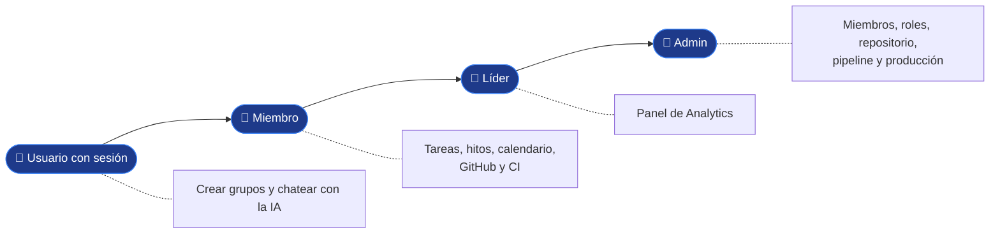

# Guía de uso por rol

**En una frase:** qué puede hacer cada rol (miembro, líder y admin) en cada pantalla de TaskMate, en una o dos líneas, con el enlace a su página de interfaz.

Cada rol suma lo del anterior: un líder hace todo lo de un miembro, y el admin todo lo de un líder.

## Qué hace
- **Miembro:** pertenece al grupo. Trabaja tareas, hitos, GitHub y CI.
- **Líder:** miembro con un rol cuyo nombre contiene «leader» (sin importar mayúsculas). Ve el panel de Analytics.
- **Admin:** quien creó el grupo (si sale, el grupo pasa al miembro más antiguo). Maneja miembros, roles, el repositorio y producción. También cuenta como líder.

## Cómo funciona (primeros pasos)
1. «Create Account» para crear tu cuenta y «Sign In» para entrar ([acceso](../05-interfaz/01-usuarios-y-acceso.md)).
2. En **Groups** pulsa **Use** en un grupo para volverlo el grupo activo. Al entrar se activa el primero de tu lista.
3. Muévete con la barra: Home, Tasks, Calendar, Milestones, Groups, Analytics, GitHub y AI Bot ([mapa de pantallas](../05-interfaz/00-general.md)).
4. Para salir: menú con tu nombre → **Logout**. Una pestaña nueva del navegador empieza sin sesión.

## Miembro

| Pantalla | Qué haces | Más |
|---|---|---|
| **Tasks** (`/tasks`) | Crear listas y tareas, editarlas, asignar personas, completarlas o mandarlas a la papelera. Filtros (Today, This Week, Completed, Deleted…) y orden | [Tareas](../05-interfaz/03-tareas.md) |
| **Calendar** (`/calendar`) | Ver en un mes las fechas de los hitos y de las tareas activas. Es de solo lectura | [Hitos y calendario](../05-interfaz/04-hitos-y-calendario.md) |
| **Milestones** (`/block-diagram`) | Crear hitos o importar tareas, conectarlos («Prerequisite» o «Progressor») y fijar su %. El avance se propaga solo por las flechas «Progressor» | [Hitos y calendario](../05-interfaz/04-hitos-y-calendario.md) |
| **Groups** (`/groups`) | Crear un grupo (quedas como su admin), activar uno con **Use**, ver miembros y roles, y salir con **Abandon Group** | [Grupos y roles](../05-interfaz/02-grupos-y-roles.md) |
| **Analytics** (`/analytics`) | Ves el aviso «Solo líderes del equipo» | [Analytics](../05-interfaz/06-analytics.md) |
| **GitHub** (`/github`) | Ver el repositorio del grupo, sus **Archivos** y **Commits**; «Sincronizar PRs»; «Analizar con IA» si el admin lo permitió | [GitHub](../05-interfaz/07-github.md) |
| Tareas con repositorio | En cada tarea: «Crear rama en GitHub», chip de la rama (copia `git checkout`) y chip del PR. Al fusionar el PR en la rama por defecto, la tarea se completa sola | [GitHub](../05-interfaz/07-github.md) |
| **GitHub → CI/CD** | Ver pipeline, ejecuciones, logs y entornos; «Ejecutar pipeline», «Re-ejecutar fallidos» y «Cancelar» en el CI; «Solicitar producción» con la versión de staging | [CI/CD](../05-interfaz/08-cicd.md) |
| **AI Bot** (`/chat`) | Conversar con la IA, pedir un plan y confirmarlo para crear un proyecto nuevo. Elegir un grupo en «Proyecto» para analizar su repositorio y guardar o descartar las tareas propuestas | [Chat IA](../05-interfaz/05-chat-ia.md) |
| Avisos (todas) | Abajo a la derecha: CI fallido y deploys terminados. **Ver** abre la pestaña CI/CD de ese grupo | [Tiempo real y avisos](../05-interfaz/09-tiempo-real-y-avisos.md) |

Las tareas y los hitos no tienen dueño: cualquier miembro puede tocarlos todos.

## Líder

| Pantalla | Qué haces además | Más |
|---|---|---|
| **Analytics** (`/analytics`) | Panel «Team Analytics Dashboard»: tarjetas del equipo, carga de trabajo (con filtro por rol), experiencia por categoría y recomendaciones con IA: describes una tarea, eliges su categoría y pulsas «Get Recommendations» para ver a quién asignarla | [Analytics](../05-interfaz/06-analytics.md) |

El rol lo crea y lo asigna el admin en **Groups** (por ejemplo, un rol llamado «Team Leader»).

## Admin

| Pantalla | Qué haces además | Más |
|---|---|---|
| **Groups** | **Add User** y **Delete Member** por nombre de usuario; **New Role**, editar y borrar roles; **Assign/Edit Rol** en cada miembro. **Leave Group** pasa el grupo al miembro más antiguo; **Delete Group** aparece cuando eres el único miembro | [Grupos y roles](../05-interfaz/02-grupos-y-roles.md) |
| **Analytics** | Lo mismo que el líder | [Analytics](../05-interfaz/06-analytics.md) |
| **GitHub** | «Conectar repositorio» o «Ya instalé la App», y «Vincular repositorio» (necesitas permiso de escritura en él en GitHub). «Permitir análisis con IA» y «Desconectar» | [GitHub](../05-interfaz/07-github.md) |
| **GitHub → CI/CD** | «Configurar pipeline» o «Editar pipeline», «Proponer con IA» y «Subir al repositorio». «Publicar en producción», «Aprobar» o «Rechazar» solicitudes, «Rollback…» y controlar las ejecuciones de deploy | [CI/CD](../05-interfaz/08-cicd.md) · [guía de CI/CD](guia-cicd.md) |
| Avisos | Además: solicitudes de producción de los miembros y deploys cancelados | [Tiempo real y avisos](../05-interfaz/09-tiempo-real-y-avisos.md) |

## Dónde está en el código

| Archivo | Qué hace |
|---|---|
| `src/components/Navbar.jsx` | Las 8 entradas de la barra y el menú con **Logout** |
| `src/components/GroupContext.jsx` | El grupo activo que usan todas las pantallas |
| `taskmate-api/middleware/groupAccess.js` | `requireGroupMember` y `requireGroupAdmin`: miembro y admin |
| `taskmate-api/models/access.model.js` | `isGroupLeader`: admin o rol con «leader» |

## Para saber más
- Tabla completa de permisos, tal como los revisa la API: [permisos por rol](../04-casos-de-uso/00-permisos-por-rol.md).
- Recorridos paso a paso: [recorridos de usuario](../04-casos-de-uso/00-recorridos-de-usuario.md).
- Conectar GitHub por primera vez: [guía de la GitHub App](guia-github-app.md).
- Defectos conocidos de la interfaz (por ejemplo, textos en inglés y en español): [cierre del proyecto](../01-proyecto/cierre-del-proyecto.md#limitaciones-conocidas).
