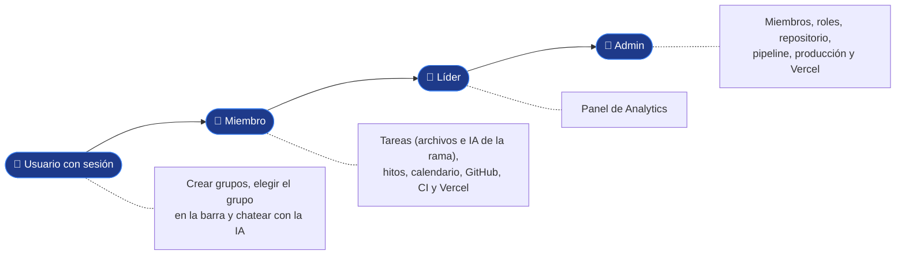

# Guía de uso por rol

**En una frase:** qué puede hacer cada rol (miembro, líder y admin) en cada pantalla de TaskMate, en una o dos líneas, con el enlace a su página de interfaz.

Cada rol suma lo del anterior: un líder hace todo lo de un miembro, y el admin todo lo de un líder.

## Qué hace
- **Miembro:** pertenece al grupo. Trabaja tareas, hitos, GitHub, CI y ve los despliegues de Vercel.
- **Líder:** miembro con un rol cuyo nombre contiene «leader» (sin importar mayúsculas). Ve el panel de Analytics.
- **Admin:** quien creó el grupo (si sale, el grupo pasa al miembro más antiguo). Maneja miembros, roles, el repositorio, producción y el proyecto de Vercel. También cuenta como líder.

La interfaz está en inglés desde el 19 nov 2026; esta guía cita los botones tal como aparecen.

## Cómo funciona (primeros pasos)
1. «Create Account» para crear tu cuenta y «Sign In» para entrar ([acceso](../05-interfaz/01-usuarios-y-acceso.md)). Al registrarte se crea tu grupo personal.
2. Elige el **grupo activo** con el selector junto al logo (muestra su nombre, o «Select a group»). El menú lista tus grupos y trae «Manage groups». También sirve un clic en el grupo dentro de **Groups**. Al entrar se activa el primero de tu lista.
3. El grupo activo vale para todas las pantallas, también para el chat.
4. Muévete con la barra: Home, Tasks, Calendar, Milestones, Groups, Analytics, GitHub y AI Bot ([mapa de pantallas](../05-interfaz/00-general.md)).
5. Para salir: menú con tu nombre → **Logout**. Una pestaña nueva del navegador empieza sin sesión.

## Miembro

| Pantalla | Qué haces | Más |
|---|---|---|
| **Tasks** (`/tasks`) | Crear listas y tareas, editarlas, asignar personas, completarlas o mandarlas a la papelera. Filtros (Today, This Week, Completed, Deleted…) y orden | [Tareas](../05-interfaz/03-tareas.md) |
| **Calendar** (`/calendar`) | Ver en un mes las fechas de los hitos y de las tareas activas. Es de solo lectura | [Hitos y calendario](../05-interfaz/04-hitos-y-calendario.md) |
| **Milestones** (`/block-diagram`) | Crear hitos o importar tareas, conectarlos («Prerequisite» o «Progressor») y fijar su %. El avance se propaga solo por las flechas «Progressor» | [Hitos y calendario](../05-interfaz/04-hitos-y-calendario.md) |
| **Groups** (`/groups`) | Crear un grupo (quedas como su admin), activarlo con un clic, ver miembros y roles, y salir con **Abandon Group** | [Grupos y roles](../05-interfaz/02-grupos-y-roles.md) |
| **Analytics** (`/analytics`) | Ves el aviso «Team leaders only» | [Analytics](../05-interfaz/06-analytics.md) |
| **GitHub** (`/github`) | Ver el repositorio del grupo, sus **Files** y **Commits**; «Sync PRs»; «Analyze with AI» si el admin activó «Allow AI analysis» | [GitHub](../05-interfaz/07-github.md) |
| Tareas con repositorio | En cada tarea: «Create branch on GitHub», chip de la rama (copia `git checkout`) y chip del PR. Al fusionar el PR en la rama por defecto, la tarea se completa sola | [GitHub](../05-interfaz/07-github.md) |
| Tareas con rama → **View task files** | El ícono abre «Task files»: los archivos que cambió el PR de la rama, con +/−, «Open on GitHub» y «Also changed by: …» si otra tarea activa toca el mismo archivo. Solo en tareas activas; la lista se trae del PR al abrir el diálogo y no se refresca ([limitaciones](../01-proyecto/cierre-del-proyecto.md#limitaciones-conocidas)) | [GitHub](../05-interfaz/07-github.md) |
| «Task files» → **AI on the branch** | «Audit» (revisa la rama), «Generate tests» (propone pruebas: no las corre ni las sube) y «Review PR» (solo con el PR abierto). Requiere «Allow AI analysis» | [IA sobre el código](../05-interfaz/10-ia-sobre-el-codigo.md) |
| **GitHub → CI/CD** | Ver pipeline, ejecuciones, logs y entornos; «Run pipeline», «Re-run failed» y «Cancel» en el CI; «Request production» con la versión de staging | [CI/CD](../05-interfaz/08-cicd.md) · [guía de CI/CD](guia-cicd.md) |
| **GitHub → Vercel (monitoring)** | Ver los despliegues que reporta Vercel (Queued, Building, Deployed, Failed, Cancelled) y pulsar «Refresh». No se actualiza solo y necesita el repositorio de GitHub conectado | [GitHub](../05-interfaz/07-github.md) · [guía de CI/CD](guia-cicd.md#13-monitoreo-de-despliegues-de-vercel) |
| **AI Bot** (`/chat`) | Conversar con el asistente sobre el grupo activo («Project: …»). Pedir un plan en el chat o pulsar «Propose tasks» (una vez por minuto, con repositorio y permiso de IA) y luego «Confirm» o «Discard». Para empezar otro proyecto, «New project» (y «Back to “<grupo>”» para volver): el plan que pidas es de un proyecto nuevo y se crea como grupo nuevo cuando respondes «yes». Si tu grupo está sin usar (como tu grupo personal al registrarte), el chat te ayuda a definir el proyecto y el plan se guarda en ese grupo. Cada proyecto tiene su propia conversación | [Chat IA](../05-interfaz/05-chat-ia.md) |
| Avisos (todas) | Abajo a la derecha: CI fallido y deploys terminados. **View** abre la pestaña CI/CD de ese grupo | [Tiempo real y avisos](../05-interfaz/09-tiempo-real-y-avisos.md) |

Las tareas y los hitos no tienen dueño: cualquier miembro puede tocarlos todos.

### Usar la IA sobre la rama de una tarea
1. La tarea debe tener rama («Create branch on GitHub») y el grupo, el permiso «Allow AI analysis» activo.
2. Pulsa **View task files** en la tarjeta. Abajo del diálogo está **AI on the branch**.
3. **Audit** revisa las líneas añadidas (unos 20 s). **Generate tests** propone pruebas pytest o Jest (unos 30 s): «They were not run or pushed», revísalas antes de usarlas. **Review PR** aparece si el PR está abierto (unos 30 s).
4. Veredicto: «No issues» (pass), «Needs review» (warn: algún hallazgo de severidad alta o media; los de la IA llevan «AI, advisory» y nunca pasan de aquí) o «Serious issues» (fail: solo lo dan las reglas fijas con un hallazgo alto, por ejemplo una credencial en el código).
5. La revisión del PR también corre sola cuando se abre o actualiza el PR (si no es borrador). Queda guardada (una por commit), se ve al abrir el panel y se publica en GitHub como comentario («Posted on GitHub») si la App tiene «Pull requests: write».
6. Las tres acciones comparten un límite de 5 por minuto por usuario y necesitan el servidor de IA local encendido. Si falla, verás un mensaje genérico, por ejemplo «Could not audit the branch.». Una revisión de PR que falló se repite en el mismo commit con «Review PR»; desde el 26 nov 2026 ya no hace falta subir otro. Una que quedó a medias se puede repetir pasados 15 minutos.

## Líder

| Pantalla | Qué haces además | Más |
|---|---|---|
| **Analytics** (`/analytics`) | Panel «Team Analytics Dashboard»: tarjetas del equipo, carga de trabajo (con filtro por rol), experiencia por categoría y recomendaciones con IA: describes una tarea, eliges su categoría y pulsas «Get Recommendations» para ver a quién asignarla | [Analytics](../05-interfaz/06-analytics.md) |

El rol lo crea y lo asigna el admin en **Groups** (por ejemplo, un rol llamado «Team Leader»). Ser líder no da permisos de admin: no conecta el repositorio ni vincula Vercel.

## Admin

| Pantalla | Qué haces además | Más |
|---|---|---|
| **Groups** | **Add User** y **Delete Member** por nombre de usuario; **New Role**, editar y borrar roles; **Assign/Edit Roles** en cada miembro. **Leave Group** pasa el grupo al miembro más antiguo; **Delete Group** aparece cuando eres el único miembro | [Grupos y roles](../05-interfaz/02-grupos-y-roles.md) |
| **Analytics** | Lo mismo que el líder | [Analytics](../05-interfaz/06-analytics.md) |
| **GitHub** | «Connect repository» o «I already installed the App», y «Link repository» (necesitas permiso de escritura en él en GitHub). «Allow AI analysis» (habilita «Analyze with AI», el repositorio en el chat, «Propose with AI» del pipeline y la IA de la rama) y «Disconnect» | [GitHub](../05-interfaz/07-github.md) · [guía de la GitHub App](guia-github-app.md) |
| **GitHub → CI/CD** | «Set up pipeline» o «Edit pipeline», «Propose with AI» y «Push to repository». «Publish to production», «Approve» o «Reject» solicitudes, «Rollback…» y controlar las ejecuciones de deploy | [CI/CD](../05-interfaz/08-cicd.md) · [guía de CI/CD](guia-cicd.md) |
| **GitHub → Vercel (monitoring)** | Pegar el «Vercel Project ID» y pulsar «Vincular» (el botón quedó en español); «Unlink» para quitarlo. En Vercel hay que agregar el webhook `/api/deploy/webhook/vercel` | [guía de CI/CD](guia-cicd.md#13-monitoreo-de-despliegues-de-vercel) |
| Avisos | Además: solicitudes de producción de los miembros y deploys cancelados | [Tiempo real y avisos](../05-interfaz/09-tiempo-real-y-avisos.md) |

## Dónde está en el código

| Archivo | Qué hace |
|---|---|
| `src/components/Navbar.jsx` | Las 8 entradas de la barra, el selector de grupo y el menú con **Logout** |
| `src/components/NavGroupSelector.jsx` | El selector de grupo junto al logo («Select a group», «Manage groups») |
| `src/components/GroupContext.jsx` | El grupo activo que usan todas las pantallas |
| `src/components/github/TaskFilesDialog.jsx` · `TaskAiPanel.jsx` | «Task files» y «AI on the branch» |
| `src/components/deploy/DeploymentPanel.jsx` | La pestaña «Vercel (monitoring)» |
| `taskmate-api/middleware/groupAccess.js` | `requireGroupMember` y `requireGroupAdmin`: miembro y admin |
| `taskmate-api/models/access.model.js` | `isGroupLeader`: admin o rol con «leader» |

## Para saber más
- Tabla completa de permisos, tal como los revisa la API: [permisos por rol](../04-casos-de-uso/00-permisos-por-rol.md).
- Recorridos paso a paso: [recorridos de usuario](../04-casos-de-uso/00-recorridos-de-usuario.md).
- Conectar GitHub por primera vez: [guía de la GitHub App](guia-github-app.md).
- Auditar, generar pruebas y revisar PRs con IA: [IA sobre el código](../02-arquitectura/10-ia-sobre-el-codigo.md).
- Defectos conocidos (por ejemplo, los pocos textos que siguen en español o la lista de archivos que no se guarda al fusionar): [cierre de la línea de Pablo y estado](../01-proyecto/cierre-del-proyecto.md#limitaciones-conocidas).
