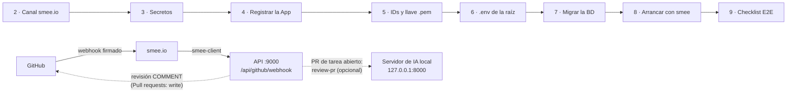

# Guía: registrar la GitHub App y probar la integración de TaskMate

**En una frase:** de cero a un flujo completo contra **GitHub real**: registrar tu GitHub App, ponerla en la `.env`, recibir webhooks en `localhost` con smee.io, migrar la BD y correr el checklist E2E.

## Resumen
- Registras **tu propia** GitHub App, con los permisos y eventos de las Fases 3 y 4, y copias sus datos a la `.env` de la raíz.
- smee.io trae los webhooks de GitHub hasta `localhost:9000`; la API verifica la firma HMAC de cada uno.
- La BD necesita las migraciones 001–011 (un contenedor nuevo ya las trae; uno creado con una imagen anterior necesita las que le falten: §7).
- Conectar un repositorio exige ser admin del grupo en TaskMate y tener permiso de **escritura** en él en GitHub.
- **Opcional:** con *Pull requests* en **Read and write**, TaskMate publica en GitHub la revisión con IA de los PR de tarea. Sin ese permiso la revisión igual se guarda en TaskMate, pero no se publica ([cómo](#revisión-de-pr-con-ia-opcional)).
- El checklist E2E (§9) pasó con GitHub real el 5–6 oct 2026 ([resultados](../08-fases/fase-03-integracion-github/README.md#e2e-con-github-real-56-oct-2026-ab2a2a0)). Usar el CI/CD: [guía de CI/CD](guia-cicd.md).



> Complemento del [capítulo de la Fase 3](../08-fases/fase-03-integracion-github/README.md). Código de las Fases 3 y 4 en `master`: Fase 3 en el PR #4 (`183f1cb`) y Fase 4 en el PR #5 (`56f7136`). Desde la Fase 4 (22 oct 2026) la App pide permisos y eventos nuevos ([paso 4](#4-registrar-la-github-app)), las instalaciones existentes deben aceptarlos ([cómo](#aceptar-permisos-nuevos-en-una-instalación-existente)) y «Redirect on update» va **marcado**. La revisión de PR con IA y la lista de archivos por tarea son de la línea de Christian: están en la rama `test/e2e` (todavía no en `master`) y no piden eventos nuevos. Limitaciones conocidas: [cierre de la línea de Pablo y estado](../01-proyecto/cierre-del-proyecto.md#limitaciones-conocidas).

---

## Índice

1. [Antes de empezar](#1-antes-de-empezar)
2. [Crear un canal de smee.io](#2-crear-un-canal-de-smeeio)
3. [Generar los secretos](#3-generar-los-secretos)
4. [Registrar la GitHub App](#4-registrar-la-github-app)
5. [Datos de la App y llave privada](#5-datos-de-la-app-y-llave-privada)
6. [Configurar `.env`](#6-configurar-env)
7. [Migrar la BD de desarrollo](#7-migrar-la-bd-de-desarrollo)
8. [Arrancar todo](#8-arrancar-todo)
9. [Checklist E2E manual](#9-checklist-e2e-manual)
10. [Solución de problemas](#10-solución-de-problemas)
11. [Cuidado de las credenciales](#11-cuidado-de-las-credenciales)

---

## 1. Antes de empezar

- TaskMate instalado: `npm install`, el venv de Python en `taskmate-api/mcp/venv` y el contenedor `taskmate-sql` ([primer arranque](primer-arranque.md)). La rama con lo más actualizado es `test/e2e`; `master` todavía no trae la línea de Christian.
- Node.js 18+ (la API usa `fetch` nativo), Python 3.9+ y Docker Desktop o Podman (`start.sh` usa Podman si está instalado y responde).
- Una cuenta de GitHub y un **repositorio de prueba con al menos un commit** (en un repositorio vacío no se pueden crear ramas: `REPO_EMPTY`).
- Una API key de Groq si el chat usa Groq (`LLM_PROVIDER=groq`, el valor por defecto). Con el modelo local (`LLM_PROVIDER=ollama`) no hace falta.
- Opcional, para auditar la rama, generar pruebas y la revisión de PR con IA: el servidor de IA local de Christian (`taskmate-ai-server`, `127.0.0.1:8000`). Cómo levantarlo: [entorno local](../09-linea-christian/ENTORNO-LOCAL.md).
- `openssl` (viene con macOS).
- Ser **administrador** de un grupo en TaskMate (quien crea el grupo es su admin).
- Para probar el CI/CD de la Fase 4: un repositorio **público** (GitHub Pages en privados requiere GitHub Pro, Team o Enterprise) con un proyecto Node.js (npm) con script `build` (Vite o Create React App) o un sitio HTML, y cuya rama principal acepte commits de la App.

---

## 2. Crear un canal de smee.io

GitHub no puede llegar a `localhost`. smee.io es un proxy público: GitHub envía el webhook al canal y `smee-client`, corriendo en tu máquina, lo reenvía a la API.

1. Abre <https://smee.io> y pulsa **Start a new channel**.
2. Copia la URL del canal, por ejemplo `https://smee.io/AbCdEf123456`. La usarás como *Webhook URL* de la App y en `smee-client`.

> Cualquiera que conozca la URL del canal puede ver los eventos (nombres de repo, títulos de PR). Por eso TaskMate exige la firma HMAC en cada webhook. Usa un canal propio y solo para desarrollo.

---

## 3. Generar los secretos

```bash
openssl rand -hex 32       # GITHUB_WEBHOOK_SECRET
openssl rand -hex 32       # MCP_SHARED_SECRET   (≥ 32 caracteres aleatorios)
openssl rand -base64 48    # JWT_SECRET          (≥ 32 caracteres aleatorios)
```

- La API **no arranca** si `JWT_SECRET` tiene menos de 32 caracteres o parece de ejemplo (contiene `change-me`, `your-secret`, `secret-key`, `placeholder`, `example`, `replace-me`). El servicio Python del chat aplica la misma regla a `MCP_SHARED_SECRET`.
- `AI_SERVER_SECRET` no se genera aquí: es el mismo valor que tiene la `.env` del servidor de IA local (su `up.sh` lo genera y `scripts/local-up.sh` lo copia).
- Guárdalos en un gestor de contraseñas. Nunca en el repositorio.

---

## 4. Registrar la GitHub App

En GitHub: foto de perfil → **Settings** → **Developer settings** → **GitHub Apps** → **New GitHub App** (<https://github.com/settings/apps/new>). Si la App será de una organización: *Settings de la organización* → *Developer settings* → *GitHub Apps*.

| Campo | Valor | Por qué |
|-------|-------|---------|
| **GitHub App name** | Un nombre único en GitHub, p. ej. `TaskMate Dev <tu-usuario>` | Define el *slug* de la URL pública `https://github.com/apps/<slug>` |
| **Description** | Opcional | — |
| **Homepage URL** | `http://localhost:3000` | Campo obligatorio; no participa en el flujo |
| **Callback URL** | `http://localhost:9000/api/github/callback` | Adonde GitHub vuelve después de instalar o autorizar |
| **Expire user authorization tokens** | Dejar marcado (por defecto) | TaskMate usa el token del usuario una sola vez y lo revoca |
| **Request user authorization (OAuth) during installation** | ✅ **Marcar (obligatorio)** | Sin esto el callback no recibe `code` y TaskMate no puede comprobar que el usuario tiene acceso a la instalación; el `installation_id` de la URL por sí solo es falsificable |
| **Enable Device Flow** | Desmarcado | No se usa |
| **Setup URL** | Queda deshabilitado al marcar la opción anterior | GitHub redirige al *Callback URL* después de instalar |
| **Redirect on update** | ✅ **Marcado** (desde la Fase 4) | Al cambiar la instalación en github.com (otro repositorio, permisos nuevos), GitHub vuelve al *Callback URL* **sin `state`** (`setup_action=update` o `install` con `installation_id`). TaskMate **no canjea ni vincula nada** y redirige a `/github?status=updated`: al admin del grupo seleccionado lo pasa por el flujo normal con `state` (GitHub responde al instante) hasta la **selección de repositorio**; a un miembro, o sin grupo seleccionado, le explica qué hacer. Antes de la Fase 4 ese regreso terminaba en un error de enlace vencido |
| **Webhook → Active** | ✅ Marcado | — |
| **Webhook URL** | La URL de tu canal: `https://smee.io/<tu-canal>` | Paso 2 |
| **Webhook secret** | El valor de `GITHUB_WEBHOOK_SECRET` | La API verifica la firma `X-Hub-Signature-256` de cada entrega |
| **SSL verification** | Enable | smee.io usa HTTPS |

**Permisos → Repository permissions** (todo lo que no está en la tabla: *No access*):

| Permiso | Nivel | Fase | Para qué lo usa TaskMate |
|---------|-------|------|--------------------------|
| **Contents** | **Read and write** | 3 | Leer árbol, archivos, README y commits (funcionalidades 2 y 3), crear y borrar (limpieza segura) la rama de cada tarea (funcionalidad 5) y, en la Fase 4, escribir el workflow, leer su versión y comprobar que una versión a desplegar está en la rama principal |
| **Metadata** | Read-only | 3 | Obligatorio para cualquier App |
| **Pull requests** | Read-only (**Read and write** opcional) | 3 (+ línea de Christian) | Sincronización manual de PRs (funcionalidad 6), comprobar que ningún PR abierto use una rama antes de borrarla (limpieza segura) y leer la lista de archivos del PR de una tarea (`GET /pulls/{n}/files`). Con **Read and write**, además, publicar la revisión con IA del PR ([abajo](#revisión-de-pr-con-ia-opcional)) |
| **Issues** | Read-only | 3 | Títulos de issues abiertos para el análisis con IA (funcionalidad 2) |
| **Actions** | **Read and write** | 4 | Leer workflows, ejecuciones, jobs y logs; ejecutar el pipeline, re-ejecutar, cancelar y lanzar deploys (`workflow_dispatch`) |
| **Administration** | **Read and write** | 4 | **Solo** para activar GitHub Pages (crear el sitio con fuente «GitHub Actions») al subir un pipeline con deploy. Ningún otro token lo pide |
| **Checks** | Read-only | 4 | Anotaciones de los jobs (errores con archivo y línea) y comprobar que el job de CI de TaskMate pasó en una versión antes de desplegarla |
| **Deployments** | Read-only | 4 | Historial de deploys y versión vigente de cada entorno (los Deployments los escribe el propio workflow) |
| **Pages** | **Read and write** | 4 | Leer el estado y la URL del sitio y activarlo (junto con Administration) |
| **Workflows** | **Read and write** | 4 | Escribir `.github/workflows/taskmate-ci.yml` (GitHub exige este permiso además de Contents para tocar `.github/workflows/`) |

*Organization permissions* y *Account permissions*: ninguno.

**Subscribe to events:**

| Evento | Fase | Para qué |
|--------|------|----------|
| ✅ **Pull request** | 3 (+ línea de Christian) | Progreso automático por PR. Desde la línea de Christian, también: revisar con IA los PR de tarea (acciones `opened`, `synchronize`, `ready_for_review` y `reopened`) e intentar guardar los archivos de la tarea cuando su PR se fusiona y la completa (según el código, no llegan a guardarse: [limitaciones](../01-proyecto/cierre-del-proyecto.md#archivos-por-tarea)) |
| ✅ **Workflow run** | 4 | Ejecuciones en vivo en la pestaña CI/CD y aviso de pipeline fallido |
| ✅ **Workflow job** | 4 | Jobs y pasos en vivo en el detalle de una ejecución |
| ✅ **Deployment status** | 4 | Entornos en vivo y aviso de deploy terminado o fallido |

Los eventos solo aparecen en la lista cuando la App tiene el permiso correspondiente (*Workflow run* y *Workflow job* con **Actions**, *Deployment status* con **Deployments**): marca primero los permisos. Los eventos `installation` e `installation_repositories` se entregan siempre a una App con webhook; TaskMate los usa para detectar desinstalación, suspensión y repositorios agregados o quitados. La revisión con IA y los archivos por tarea reutilizan el evento **Pull request**: no hay que suscribir nada nuevo. Los de la Fase 4 **no se guardan**: TaskMate solo registra la entrega (idempotencia) y los reenvía en vivo por el WebSocket `/events` a los miembros de los grupos vinculados a ese repositorio.

**Where can this GitHub App be installed?**
- **Only on this account**: si el repositorio de prueba está en tu cuenta personal.
- **Any account**: si la vas a instalar en una organización (p. ej. la del equipo) o en la cuenta de otra persona.

Pulsa **Create GitHub App**.

TaskMate pide tokens de instalación **acotados al repositorio del grupo** y con permisos **mínimos por operación**:
- Fase 3: solo lectura para explorar; `contents: write` solo al crear o borrar ramas; `pull_requests: read` para sincronizar, para la limpieza de ramas y (línea de Christian) para la lista de archivos del PR de una tarea.
- Fase 4: `contents` + `workflows: write` solo al subir el workflow; `actions: write` solo para ejecutar, re-ejecutar, cancelar o desplegar; `checks: read` para anotaciones y para verificar versiones; `administration` + `pages: write` solo al activar Pages.
- IA sobre el código (línea de Christian): `contents: read` para leer el diff de la rama (auditar, generar pruebas, revisar el PR) y `pull_requests: write` **solo** al publicar la revisión. Este último es **opcional** ([abajo](#revisión-de-pr-con-ia-opcional)).

Aun así, la App debe tener al menos los permisos de la tabla. Si una instalación no aceptó alguno, la acción que lo necesita responde `APP_PERMISSIONS_MISSING` y TaskMate muestra «The GitHub App does not have the CI/CD permissions on this repository yet. Whoever installed it must accept them on GitHub.» La única excepción es la revisión con IA: sin `pull_requests: write` no da error (ver abajo).

> **Si no quieres dar Administration:** activa Pages a mano en el repositorio (**Settings → Pages → Build and deployment → Source: GitHub Actions**). TaskMate detecta que ya publica desde Actions y no pide ese permiso. Sin Pages activado y sin Administration, subir un pipeline con deploy falla con `APP_PERMISSIONS_MISSING`.

### Revisión de PR con IA (opcional)

Es de la línea de Christian (rama `test/e2e`). TaskMate le pide al servidor de IA local una revisión del PR de una tarea, la guarda (una por commit, en `dbo.AiReviews`) y, si la App puede, la publica en GitHub como revisión de tipo **COMMENT**: nunca aprueba ni pide cambios. Detalle: [IA sobre el código](../02-arquitectura/10-ia-sobre-el-codigo.md).

**Cuándo se revisa un PR:**
- **Sola, por webhook:** con el evento **Pull request** (`opened`, `synchronize`, `ready_for_review` o `reopened`), en segundo plano, sin retrasar la respuesta del webhook.
- **A mano:** botón «Review PR» del panel «AI on the branch», en el diálogo «Task files» de la tarea. Solo aparece si el PR está abierto.

**Qué hace falta:**

| Requisito | Si falta |
|---|---|
| `AI_SERVER_URL` y `AI_SERVER_SECRET` en la `.env` ([paso 6](#6-configurar-env)) y el servidor de IA local corriendo | Sin URL, el webhook no revisa nada; con el servidor apagado o el secreto distinto, la revisión de ese commit queda `failed`. El botón falla (`AI_SERVER_DISABLED`, 503, o un error de conexión) y el panel solo dice «Could not review the pull request.» |
| «Allow AI analysis» activado por el admin del grupo (pestaña **Repository**) | No hay revisión por webhook y el panel dice «AI analysis is turned off for this project; an admin can turn it on from the GitHub page.» |
| PR **abierto**, que no sea borrador ni venga de un fork, desde la rama de una tarea (`tm/…`) | No se revisa. Los PR que no son de tarea nunca se revisan |
| *Pull requests* en **Read and write**, aceptado en la instalación | Ver abajo: se guarda, pero no se publica |

**Sin el permiso de escritura:** GitHub rechaza la publicación (`APP_PERMISSIONS_MISSING`). TaskMate **no lo trata como error**: guarda la revisión con `posted = 'no_permission'` y el panel la muestra con el aviso «Not posted on GitHub: the GitHub App needs the “Pull requests: write” permission.» Cualquier otro fallo al publicar queda como `posted = 'failed'` («Could not post on GitHub.»). Si GitHub rechaza los comentarios en línea (422), TaskMate vuelve a publicar la revisión sin ellos.

**Para activarlo en una App ya registrada:**
1. GitHub → **Settings → Developer settings → GitHub Apps** → tu App → **Edit** → pestaña **Permissions & events**.
2. En *Repository permissions*, sube **Pull requests** de *Read-only* a **Read and write** y pulsa **Save changes**. No hay que marcar eventos nuevos.
3. Quien instaló la App acepta el permiso nuevo ([cómo](#aceptar-permisos-nuevos-en-una-instalación-existente)).

No hace falta reiniciar la API ni tocar la `.env`. La revisión ya guardada de ese commit no se vuelve a publicar sola: se publica la del siguiente commit (o la pide alguien con «Review PR» en un commit nuevo). Limitaciones: [cierre de la línea de Pablo y estado](../01-proyecto/cierre-del-proyecto.md#limitaciones-conocidas).

### Agregar los permisos de la Fase 4 a una App ya registrada

Si registraste la App en la Fase 3:

1. GitHub → foto de perfil → **Settings → Developer settings → GitHub Apps** → tu App → **Edit**.
2. Pestaña **General**: marca **Redirect on update** y pulsa **Save changes**.
3. Pestaña **Permissions & events**: en *Repository permissions* sube **Actions**, **Administration**, **Pages** y **Workflows** a *Read and write*, y **Checks** y **Deployments** a *Read-only* (tabla de arriba). En *Subscribe to events* marca **Workflow run**, **Workflow job** y **Deployment status**.
4. Pulsa **Save changes**. GitHub avisa que las instalaciones existentes deben aceptar los permisos nuevos: hasta entonces siguen con los anteriores.

No hace falta cambiar `.env` ni la llave privada.

### Aceptar permisos nuevos en una instalación existente

Lo hace **quien instaló la App** (dueño de la cuenta, o un propietario de la organización). GitHub también le envía un correo con el enlace.

1. Cuenta personal: GitHub → foto de perfil → **Settings → Applications → Installed GitHub Apps** → la App → **Configure**. Organización: **Settings de la organización → GitHub Apps** (*Third-party Access*) → la App → **Configure**.
2. Arriba aparece el aviso de que la App pide permisos actualizados: pulsa **Review request**.
3. Revisa la lista y pulsa **Accept new permissions**.
4. En la misma página, en **Repository access**, confirma que el repositorio del grupo sigue seleccionado.

Con «Redirect on update» marcado, al guardar GitHub vuelve a TaskMate (`/github?status=updated`): si eres admin del grupo seleccionado, TaskMate te lleva a la selección de repositorio; si el repositorio ya estaba vinculado no hace falta volver a vincularlo, basta con regresar a la pestaña **CI/CD**. No hace falta reiniciar la API: los tokens se piden por conjunto de permisos y un intento rechazado no queda en caché, así que la siguiente acción ya usa los permisos aceptados.

---

## 5. Datos de la App y llave privada

Después de crearla quedas en la pestaña **General** de la App:

| Dato | Dónde está | Variable |
|------|-----------|----------|
| App ID | Sección *About* (un número) | `GITHUB_APP_ID` |
| Client ID | Sección *About* (`Iv1.…` o `Iv23…`) | `GITHUB_APP_CLIENT_ID` |
| Client secret | **Generate a new client secret** (se muestra una sola vez) | `GITHUB_APP_CLIENT_SECRET` |
| Slug | *Public link* `https://github.com/apps/<slug>` (solo la última parte) | `GITHUB_APP_SLUG` |
| Llave privada | **Private keys → Generate a private key** (descarga un `.pem`) | `GITHUB_APP_PRIVATE_KEY` (en base64) |

Convierte la llave a base64 en una sola línea:

```bash
base64 -i ~/Downloads/<nombre-de-la-app>.<fecha>.private-key.pem | tr -d '\n'
# Linux: base64 -w0 archivo.pem
```

Pega el resultado en `GITHUB_APP_PRIVATE_KEY` y guarda el `.pem` fuera del repositorio (o bórralo: GitHub permite generar otra llave cuando quieras). `*.pem` está en `.gitignore`, pero no lo copies al proyecto. (También se acepta el PEM crudo con `\n` literales, pero base64 evita problemas de saltos de línea.)

---

## 6. Configurar `.env`

Usa **una sola `.env`, en la raíz**: así la API y el servicio Python del chat ven los mismos valores. Plantilla comentada: `taskmate-api/.env.example`. En Linux, `./scripts/local-up.sh` genera la `.env` si no existe y agrega las claves que falten (no agrega `GROQ_API_KEY` ni las `GITHUB_*`).
- La API carga primero la `.env` de la carpeta desde la que arranca y después la de la raíz, sin pisar (`server.js:7-8`, `helpers/pool.js:5-6`). Con `./start.sh`, que la lanza desde la raíz, solo se lee la de la raíz; `taskmate-api/.env` solo se lee, y gana, con `npm run start:api`.
- El servicio Python del chat lee `taskmate-api/mcp/.env`, `taskmate-api/.env` y la raíz. Las variables exportadas en la terminal siempre ganan.

> El servicio Python del chat carga **todas** las variables de esos archivos en su entorno (`taskmate-api/mcp/llm_service.py`), también las que no usa (credenciales de la BD, `JWT_SECRET`, llave y secretos de la App). Es un riesgo residual conocido: ver [riesgos residuales de la Fase 3](../08-fases/fase-03-integracion-github/SEGURIDAD-Y-BASE-DE-DATOS.md#parte-c--riesgos-residuales).

```env
# --- API y navegador
FRONTEND_URL=http://localhost:3000

# --- Autenticación
JWT_SECRET=<openssl rand -base64 48>

# --- SQL Server
DB_SERVER=localhost
DB_PORT=1433
DB_NAME=taskmate-db
DB_USERNAME=sqladmin                     # login de la app (nunca sa)
DB_PASSWORD=<contraseña del login de la app>
# Solo para `npm run db:migrate` (puedes no guardarlas aquí y pasarlas al migrar, ver paso 7)
MIGRATION_DB_USERNAME=sa
MIGRATION_DB_PASSWORD=<SA_PASSWORD del contenedor>

# --- Servicio Python del chat
LLM_WEBSOCKET_URL=ws://127.0.0.1:8001/ws   # el puerto debe coincidir con MCP_PORT (por defecto 8001)
MCP_SHARED_SECRET=<openssl rand -hex 32>
LLM_PROVIDER=groq                         # groq (por defecto) u ollama (modelo local)
GROQ_API_KEY=<tu llave de Groq>           # solo con LLM_PROVIDER=groq
LLM_MODEL=openai/gpt-oss-20b

# --- Servidor de IA local (opcional: auditar, generar pruebas, revisar PR)
AI_SERVER_URL=                            # vacío = desactivado; local-up.sh pone http://127.0.0.1:8000
AI_SERVER_SECRET=<el de la .env del servidor de IA local>

# --- GitHub App
GITHUB_APP_ID=<App ID>
GITHUB_APP_SLUG=<slug>
GITHUB_APP_CLIENT_ID=<Client ID>
GITHUB_APP_CLIENT_SECRET=<Client secret>
GITHUB_APP_PRIVATE_KEY=<pem en base64, una línea>
GITHUB_WEBHOOK_SECRET=<el mismo valor que en la App>
GITHUB_APP_CALLBACK_URL=
GITHUB_INSTALLATION_HOURLY_BUDGET=4000
WEBHOOK_DELIVERY_RETENTION_DAYS=90
```

| Variable | Para qué | Si falta o está mal |
|----------|----------|---------------------|
| `FRONTEND_URL` | Orígenes permitidos (CORS y *handshake* del WebSocket) y destino de la redirección del callback (`FRONTEND_URL/github`). Puede llevar varios orígenes separados por coma; el primero es el de la redirección | Por defecto `http://localhost:3000`. Si no coincide **exactamente** con el origen del navegador: errores CORS y el chat no conecta (403) |
| `JWT_SECRET` | Firma las sesiones (24 h) y el `state` del flujo de instalación | La API no arranca |
| `DB_USERNAME` / `DB_PASSWORD` | Login de la app: solo `db_datareader` + `db_datawriter` en contenedores creados con el nuevo `setup-db.sh` | La API no conecta a la BD |
| `MIGRATION_DB_USERNAME` / `MIGRATION_DB_PASSWORD` | Login con permisos de DDL para las migraciones (SA en el Docker de desarrollo) | `db:migrate` falla por permisos |
| `LLM_WEBSOCKET_URL` / `MCP_PORT` | Dónde escucha el servicio Python del chat (solo `127.0.0.1`; puerto por defecto 8001). Si el 8001 está ocupado, se usa otro (p. ej. 8011) en las dos variables | El chat responde «The AI service is not available right now.» |
| `MCP_SHARED_SECRET` | Node lo envía en la cabecera `X-MCP-Secret`; Python rechaza (403) cualquier conexión sin él | Python no arranca si falta o es débil; con valores distintos, 403 |
| `LLM_PROVIDER` | Proveedor del chat: `groq` (por defecto) u `ollama` (modelo local `gemma4:e2b-it-qat`; variables `OLLAMA_*`) | Un valor desconocido avisa y usa `groq` |
| `GROQ_API_KEY`, `LLM_MODEL` | Llave y modelo de Groq; solo con `LLM_PROVIDER=groq` | Con Groq, las llamadas de IA fallan |
| `AI_SERVER_URL` / `AI_SERVER_SECRET` | Servidor de IA local (cabecera `X-AI-Server-Secret`): auditar la rama, generar pruebas y la revisión de PR con IA | Opcionales. Sin URL, esas acciones responden `AI_SERVER_DISABLED` (503) y el webhook no revisa PR; con el secreto distinto, `AI_SERVER_AUTH` (502) |
| `GITHUB_APP_ID` | `iss` del JWT RS256 de la App (para `/app/*` y para pedir tokens de instalación) | `GITHUB_NOT_CONFIGURED` (503) al explorar, crear ramas, sincronizar o vincular |
| `GITHUB_APP_SLUG` | Arma la URL de instalación | 503 al pulsar «Connect repository» |
| `GITHUB_APP_CLIENT_ID` | URL de autorización, canje del `code` y revocación del token del usuario | 503 al pulsar «Connect repository» |
| `GITHUB_APP_CLIENT_SECRET` | Canje del `code` y revocación | El callback termina en `status=error&code=GITHUB_NOT_CONFIGURED` |
| `GITHUB_APP_PRIVATE_KEY` | Firma el JWT de la App | 503 (`GITHUB_NOT_CONFIGURED`) si falta o no es un PEM válido |
| `GITHUB_WEBHOOK_SECRET` | Verificación HMAC de los webhooks | Vacío o distinto: **todos** los webhooks responden 401 |
| `GITHUB_APP_CALLBACK_URL` | Opcional: solo si la App tiene varias *Callback URL* (debe coincidir con una) | Vacío: GitHub usa la primera |
| `GITHUB_INSTALLATION_HOURLY_BUDGET` | Solicitudes por hora que TaskMate se permite por instalación (GitHub da 5 000/h) | Por defecto 4 000 |
| `WEBHOOK_DELIVERY_RETENTION_DAYS` | Días que se conserva la bitácora de entregas (es la protección contra reenvíos); se purga una vez al día | Entero ≥ 30; un valor menor o inválido usa el valor por defecto, 90 |

El frontend usa `REACT_APP_API_URL` (por defecto `http://<host de la página>:9000`) y `REACT_APP_WS_URL` (por defecto `ws://<host de la página>:9000`); solo hay que definirlas si cambias el puerto de la API.

Otras variables de la línea de Christian, sin relación con la App: `VERCEL_WEBHOOK_SECRET` (monitoreo de Vercel) y `ALLOW_LAN_ORIGINS` (abrir la app desde otro equipo de la red; solo desarrollo). Detalle: [primer arranque](primer-arranque.md).

**Después de editar `.env` reinicia la API y el servicio Python del chat**: ambos leen las variables al arrancar.

> Si cambias `JWT_SECRET`, las sesiones abiertas dejan de valer: hay que **iniciar sesión de nuevo** (lo mismo con un token antiguo sin `typ: 'access'`).

---

## 7. Migrar la BD de desarrollo

El código de `test/e2e` necesita **001–011** (`master` llega a la 008). Vincular y desvincular un repositorio también borran en `dbo.DeployRequests` (007), la lista de tareas lee `created_at` (008), y la línea de Christian agrega los despliegues de Vercel (009), los archivos por tarea (`TaskFiles`, 010) y las revisiones con IA (`AiReviews`, 011). Un contenedor **nuevo** las aplica solo al arrancar (`setup-db.sh`), y `./scripts/local-up.sh` corre `npm run db:migrate` en cada arranque. `./start.sh` no migra: este paso es para un contenedor creado con una imagen anterior. La BD de desarrollo de Pablo tenía 001–008 al 5 nov 2026, con respaldo previo (001–006 el 11 sep, la 007 el 9 oct y la 008 el 5 nov).

**0. Respaldo recomendado de los triggers.** La migración 006 instala la versión BFS de los triggers de porcentaje, la misma que la BD de desarrollo tenía instalada a mano. Aun así, guarda su definición antes de migrar por si tu BD tiene otra variante:

```bash
docker start taskmate-sql
read -s "SA_PW?Contraseña SA: "; echo           # zsh (en bash: read -s -p "Contraseña SA: " SA_PW; echo)
docker exec -i -e SQLCMDPASSWORD="$SA_PW" taskmate-sql /opt/mssql-tools/bin/sqlcmd \
  -S localhost -U SA -d taskmate-db -y 0 \
  -Q "SET NOCOUNT ON; SELECT OBJECT_DEFINITION(OBJECT_ID('dbo.UpdateTargetNodePercentage')); SELECT OBJECT_DEFINITION(OBJECT_ID('dbo.UpdateTargetOnPrerequisiteChange'));" \
  > "$HOME/triggers-antes-de-003.sql"
```

**1. Aplicar las migraciones** como SA, sin dejar la contraseña en el historial ni en `.env`:

```bash
cd taskmate-api
MIGRATION_DB_USERNAME=sa MIGRATION_DB_PASSWORD="$SA_PW" npm run db:migrate
MIGRATION_DB_USERNAME=sa MIGRATION_DB_PASSWORD="$SA_PW" node migrations/runner.js status
#   [x] 001_schema_fixes
#   [x] 002_github
#   [x] 003_triggers
#   [x] 004_repair_group_admins
#   [x] 005_unicode_membership_github
#   [x] 006_bfs_progress_triggers
#   [x] 007_cicd                      (Fase 4: RepoPipelines y DeployRequests)
#   [x] 008_task_created_at           (orden «Creation Date» de /tasks)
#   [x] 009_deployments               (monitoreo de Vercel)
#   [x] 010_task_files                (archivos por tarea)
#   [x] 011_ai_reviews                (revisión de PR con IA)
unset SA_PW
```

El mismo `npm run db:migrate` aplica solo las que falten: con 001–008, de la 009 a la 011.

- Cada migración corre en **una transacción** junto con su registro en `dbo.SchemaMigrations`: si algo falla, no queda nada a medias. Todas son idempotentes.
- Si 001 imprime `WARNING 001: duplicate ...`, había datos duplicados y esa restricción UNIQUE se omitió **sin borrar nada**. Corrige los datos y ejecuta `node migrations/runner.js reapply 1` (con las mismas variables).
- Revertir la última: `node migrations/runner.js down --steps 1` (la reversa de 005 es con pérdida: los caracteres fuera del *code page* vuelven a `?`).
- BD vacía: `node migrations/runner.js up --with-base` crea primero las tablas base.

---

## 8. Arrancar todo

**Opción rápida (macOS, o Podman):** `./start.sh` levanta SQL Server (`taskmate-sql`, con Podman si está instalado y responde, si no Docker), la API (`:9000`) y el servicio Python del chat (`127.0.0.1:8001`, o el `MCP_PORT` de la `.env`; avisa si falta `MCP_SHARED_SECRET` en la `.env` de la raíz). No aplica migraciones ni levanta el servidor de IA local. Luego, en otras terminales, `npm start` (frontend) y `smee-client`.

**Opción Linux + Podman:** `./scripts/local-up.sh` levanta, en orden, la IA local (Ollama y el servidor de IA local, de `../ai-server`), SQL Server con `npm run db:migrate`, el servicio Python del chat, la API y el frontend; `./scripts/local-down.sh` lo detiene. `smee-client` se lanza aparte igual. Detalle: [entorno local](../09-linea-christian/ENTORNO-LOCAL.md).

> smee solo reenvía a `/api/github/webhook`. El webhook de Vercel (`/api/deploy/webhook/vercel`) necesita un túnel público aparte: ver [entorno local](../09-linea-christian/ENTORNO-LOCAL.md).

**Opción manual (una terminal por proceso):**

```bash
# T1 — SQL Server
docker start taskmate-sql

# T2 — API (puerto 9000)
npm run start:api

# T3 — Servicio Python del chat (solo local)
cd taskmate-api/mcp && source venv/bin/activate
uvicorn server:app --host 127.0.0.1 --port 8001 --ws-max-size 4194304   # o el puerto de MCP_PORT

# T4 — Frontend (puerto 3000)
npm start

# T5 — Webhooks de GitHub hacia la API
npx smee-client -u https://smee.io/<tu-canal> -t http://localhost:9000/api/github/webhook
```

Señales de que todo está bien:
- API: `API running on PORT 9000` y `[LLMService] WebSocket connection established.`
- Servicio Python del chat: `Client connected`.
- smee: `Connected https://smee.io/<tu-canal>`; cada webhook aparece como `POST http://localhost:9000/api/github/webhook - 200`.

---

## 9. Checklist E2E manual

Recomendación: instala la App **desde TaskMate** («Connect repository») para que el flujo lleve el `state` firmado. Si la instalas directamente en GitHub, en TaskMate usa «I already installed the App». Con «Redirect on update» marcado, darle acceso a otro repositorio desde GitHub también te devuelve a la selección de repositorio.

**Resultado:** en verde con GitHub real el 5–6 oct 2026, salvo el paso 4, que no se probó en vivo (la línea de Pablo cerró el 3 nov 2026); lo cubren las pruebas automáticas. Aquel recorrido fue con la interfaz en español: desde el 19 nov los textos están en inglés y abajo se citan como se ven ahora. El paso 11b (revisión con IA) es de la línea de Christian y no se ha probado con GitHub real. Detalle en el [capítulo de la Fase 3](../08-fases/fase-03-integracion-github/README.md#e2e-con-github-real-56-oct-2026-ab2a2a0).

Este checklist cubre la Fase 3. El recorrido del CI/CD (Fase 4) está en la [guía de CI/CD](guia-cicd.md) y su resultado con GitHub real en el [capítulo de la Fase 4](../08-fases/fase-04-pipeline-cicd/README.md#pruebas-e2e-con-github-real).

- [ ] **1. Preparación.** Los cinco procesos arriba, smee conectado y sesión iniciada de nuevo en `http://localhost:3000`.
- [ ] **2. Conectar.** Elige un grupo del que seas admin en el selector de grupo del navbar (o con un clic en su tarjeta en **Groups**); en **GitHub** (`/github`) pulsa **«Connect repository»**. En GitHub elige tu cuenta, **Only select repositories** → el repositorio de prueba → **Install & Authorize**.
- [ ] **3. Seleccionar.** Vuelves a `/github` con la tarjeta «Connecting as @tu-login». Elige el repositorio y pulsa **«Link repository»** → aviso «Repository `dueño/repo` connected.» La pestaña **Repository** muestra rama por defecto, cuenta de la instalación y quién lo conectó.
  - Desde la Fase 4 (`069da9a`) la tarjeta solo ofrece los repositorios donde tu cuenta de GitHub tiene permiso **push, maintain o admin**.
  - Por qué: conectar le da al grupo el token de la App para ese repositorio (crear ramas, subir el workflow, publicar producción, hacer rollback); alguien con solo lectura no debe poder vincularlo a su propio grupo y publicar su producción.
  - Con un usuario que solo tiene lectura, el regreso termina en `code=NO_WRITABLE_REPOSITORIES` ([solución de problemas](#10-solución-de-problemas)).
- [ ] **4. Permisos por rol (opcional; no se probó en vivo).** Con otro usuario **miembro no admin** del grupo: ve el repositorio pero no los botones para conectar o desconectar ni el interruptor «Allow AI analysis». Un usuario que no es miembro recibe 403 en cualquier ruta del grupo.
- [ ] **5. Explorar.** Pestaña **Files**: navega el árbol, abre un archivo y el README (renderizado). Pestaña **Commits**: aparecen los últimos commits con autor y fecha.
- [ ] **6. Permitir IA.** En **Repository**, activa **«Allow AI analysis»** y lee el aviso (qué se envía a la IA).
- [ ] **7. Analizar.** Pulsa **«Analyze with AI»**: el chat muestra «Reading the repository on GitHub…», luego «The AI is analyzing the repository (this can take up to a minute and a half)…» y al final una tarjeta con resumen, hitos y tareas. (Alternativa: en **AI Bot**, que sigue al grupo del navbar, pulsa el botón «Propose tasks» o pide un plan en el chat.)
- [ ] **8. Límite.** Pide otro análisis antes de que pase un minuto → «You can only ask for one analysis per minute. You can retry in N s.» Ese aviso se ve solo en vivo: al salir y volver a **AI Bot** no reaparece (el historial guarda turnos completos, no solicitudes rechazadas).
- [ ] **9. Confirmar.** Pulsa **Confirm** → la tarjeta pasa a «Plan saved to “grupo”: N tasks created and M milestones.» En **Tasks** aparecen las tareas en listas con el nombre de cada hito (o `GitHub`); en **Milestones**, los hitos. (En otro análisis prueba **Discard** → «Plan discarded (N proposed tasks).»)
- [ ] **10. Crear rama.** En **Tasks**, en una tarea, pulsa **«Create branch on GitHub»** → «Branch `tm/<slug>-<tid8>` is ready on GitHub.» La rama existe en GitHub; recargar o pulsar de nuevo no crea otra. Clic en el chip copia `git checkout <rama>`.
- [ ] **11. Abrir PR.** En tu copia local: `git fetch origin && git checkout tm/<slug>-<tid8>`, haz un commit, `git push` y abre un PR hacia la **rama por defecto**. smee muestra el `POST … 200`. Recarga **Tasks** → la tarea muestra **«PR #N open»** (si es borrador, «PR #N draft»).
- [ ] **11b. Revisión con IA (opcional; no probado con GitHub real).** Con el servidor de IA local corriendo, `AI_SERVER_URL` en la `.env`, «Allow AI analysis» activado y *Pull requests* en **Read and write**: al abrir o actualizar el PR aparece en GitHub una revisión de tipo *Comment* de la App. En **Tasks**, «View task files» → diálogo «Task files» → panel «AI on the branch» muestra la revisión guardada. Sin el permiso de escritura, el panel avisa «Not posted on GitHub: …» ([cómo](#revisión-de-pr-con-ia-opcional)).
- [ ] **12. Fusionar.** Haz *merge* del PR en GitHub. Recarga **Tasks** → la tarea ya no está en su lista y aparece en el filtro **Completed** con 100 %. La lista de archivos del PR se ve con «View task files» solo mientras la tarea sigue activa (paso 11b); según el código, no se conserva al fusionar ([limitaciones](../01-proyecto/cierre-del-proyecto.md#archivos-por-tarea)).
- [ ] **13. Reenvío sin duplicado.** En la App: **Advanced → Recent Deliveries** → la entrega `pull_request` del cierre → **Redeliver**. smee muestra otro `POST … 200` y la tarea sigue apareciendo una sola vez en Completed. Con smee, GitHub registra la respuesta de smee.io (200 con cuerpo vacío), no la de la API: el `{"status":"duplicate"}` solo se ve sin smee (endpoint público). Para confirmarlo en desarrollo, `GitHubWebhookDeliveries` tiene una sola fila con ese `delivery_id`.
- [ ] **14. Sincronizar.** En `/github` pulsa **«Sync PRs»** → «Sync complete: N branches checked, N PRs found, N updated.» Repetir antes de 30 s → «It was synced a moment ago. Wait about 30 seconds and try again.»
- [ ] **15. Casos negativos.** Un PR fusionado hacia **otra** rama (no la por defecto) **no** completa la tarea. Un PR cerrado sin *merge* deja el chip «PR #N closed» y la tarea sigue abierta.
- [ ] **15b. Limpieza segura de ramas.** Con cuatro tareas con rama: (1) sin commits → **completar** → aviso «Branch `…` deleted on GitHub.» y la rama ya no está en GitHub; (2) con un commit fusionado solo en otra rama (p. ej. `develop`) → **papelera** → «Branch `…` is still on GitHub: it has unmerged commits.» con «View branch»; (3) con un PR abierto → **completar** → «… it has an open PR.»; (4) PR fusionado con *squash* en la rama por defecto → la tarea se completa por webhook y el log de la API muestra `GitHub branch cleanup of tm/… (task …): deleted`.
- [ ] **16. Desinstalar.** En GitHub: **Settings → Applications → Installed GitHub Apps** → tu App → **Configure → Uninstall**. smee muestra el evento `installation`; en `/github` el grupo aparece como **«No repository connected»** y TaskMate borra la instalación, sus repositorios, los vínculos, las ramas por tarea y los PR registrados, y desde la Fase 4 también el pipeline registrado (`RepoPipelines`) y las solicitudes de deploy (`DeployRequests`), por cascada (las ramas siguen en GitHub). Quitar un repositorio de la instalación (**Configure → Repository access**) también desvincula los grupos que lo usaban (evento `installation_repositories`). Para volver a usarla: **«Connect repository»** en `/github` (instalación nueva) y elegir el repositorio.
- [ ] **17. Limpieza.** Detén `smee-client`. Si la App era solo de prueba, bórrala o regenera la llave privada y los secretos si se expusieron.

---

## 10. Solución de problemas

| Síntoma | Causa probable | Qué hacer |
|---------|----------------|-----------|
| La API no arranca: `FATAL: JWT_SECRET must be a random value of at least 32 characters` | `JWT_SECRET` corto o de ejemplo | `openssl rand -base64 48` y reiniciar |
| `start.sh`: «el puerto 8001 está ocupado por …, que no es de TaskMate» | Otro programa (p. ej. otro proyecto en Docker) usa ese puerto; el script ya no mata procesos ajenos | En `.env`: `MCP_PORT=8011` y `LLM_WEBSOCKET_URL=ws://127.0.0.1:8011/ws` (o `API_PORT` si el choque es en 9000) |
| El servicio Python del chat no arranca: `MCP_SHARED_SECRET is not set` o `must be a random value of at least 32 characters` | Falta el secreto compartido o es débil | `openssl rand -hex 32` en la `.env` que lee Python (paso 6) |
| Log de la API: `[LLMService] The AI service rejected the connection (403); check MCP_SHARED_SECRET.` y el chat dice «The AI service is not available right now.» | `MCP_SHARED_SECRET` distinto entre Node y Python (o una variable exportada en la terminal pisa la `.env`) | Mismo valor en ambos procesos; reiniciar los dos. Python registra `Rejected an unauthorized WebSocket connection` |
| El chat no conecta y la consola del navegador muestra errores CORS | `FRONTEND_URL` no coincide exactamente con el origen (`http://localhost:3000` ≠ `http://127.0.0.1:3000`; sin rutas) | Corregir `FRONTEND_URL` y reiniciar la API. Los *handshakes* WebSocket de otro origen reciben 403 |
| «The GitHub integration is not configured on the server.» / `GITHUB_NOT_CONFIGURED` (503) | Falta alguna `GITHUB_APP_*` o la llave no es un PEM válido en base64 | Revisar paso 5 y 6; reiniciar la API |
| GitHub muestra «The redirect_uri is not associated with this application» | *Callback URL* distinta de `http://localhost:9000/api/github/callback`, o `GITHUB_APP_CALLBACK_URL` no coincide | Igualar ambas; dejar `GITHUB_APP_CALLBACK_URL` vacía si la App tiene una sola |
| `/github?status=error&code=INVALID_STATE` | El enlace duró más de 10 min, ya se usó, o **la API se reinició** a mitad del flujo (los nonces viven en memoria) | Volver a pulsar «Connect repository» |
| `code=NOT_GROUP_ADMIN` | Quien volvió del callback ya no es admin del grupo | Conectar desde una cuenta admin |
| `code=ACCESS_DENIED` | Se canceló la autorización en GitHub | Repetir y aceptar |
| `code=INSTALLATION_NOT_FOUND` | Tu usuario de GitHub no tiene acceso a esa instalación | Instalar la App en una cuenta u organización donde tengas acceso |
| `code=NO_REPOSITORIES` | La instalación no tiene repositorios accesibles para ti | En GitHub, *Configure* la instalación y agrega el repositorio |
| `code=NO_WRITABLE_REPOSITORIES` («Your GitHub account has no write access to any repository in the installation…») | Tu usuario de GitHub solo tiene lectura (o *triage*) en los repositorios de la instalación. Si tiene escritura en algunos, solo esos aparecen en la selección | Que conecte el repositorio alguien con permiso push, maintain o admin, o pedir ese permiso al dueño del repositorio |
| `status=pending` | La organización exige que un propietario apruebe la instalación | Tras la aprobación, pulsar «I already installed the App» |
| «The repository selection expired (it lasts 10 minutes) or was already used…» (`SELECTION_NOT_FOUND`) | Pasaron más de 10 min en la tarjeta de selección, ya se usó o se reinició la API | Repetir desde «Connect repository» |
| La App ya estaba instalada y «Connect repository» no vuelve a TaskMate | GitHub muestra la configuración de la instalación existente; sin «Redirect on update» GitHub no regresa al guardar | Marcar **Redirect on update** en la App (paso 4): al guardar, GitHub vuelve y el admin cae en la selección de repositorio. Si aun así no vuelve, usar **«I already installed the App»** (autorización OAuth sin reinstalar) |
| `/github?status=updated` con «The GitHub App installation changed on GitHub. Only the group admin can connect the repository.» | Volviste de GitHub tras cambiar la instalación, pero no eres admin del grupo seleccionado | Que el admin del grupo conecte el repositorio |
| `/github?status=updated` con «… Choose the group and click “I already installed the App” to connect the repository.» | Volviste de GitHub sin un grupo seleccionado en TaskMate | Elegir el grupo en el navbar (o en **Groups**) y pulsar «I already installed the App» |
| «The GitHub App does not have the CI/CD permissions on this repository yet…» (`APP_PERMISSIONS_MISSING`, 409) | La App no tiene registrados los permisos de la Fase 4, o la instalación no los aceptó | Agregar los permisos a la App y aceptarlos en la instalación ([cómo](#aceptar-permisos-nuevos-en-una-instalación-existente)) |
| La pestaña CI/CD no se actualiza sola y no llegan avisos de CI/CD | La App no está suscrita a **Workflow run**, **Workflow job** y **Deployment status**, o `smee-client` no corre | Suscribir los eventos (paso 4) y revisar smee; más casos en la [guía de CI/CD](guia-cicd.md#11-solución-de-problemas) |
| Webhook responde **401** (con smee, el código de la API se ve en la salida de `smee-client`, `POST … - 401`; **Recent Deliveries** de GitHub solo ve la respuesta de smee.io) | `GITHUB_WEBHOOK_SECRET` vacío o distinto del *Webhook secret* de la App | Igualarlos y reiniciar la API; luego *Redeliver* |
| Webhook responde **400** | Faltan las cabeceras `X-GitHub-Event`/`X-GitHub-Delivery` o el cuerpo no es un objeto JSON (no viene de GitHub) | Enviar solo a través de la App/smee |
| Webhook responde **500** | El procesamiento falló; la entrega queda `failed` | Revisar el log de la API; *Redeliver* o «Sync PRs» (GitHub no reintenta solo) |
| Webhook responde **202** | Tardó más de 8 s; se termina en segundo plano | Nada; revisar el log si no se refleja |
| No llega ningún webhook | `smee-client` apagado o con otro canal, webhook de la App inactivo, o no se suscribió **Pull request** | Revisar pasos 2, 4 y 8 |
| `REPO_NOT_ACCESSIBLE` (403) | El repositorio salió de la instalación o se cambiaron los permisos de la App y el dueño no los aceptó | Agregar el repo a la instalación / aceptar los permisos nuevos en GitHub |
| `INSTALLATION_SUSPENDED` (409) | La instalación está suspendida | Reactivarla en GitHub |
| `REPO_EMPTY` (409) al crear rama | Repositorio sin commits | Hacer un primer commit |
| `BRANCH_CONFLICT` (409) | Esa rama ya pertenece a otra tarea | Renombrar la tarea o borrar la rama huérfana |
| «The task no longer exists.» (`TASK_NOT_FOUND`, 404) al crear rama | La tarea se completó o se borró mientras la pantalla seguía abierta | Recargar **Tasks** |
| «The file is larger than 1 MB and cannot be shown here.» (`FILE_TOO_LARGE`, 413) | El explorador solo muestra archivos de hasta 1 MB | Abrir el archivo en GitHub |
| «The file does not exist on this branch.» (`FILE_NOT_FOUND`, 404) | La ruta (o el README) no existe en esa rama | Recargar el árbol de **Files** |
| «This group has no GitHub repository connected.» (en el chat: «The project has no GitHub repository connected.»; `REPO_NOT_CONNECTED`, 409) | Se cambió el permiso de IA o se pidió un análisis en un grupo sin repositorio | Conectar primero el repositorio |
| «The server is busy. Try again in a few seconds.» (`DB_BUSY`, 503) | La BD agotó el tiempo de espera de un bloqueo (5 s) o los reintentos por *deadlock* | Reintentar en unos segundos |
| «The message is too long: the limit is 4000 characters.» (`MESSAGE_TOO_LONG`) | Mensaje del chat de más de 4 000 caracteres | Acortar el mensaje |
| `GITHUB_RATE_LIMITED` (503, con `Retry-After`) | Límite de GitHub o presupuesto por instalación agotado | Esperar lo que indique `Retry-After` |
| `RATE_LIMITED` (429) | Límite por usuario (p. ej. 60 lecturas/min, sincronizar 1 cada 30 s) | Esperar |
| «AI analysis is turned off…» (`AI_ANALYSIS_DISABLED`) | El admin no activó el permiso | Activar «Allow AI analysis» en la pestaña **Repository** |
| «The AI service is busy. Try again in a few seconds.» (`LLM_RATE_LIMIT`) | Con Groq, límite de tokens por minuto del plan gratuito, u otro análisis en curso | Reintentar en unos segundos |
| «The AI took too long to answer…» / «The AI returned an invalid plan…» | Timeout (90 s) o salida inválida tras un reintento | Reintentar; acotar con instrucciones |
| 401 por todas partes / te saca de la sesión | Token vencido (24 h), `JWT_SECRET` rotado o token antiguo sin `typ` | Iniciar sesión de nuevo |
| `db:migrate` falla con permisos (`CREATE TABLE permission denied`…) | Se ejecutó con el login de la app | Pasar `MIGRATION_DB_USERNAME=sa` y su contraseña (paso 7) |
| Panel «AI on the branch»: «Not posted on GitHub: the GitHub App needs the “Pull requests: write” permission.» | La App tiene *Pull requests* en *Read-only*, o la instalación no aceptó el cambio | Subir el permiso y aceptarlo ([cómo](#revisión-de-pr-con-ia-opcional)); se publica la revisión del siguiente commit |
| «Could not review the pull request.» / «Could not audit the branch.» / «Could not generate the tests.» | El panel no traduce los códigos `AI_SERVER_*`, `TASK_NO_BRANCH`, `NOTHING_TO_REVIEW` ni `NO_OPEN_PR`: falta `AI_SERVER_URL`, el servidor de IA local está apagado o el secreto no coincide, la tarea no tiene rama o cambios, o el PR no está abierto | Revisar el log de la API y la `.env` (paso 6); levantar el servidor de IA local |
| «The last review failed (AI_SERVER_…).» y pedirla otra vez no cambia nada | La revisión de ese commit quedó `failed`: hay una sola por commit | Subir un commit nuevo al PR ([limitaciones](../01-proyecto/cierre-del-proyecto.md#limitaciones-conocidas)) |

---

## 11. Cuidado de las credenciales

- `.env`, `taskmate-api/.env` y `*.pem` están en `.gitignore`; verifica con `git status` que no aparezcan antes de cada commit.
- Rotación: genera una llave privada nueva (GitHub admite varias; borra la vieja), un *client secret* nuevo y un *webhook secret* nuevo; actualiza `.env` y reinicia la API. Si rotas `AI_SERVER_SECRET`, cámbialo en las dos `.env` (TaskMate y servidor de IA local).
- Para revisar PR con IA basta *Pull requests: Read and write*; si no la usas, deja *Read-only*.
- Instala la App con **Only select repositories** y solo en los repositorios que el grupo necesita.
- smee.io es solo para desarrollo. En producción el webhook debe apuntar a un endpoint HTTPS público de la API, y `FRONTEND_URL`/*Callback URL* a los dominios reales.
- TaskMate nunca guarda tokens de GitHub en la BD: los tokens de instalación viven en memoria (1 h) y el token del usuario se revoca al terminar el callback.
- Para un compañero: o registra su propia App, o el dueño le comparte las credenciales de la App de desarrollo por un gestor de contraseñas, nunca por git ni chat ([primer arranque](primer-arranque.md)).

---

## Para saber más
- Instalar TaskMate desde cero: [primer arranque](primer-arranque.md).
- Usar el CI/CD: [guía de CI/CD](guia-cicd.md).
- Cómo funciona la integración: [arquitectura](../02-arquitectura/07-github.md), [flujos](../06-flujos/07-github.md) y [capítulo de la Fase 3](../08-fases/fase-03-integracion-github/README.md).
- Seguridad y diseño de la BD: [seguridad y BD de la Fase 3](../08-fases/fase-03-integracion-github/SEGURIDAD-Y-BASE-DE-DATOS.md).
- Revisión de PR, auditoría y pruebas con IA: [IA sobre el código](../02-arquitectura/10-ia-sobre-el-codigo.md). Levantar el servidor de IA local y el webhook de Vercel: [entorno local](../09-linea-christian/ENTORNO-LOCAL.md).

**Creada:** 11 sep 2026 · **Última actualización:** 25 nov 2026 (línea de Christian en `test/e2e`) · **Autor:** Pablo Pineda
