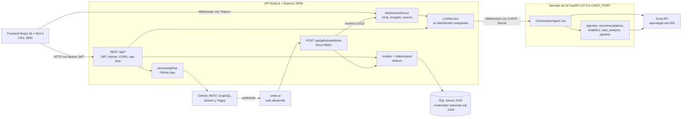

# Guía técnica de TaskMate

**En una frase:** la referencia técnica de TaskMate tal como está en el código al cierre del proyecto: arquitectura, carpetas, módulos, API, base de datos, variables, puertos, pruebas y convenciones.

## Resumen
- Tres procesos propios (React en `:3000`, API Express en `:9000`, servidor de IA FastAPI en `MCP_PORT`) más SQL Server 2019 en Docker.
- La API es la única que habla con la BD, con GitHub y con el servidor de IA, que llama a Groq (`openai/gpt-oss-20b`).
- 99 rutas REST, 3 WebSockets (`/chat`, `/insights`, `/events`) y 24 tablas (migraciones 001–008).
- Fases 1–4 hechas; proyecto cerrado el 3 nov 2026 con `master` en `56f7136` (merge del PR #5).
- 1960 pruebas en verde (5 nov 2026). Esta guía se escribió desde el código: si algo no coincide, manda el código.

**Limitaciones conocidas y TODO pendiente:** viven en un solo lugar, el [cierre del proyecto](../01-proyecto/cierre-del-proyecto.md#limitaciones-conocidas). Aquí solo se mencionan.

---

## 1. Qué es el proyecto

**TaskMate** es una plataforma colaborativa de gestión de proyectos con IA integrada. Un equipo crea grupos con roles, gestiona listas de tareas, ve las fechas en un calendario, organiza hitos en un diagrama (React Flow) cuyo avance se propaga solo, consulta analytics del equipo y chatea con un asistente de IA (Groq, modelo `openai/gpt-oss-20b`) que arma un plan de proyecto completo y lo guarda al confirmarlo.

Desde la Fase 3 el grupo conecta **su** repositorio de GitHub (GitHub App): explorador, rama por tarea, tarea completada al fusionar el PR y tareas propuestas por la IA a partir del repositorio. Desde la Fase 4 el grupo opera el **CI/CD de su repositorio** sin salir de TaskMate: pipeline propuesto por TaskMate o por la IA, ejecuciones y logs en vivo, ejecutar/re-ejecutar/cancelar, staging automático y producción con aprobación del admin en GitHub Pages, rollback y notificaciones.

| Fase | Estado | Integración en `master` |
|---|---|---|
| 1 · Entornos, repositorio y CI inicial | ✅ Hecha (el «CI» son scripts de prueba locales; el repo de TaskMate no tiene workflow propio) | PR #2 (`7e1610f`) |
| 2 · Optimización del rendimiento | ✅ Hecha (las mejoras son **estimaciones, no mediciones**) | PR #2 (`7e1610f`) |
| 3 · Integración con GitHub (GitHub App) | ✅ Hecha | PR #4 (`183f1cb`) |
| 4 · Pipeline CI/CD gestionado desde TaskMate | ✅ Hecha (22 oct 2026) | PR #5 (`56f7136`) |
| 5 · Testing automático por tarea | No se realizará (proyecto cerrado el 3 nov 2026) | — |
| 6 · SonarQube | Cancelada en la etapa de plan (SonarQube Cloud, sin código) | — |
| 7 · Algoritmo de colisión de archivos (con Christian Martínez) | No se realizará (proyecto cerrado el 3 nov 2026) | — |
| 8 · Pruebas finales | No se realizará (proyecto cerrado el 3 nov 2026) | — |

Fechas planificadas y reales: [calendarización](../01-proyecto/calendarizacion.md) y [capítulos de las fases](../08-fases/README.md).

**Monorepo** `proyecto-is-cc6` con un workspace npm, `taskmate-api`.

### Stack (versiones instaladas)
| Capa | Tecnología |
|---|---|
| Frontend | React 18.3, MUI 6.1, React Flow 12.3 (`@xyflow/react`), react-big-calendar 1.15, react-router-dom 6.30, react-markdown 10 con rehype-sanitize 6; Create React App (react-scripts 5.0.1) |
| API | Node.js (desarrollada con Node 24), Express 4.22, tedious 18.6 (SQL Server), ws 8.21, helmet 8.3, express-rate-limit 8.7, jsonwebtoken 9, bcryptjs 2.4, node-cron 3 |
| Servidor de IA | Python 3.9+, FastAPI 0.128, uvicorn 0.39, websockets 15, groq 1.0 (modelo `openai/gpt-oss-20b`), pydantic 2.12 |
| Base de datos | SQL Server 2019 en Docker (`mcr.microsoft.com/mssql/server:2019-latest`) |
| Pruebas | Jest 30 + supertest 7 (API), Jest 27 de react-scripts + React Testing Library 13 (frontend), pytest 8.4 + pytest-asyncio 1.2 (IA) |

---

## 2. Arquitectura

Tres procesos propios más SQL Server en Docker. La API es el único que habla con la BD, con GitHub y con el servidor de IA; el servidor de IA no tiene acceso a la BD.



Puntos clave:
- **REST** para todo el CRUD. Todas las rutas piden JWT salvo registro, login, el callback de GitHub (lo autentica su `state` firmado) y el webhook (lo autentica la firma HMAC).
- **Tiempo real** solo en tres canales WebSocket: `/chat` (chat con IA), `/insights` (recomendaciones de asignación del dashboard) y `/events` (eventos de CI/CD: ejecuciones, jobs, deploys y solicitudes de producción). Los cambios de tareas, nodos y aristas **no** se difunden a otros clientes: se ven al recargar.
- **Servidor de IA propio**: FastAPI con un único WebSocket `/ws` y un protocolo JSON propio (`{sessionId, requestId, method, params}`). La carpeta se llama `mcp/` por el diseño inicial, pero **no** implementa el Model Context Protocol (no hay SDK de MCP, JSON-RPC ni `tools/list`).
- **Una sola instancia de la API**: guarda estado en memoria (sesiones de chat, planes pendientes, flujos de instalación de GitHub en `ttlStore`, contadores de `express-rate-limit`, suscripciones de `/events`).

Diagramas completos: [arquitectura](../02-arquitectura/00-general.md), y los de las Fases 3 y 4 en sus capítulos ([Fase 3](../08-fases/fase-03-integracion-github/README.md), [Fase 4](../08-fases/fase-04-pipeline-cicd/README.md)).

---

## 3. Estructura de carpetas

Archivos versionados (`git ls-files`), sin `node_modules`, `taskmate-api/mcp/venv/` ni los entregables PDF/DOCX sin versionar de la raíz.

```
proyecto-is-cc6/
├── package.json                  ← workspaces ["taskmate-api"]; scripts start, build, test, start:api
├── start.sh                      ← arranca Docker/SQL Server, el servidor de IA y la API (solo macOS)
├── .env.production               ← solo GENERATE_SOURCEMAP (no es secreto)
├── README.md                     ← inicio rápido
├── documentacion/                ← toda la documentación (índice en documentacion/README.md)
│   ├── 01-proyecto/              ← documento del proyecto, calendarización y cierre
│   ├── 02-arquitectura/ … 06-flujos/   ← arquitectura, BD, casos de uso, interfaz y flujos (páginas 00-* generales y una por módulo)
│   ├── 07-guias/                 ← primer arranque, uso, pruebas, Docker, GitHub App, CI/CD y esta guía
│   └── 08-fases/                 ← plantilla y un capítulo por fase (01–04)
├── public/                       ← index.html, manifest.json, robots.txt
├── src/                          ← Frontend React (CRA)
│   ├── App.js                    ← rutas (React.lazy + Suspense), ThemeProvider, GroupProvider, RealtimeProvider
│   ├── index.js · config.js      ← API_BASE / WS_BASE (REACT_APP_API_URL / REACT_APP_WS_URL)
│   ├── api/                      ← client.js (apiFetch, ApiError) · github.js (una función por ruta /api/github)
│   ├── components/
│   │   ├── Login, Register, HomePage, Navbar, GroupContext
│   │   ├── Recordatorios, ListaRecordatorios, BarraLateral, Dialogos, SeleccionarPersona   ← tareas
│   │   ├── CalendarView · BlockDiagram (hitos) · AnalyticsDashboard · ChatPage
│   │   ├── GroupsView, GroupRolesPanel, RoleForm, AssignRolesDialog, UserRolesChips
│   │   ├── flow/                 ← Flow, CustomNode, FloatingEdge, CustomConnectionLine, utils
│   │   ├── github/               ← GitHubPage, RepositoryPanel, RepoSelection, RepoExplorer, FileViewer,
│   │   │   │                       CommitList, TaskGitHubActions, BranchToastMessage, ChatProjectSelector,
│   │   │   │                       RepoPlanCard, useTaskLinks, githubUtils
│   │   │   └── cicd/             ← CicdPanel, PipelineCard, PipelineSetup, RunList, RunDetail, JobLog,
│   │   │                           DeployPanel, cicdUtils, useVisibleInterval
│   │   ├── realtime/             ← RealtimeContext (WS /events), CicdNotifications
│   │   ├── hooks/useGroupRoles.js
│   │   └── ui/                   ← Button, Card, TextField (design system)
│   ├── hooks/useWebSocket.js     ← reconexión exponencial 1 s → 30 s (5 intentos), heartbeat 30 s
│   ├── theme/                    ← ThemeProvider, theme.js, themeUtils, useTheme, globalStyles.css
│   ├── constants/                ← limits.js (límites de formularios = validación del servidor), ws.js (códigos de cierre)
│   └── utils/ids.js              ← comparación de GUID sin distinguir mayúsculas
└── taskmate-api/                 ← API Node.js + servidor de IA Python
    ├── server.js                 ← carga .env, valida JWT_SECRET, crea HTTP + WebSocketServer, pool, jobs
    ├── app.js                    ← createApp(): helmet, CORS, webhook (raw), express.json, routers, errores
    ├── controllers/  (13)        ← user, tasks, group, nodes, edges, complete, delete, usertask,
    │                               groupRoles, userGroupRoles, analytics, utils, github
    ├── models/       (14)        ← access, cicd, complete, delete, edges, github, group, groupRoles,
    │                               nodes, tasks, user, userGroup, userGroupRoles, usertask
    ├── helpers/                  ← pool.js, execQuery.js, transaction.js (withTransaction), tokens.js, errors.js (AppError)
    ├── middleware/               ← auth.middleware.js, groupAccess.js, rateLimit.js, cors.js, validate.js, errorHandler.js
    ├── services/                 ← WebSocketServer, SessionManager, UserSession, LLMService, ProjectService,
    │   │                           AnalyticsService, AnalyticsIntegration, AnalyticsBatchJob, analyticsContext, realtime
    │   └── github/   (19)        ← githubApp, oauth, installFlow, ttlStore, repoService, repoSnapshot, repoPlan,
    │                               branchName, branchService, pullRequestProcessor, syncService, webhookHandler,
    │                               webhookSignature, cicdEvents, pipelineSpec, pipelineService, pipelineAi,
    │                               actionsService, deployService
    ├── taskmate_tables.sql       ← esquema base (versión 0, 14 tablas)
    ├── migrations/               ← 001–008 (+ .down.sql), runner.js, run-migrations.sh, _schema_migrations.sql, _begin/_record.sql
    ├── Dockerfile · setup-db.sh  ← imagen SQL Server 2019 y arranque idempotente (BD, login sqladmin, esquema, migraciones)
    ├── jest.config.js · jest.db.config.js
    ├── start-mcp-server.sh       ← heredado: fija el puerto 8001 e ignora MCP_PORT; usar start.sh
    ├── .env.example              ← plantilla de variables (solo marcadores)
    ├── tests/                    ← Jest: raíz, api/, github/, integration/, db/ (*.dbtest.js), README.md
    └── mcp/                      ← servidor de IA (Python)
        ├── server.py             ← FastAPI, WebSocket /ws, X-MCP-Secret
        ├── llm_service.py        ← cliente AsyncGroq, errores tipados (LLM_TIMEOUT, LLM_RATE_LIMIT, …)
        ├── schemas.py            ← modelos pydantic de analyze_repository y propose_pipeline
        ├── agents/               ← orchestrator, recommendations_agent, analytics_agent, repo_analysis_agent, pipeline_agent
        ├── tests/                ← pytest (server, orchestrator, analytics, repo_analysis, pipeline, llm_service)
        └── requirements.txt · requirements-dev.txt · pytest.ini
```

No existen (las mencionaban versiones anteriores de esta guía): `helpers/getConnection.js`, `middleware/analytics-access.middleware.js`, `taskmate-api/utils/`, `taskmate-api/__tests__/`, `migrations/add_percentage_to_deletetask.sql`, `create_analytics_tables.sql`, `taskmate_triggers.sql`, `taskmate_edge_trigger.sql`, `src/context/`. Tampoco están instaladas `axios` (API) ni `google-generativeai` (Python).

---

## 4. Módulos principales por capa

### Frontend (`src/`)
| Módulo | Qué hace |
|---|---|
| `App.js` | 10 pantallas: `/`, `/register`, `/home`, `/tasks`, `/calendar`, `/block-diagram`, `/groups`, `/analytics`, `/chat`, `/github`. Redirecciones: `/` y `/register` → `/home` con sesión; `/flow` → `/block-diagram` y `/create-group` → `/groups` (direcciones antiguas, `/` sin sesión); `*` → `/home` o `/` |
| `GroupContext.jsx` | Grupo activo (`selectedGroupId`, `selectedGroupName`) compartido por todas las vistas |
| `api/client.js` | `apiFetch`: añade el Bearer, normaliza errores en `ApiError {status, code}`, emite `taskmate:unauthorized` en 401 |
| `api/github.js` | 31 funciones, una por ruta autenticada de `/api/github` |
| `Recordatorios.jsx` | Listas de tareas: crear, editar, completar (`POST /tasks/:tid/complete`), papelera (`POST /tasks/:tid/trash`), asignar, historial de completadas y papelera |
| `BlockDiagram.jsx` + `flow/` | Diagrama de hitos (React Flow `@xyflow/react` 12): nodos, aristas prerrequisito/progresor, % y completado |
| `CalendarView.jsx` | Calendario mensual (`react-big-calendar`) con tareas e hitos |
| `AnalyticsDashboard.jsx` | Panel solo para líderes (REST `dashboard/:gid`) y recomendaciones por WS `/insights` |
| `ChatPage.jsx` | Chat por WS `/chat`: plan de proyecto, selector de proyecto, análisis del repositorio |
| `github/GitHubPage.jsx` | Página `/github` con pestañas Repositorio, Archivos, Commits y CI/CD (`?tab=cicd`) |
| `github/cicd/*` | Pipeline (propuesta, vista previa, aplicar), ejecuciones, logs, anotaciones, entornos y solicitudes |
| `realtime/*` | Un WS `/events` por pestaña; refresco en vivo de CI/CD y avisos globales |
| `theme/` | Tema MUI: primario `#3b82f6`, secundario `#f59e0b`, éxito `#10b981`, error `#ef4444`; fuente Inter |

### API (`taskmate-api/`)
| Módulo | Qué hace |
|---|---|
| `app.js` | Monta helmet, CORS, el webhook con `express.raw` (antes de `express.json`), los routers y `notFoundHandler` / `errorHandler` |
| `middleware/auth.middleware.js` | Valida `Authorization: Bearer` (HS256, `typ: 'access'`) → `req.user = {userId, username}` |
| `middleware/groupAccess.js` | `requireGroupMember`, `requireGroupAdmin`, `requireResourceMember` (tarea, nodo, arista, rol…), `requireUuids`; lee el `gid` de params, query o body |
| `middleware/rateLimit.js` | `authLimiter` (10 / 15 min por IP), `apiLimiter` (300 / min por usuario) y `createLimiter` para límites por ruta |
| `helpers/pool.js` | Pool propio sobre tedious: mín. 2, máx. `DB_POOL_MAX` (10), espera de 10 s, `useUTC: false` |
| `helpers/execQuery.js` | `execReadCommand` / `execWriteCommand` con parámetros tipados |
| `helpers/transaction.js` | `withTransaction(fn, {retries: 2, lockTimeoutMs: 5000})`: reintenta en deadlock, `DB_BUSY` 503 si no se libera; clasificadores de errores SQL |
| `services/WebSocketServer.js` | Upgrade con token y Origin; `/chat`, `/insights`, `/events`; heartbeat 30 s; cierra con 4001 al vencer el token |
| `services/SessionManager.js` · `UserSession.js` | Sesión de chat por usuario (se conserva 1 h desconectada, historial de 100 mensajes); límites de 4000 caracteres y 20 mensajes/min |
| `services/LLMService.js` | Cliente WS único hacia Python con `X-MCP-Secret`; reconexión de 5 s a 5 min; enruta respuestas por `requestId` |
| `services/ProjectService.js` | Crea grupo, membresía, roles, tareas e hitos desde el plan de la IA en **una transacción**; también guarda en un grupo existente las tareas e hitos que la IA propone a partir del repositorio (Fase 3) |
| `services/Analytics*.js` · `analyticsContext.js` | Métricas, expertise y carga; hooks no bloqueantes; job batch opcional; contexto real del equipo para el agente |
| `services/realtime.js` | Hub de `/events`: suscripción por grupo con revalidación de membresía |
| `services/github/*` | GitHub App (JWT RS256 + tokens de instalación de 1 h), instalación/OAuth, explorador, ramas, PRs, webhooks, pipeline, Actions y deploys |

### Servidor de IA (`taskmate-api/mcp/`)
| Módulo | Qué hace |
|---|---|
| `server.py` | FastAPI, WebSocket `/ws`; rechaza con 403 sin `X-MCP-Secret` (mín. 32 caracteres) |
| `agents/orchestrator.py` | Métodos `handle_user_message`, `save_plan_result`, `analyze_repository`, `propose_pipeline` y mensajes `type: analytics` |
| `agents/recommendations_agent.py` | Genera el plan JSON del proyecto |
| `agents/analytics_agent.py` | Recomendaciones de asignación con el `team_context` real que envía Node |
| `agents/repo_analysis_agent.py` | Propone tareas e hitos a partir de un snapshot del repositorio (Fase 3) |
| `agents/pipeline_agent.py` | Elige valores del pipeline entre opciones detectadas; Node revalida y renderiza desde plantilla fija (Fase 4) |
| `llm_service.py` | Groq (`groq` 1.0, modelo `openai/gpt-oss-20b`, `LLM_REASONING_EFFORT=low`) |

### Base de datos
SQL Server 2019 en el contenedor `taskmate-sql` (imagen de `taskmate-api/Dockerfile`). Detalle en la [sección 6](#6-base-de-datos).

---

## 5. Referencia de la API

### Autenticación
- **Registro** `POST /api/users`: bcrypt, crea usuario + grupo personal + membresía en una transacción.
- **Login** `POST /api/users/login`: JWT HS256 de 24 h con `userId`, `username` y `typ: 'access'`. El frontend lo guarda en `localStorage` (`token` y `user`).
- **REST**: `Authorization: Bearer <token>`. El usuario que actúa siempre sale del token; un `uid` en el body o el query es siempre el usuario **objetivo** (por ejemplo, a quién se asigna).
- **WebSocket**: `ws://<host>:9000/<canal>?token=<JWT>`; se valida también el `Origin` (`FRONTEND_URL`).
- **Errores**: `{success: false, error, code}` con un `code` estable (`VALIDATION_ERROR`, `NOT_GROUP_MEMBER`, `NOT_GROUP_ADMIN`, `RATE_LIMITED`, `DB_BUSY`, `GITHUB_NOT_CONFIGURED`, …).

### Niveles de acceso
| Nivel | Significado |
|---|---|
| **Público** | Sin token |
| **Auth** | JWT válido |
| **Miembro** | Miembro del grupo indicado, o del grupo dueño del recurso (tarea, nodo, arista, rol) |
| **Admin** | El admin del grupo (`Groups.adminId`) |
| **Líder** | El admin, o un miembro con un rol cuyo nombre contiene «leader» (`access.model.isGroupLeader`) |
| **Propio** | Solo el mismo usuario del `:userId` |

Todas las rutas salvo las públicas pasan por `requireAuth` + `apiLimiter`. **Sin UI** = ninguna pantalla la llama (20 rutas; quedan para la API y las pruebas).

### 99 rutas REST

**`/api/users`** (3)
| Método | Ruta | Acceso | Qué hace |
|---|---|---|---|
| POST | `/api/users` | Público (`authLimiter`) | Registro |
| POST | `/api/users/login` | Público (`authLimiter`) | Login → `{uid, token}` |
| GET | `/api/users/getuid?username=` | Auth | UID por nombre de usuario (para agregar miembros) |

**`/api/tasks`** (8)
| Método | Ruta | Acceso | Qué hace |
|---|---|---|---|
| GET | `/api/tasks?gid=` | Miembro | Tareas del grupo, la más antigua primero (`createdAt`, migración 008) |
| GET | `/api/tasks/:id` | Miembro | Una tarea · Sin UI |
| POST | `/api/tasks` | Miembro | Crear tarea |
| PUT | `/api/tasks/:id` | Miembro | Editar tarea (no cambia de grupo) |
| PUT | `/api/tasks/nodes/:id` | Miembro (tarea o nodo) | Edición reducida desde el diagrama de hitos |
| POST | `/api/tasks/:tid/complete` | Miembro | Completar de forma atómica (pasa a `Complete`, cierra analytics, limpia la rama de GitHub) |
| POST | `/api/tasks/:tid/trash` | Miembro | Mandar a la papelera de forma atómica (`DeleteTask` + borrado) |
| DELETE | `/api/tasks/list/:gid/:list` | Miembro | Borrar una lista completa |

**`/api/groups`** (8)
| Método | Ruta | Acceso | Qué hace |
|---|---|---|---|
| POST | `/api/groups/group` | Auth | Crear grupo (el admin es quien llama) |
| GET | `/api/groups/:gid/members` | Miembro | Miembros |
| GET | `/api/groups/user-groups` | Auth | Grupos del usuario del token (el `?uid=` se ignora) |
| GET | `/api/groups/:gid/roles` | Miembro | Roles del grupo (duplica `/api/grouproles/...`) · Sin UI |
| POST | `/api/groups/join` | Admin | Agregar a otro usuario al grupo |
| DELETE | `/api/groups/remove-member` | Admin | Quitar a un miembro |
| DELETE | `/api/groups/leave` | Miembro | Salir del grupo (si sale el admin, lo sucede el miembro más antiguo; si sale el último, se borra el grupo) |
| DELETE | `/api/groups/delete` | Admin | Borrar el grupo en cascada |

**`/api/nodes`** — hitos del diagrama (9)
| Método | Ruta | Acceso | Qué hace |
|---|---|---|---|
| GET | `/api/nodes/tasks/:gid` | Miembro | Nodos + tareas del grupo (calendario) |
| GET | `/api/nodes/:id` | Miembro | Un nodo · Sin UI |
| GET | `/api/nodes/group/:gid` | Miembro | Nodos del grupo |
| POST | `/api/nodes` | Miembro | Crear nodo (`nid` opcional, no puede ser una tarea de otro grupo) |
| PUT | `/api/nodes/:id` | Miembro | Editar nombre, descripción y fecha |
| PUT | `/api/nodes/:id/coords` | Miembro | Mover |
| PUT | `/api/nodes/:id/percentage` | Miembro | Cambiar % (dispara el trigger de propagación) |
| PUT | `/api/nodes/:id/toggleComplete` | Miembro | Marcar o desmarcar completado |
| DELETE | `/api/nodes/:id` | Miembro | Borrar el nodo y sus aristas |

**`/api/edges`** — aristas (6)
| Método | Ruta | Acceso | Qué hace |
|---|---|---|---|
| POST | `/api/edges` | Miembro | Crear arista (`prerequisite` 1 por defecto) |
| GET | `/api/edges/group/:gid` | Miembro | Aristas del grupo |
| GET | `/api/edges/:eid` | Miembro | Una arista · Sin UI |
| PUT | `/api/edges/:eid` | Miembro | Cambiar prerrequisito (1) ↔ progresor (0) (dispara trigger) |
| DELETE | `/api/edges/source/:id` | Miembro | Borrar las aristas que salen de un nodo |
| DELETE | `/api/edges/:eid` | Miembro | Borrar una arista |

**`/api/completados` y `/api/delete`** — historiales (2 + 2)
| Método | Ruta | Acceso | Qué hace |
|---|---|---|---|
| GET | `/api/completados/:gid` | Miembro | Tareas completadas, en el mismo orden (`createdAt`) |
| DELETE | `/api/completados/:gid` | Miembro | Vaciar el historial (cualquier miembro puede) |
| GET | `/api/delete/:gid` | Miembro | Papelera, en el mismo orden (`createdAt`) |
| DELETE | `/api/delete/:gid` | Miembro | Vaciar la papelera (cualquier miembro puede) |

**`/api/usertask`** — asignaciones (3)
| Método | Ruta | Acceso | Qué hace |
|---|---|---|---|
| POST | `/api/usertask` | Miembro (grupo de la tarea) | Asignar (idempotente) + hook de analytics |
| DELETE | `/api/usertask?tid=&uid=` | Miembro (grupo de la tarea) | Desasignar (cierra el hecho como `reassigned`) |
| GET | `/api/usertask?tid=` | Miembro (grupo de la tarea) | Asignados de una tarea |

**`/api/grouproles`** (4)
| Método | Ruta | Acceso | Qué hace |
|---|---|---|---|
| GET | `/api/grouproles/groups/:gid/roles` | Miembro | Listar roles |
| POST | `/api/grouproles/groups/:gid/roles` | Admin | Crear rol (nombre único por grupo, color, icono) |
| PUT | `/api/grouproles/groups/:gid/roles/:gr_id` | Admin | Editar rol |
| DELETE | `/api/grouproles/groups/:gid/roles/:gr_id` | Admin | Borrar rol |

**`/api/usergrouproles`** (9, todas bajo `/api/usergrouproles/groups/:gid`)
| Método | Ruta | Acceso | Qué hace |
|---|---|---|---|
| GET | `…/userroles` | Miembro | Todas las asignaciones de roles · Sin UI |
| POST | `…/userroles` | Admin | Asignar un rol a un miembro |
| DELETE | `…/userroles/:ugr_id` | Admin | Quitar una asignación por id · Sin UI |
| DELETE | `…/userroles` (body `uid`, `gr_id`) | Admin | Quitar una asignación por claves |
| GET | `…/users/:uid/roles` | Miembro | Ids de roles de un miembro |
| GET | `…/roles/:gr_id/users` | Miembro | Miembros con un rol · Sin UI |
| GET | `…/users/:uid/roles/:gr_id` | Miembro | ¿Tiene ese rol? · Sin UI |
| GET | `…/roles/:gr_id/count` | Miembro | Cuántos tienen el rol · Sin UI |
| GET | `…/rolesmatrix` | Miembro | Matriz usuario × rol |

**`/api/analytics`** (11)
| Método | Ruta | Acceso | Qué hace |
|---|---|---|---|
| GET | `/api/analytics/user/:userId` | Propio, o Líder con `?groupId=` | Resumen individual (de otro miembro, solo el de ese grupo) · Sin UI |
| GET | `/api/analytics/team/:groupId` | Líder | Resumen del equipo · Sin UI |
| GET | `/api/analytics/workload/:groupId` | Líder | Distribución de carga · Sin UI |
| GET | `/api/analytics/trends/:userId?days=` | Propio | Tendencias de compleción (1–365 días, 30 por defecto) · Sin UI |
| GET | `/api/analytics/expertise/:groupId` | Líder | Ranking de expertise por categoría · Sin UI |
| GET | `/api/analytics/config/:groupId` | Líder | Config guardada en `dbo.AnalyticsConfig` (o valores por defecto) · Sin UI |
| PUT | `/api/analytics/config/:groupId` | Líder | Guardar config (MERGE; hoy no cambia el comportamiento) · Sin UI |
| GET | `/api/analytics/dashboard/:groupId` | Líder | Datos del panel (400 si el id no es UUID, 500 si falla la BD; sin mock) |
| POST | `/api/analytics/recommendations` | Miembro (10 / min) | Recomendaciones de asignación vía el agente de IA · Sin UI |
| POST | `/api/analytics/assignment` | Miembro | Registrar una asignación en `TaskAnalytics` · Sin UI |
| POST | `/api/analytics/completion` | Miembro | Registrar una compleción · Sin UI |

**`/api/utils`** (1)
| Método | Ruta | Acceso | Qué hace |
|---|---|---|---|
| POST | `/api/utils/populate-assignments/:groupId` | Admin | Siembra asignaciones aleatorias de demo para analytics · Sin UI |

**`/api/github`** — Fase 3 (13 autenticadas)
| Método | Ruta | Acceso | Qué hace |
|---|---|---|---|
| POST | `/api/github/groups/:gid/install` | Admin (10 / min) | URLs para instalar o autorizar la GitHub App |
| GET | `/api/github/selections/:id` | Auth (solo quien inició la instalación) | Repositorios elegibles tras el callback |
| POST | `/api/github/groups/:gid/repository` | Admin (10 / min) | Vincular el repositorio elegido |
| GET | `/api/github/groups/:gid/repository` | Miembro | Repositorio vinculado |
| DELETE | `/api/github/groups/:gid/repository` | Admin | Desvincular |
| PUT | `/api/github/groups/:gid/ai-analysis` | Admin | Permitir o no el análisis del repositorio con IA |
| GET | `/api/github/groups/:gid/tree?ref=` | Miembro (60 / min, 600 / h) | Árbol de archivos |
| GET | `/api/github/groups/:gid/file?path=&ref=` | Miembro (60 / min, 600 / h) | Un archivo |
| GET | `/api/github/groups/:gid/readme?ref=` | Miembro (60 / min, 600 / h) | README |
| GET | `/api/github/groups/:gid/commits?ref=&perPage=` | Miembro (60 / min, 600 / h) | Commits recientes |
| POST | `/api/github/tasks/:tid/branch` | Miembro (grupo de la tarea, 20 / min) | Crear la rama de la tarea (`tm/<slug>-<tid8>`) |
| GET | `/api/github/groups/:gid/task-links` | Miembro | Ramas y PRs por tarea |
| POST | `/api/github/groups/:gid/sync` | Miembro (1 cada 30 s) | Reconciliar PRs con GitHub |

**`/api/github`** — Fase 4, CI/CD (18 autenticadas)
| Método | Ruta | Acceso | Qué hace |
|---|---|---|---|
| GET | `/api/github/groups/:gid/pipeline` | Miembro | Pipeline guardado, estado del workflow en la rama por defecto y estado de Pages |
| POST | `/api/github/groups/:gid/pipeline/proposal` | Admin (10 / min) | Propuesta del pipeline (determinista o con IA) |
| POST | `/api/github/groups/:gid/pipeline/preview` | Admin (60 / min) | Vista previa del YAML |
| PUT | `/api/github/groups/:gid/pipeline` | Admin (10 / min) | Aplicar: commit del workflow y activación de Pages |
| GET | `/api/github/groups/:gid/actions/workflows` | Miembro | Workflows del repositorio |
| GET | `/api/github/groups/:gid/actions/runs?branch=&status=&workflow=&page=` | Miembro | Ejecuciones con filtros |
| GET | `/api/github/groups/:gid/actions/runs/:runId` | Miembro | Detalle de una ejecución y sus jobs |
| GET | `/api/github/groups/:gid/actions/jobs/:jobId/logs` | Miembro | Log de un job |
| GET | `/api/github/groups/:gid/actions/jobs/:jobId/annotations` | Miembro | Anotaciones (archivo y línea) |
| POST | `/api/github/groups/:gid/actions/runs` | Miembro (10 / min) | Ejecutar el CI en una rama (`ref`) |
| POST | `/api/github/groups/:gid/actions/runs/:runId/rerun-failed` | Miembro; Admin si es un deploy (10 / min) | Re-ejecutar los jobs fallidos |
| POST | `/api/github/groups/:gid/actions/runs/:runId/cancel` | Miembro; Admin si es un deploy (10 / min) | Cancelar |
| GET | `/api/github/groups/:gid/deployments` | Miembro | Entornos y su historial |
| POST | `/api/github/groups/:gid/deployments` | Admin (10 / min) | Desplegar ya, o rollback, una versión que pasó el CI |
| POST | `/api/github/groups/:gid/deploy-requests` | Miembro (10 / min) | Solicitar producción |
| POST | `/api/github/groups/:gid/deploy-requests/:requestId/approve` | Admin (10 / min) | Aprobar (TaskMate lanza el deploy) |
| POST | `/api/github/groups/:gid/deploy-requests/:requestId/reject` | Admin (10 / min) | Rechazar con nota |
| POST | `/api/github/groups/:gid/deploy-requests/:requestId/cancel` | Miembro (solo el solicitante) | Retirar la solicitud propia |

**`/api/github`** — sin Bearer (2)
| Método | Ruta | Acceso | Qué hace |
|---|---|---|---|
| GET | `/api/github/callback` | Público (`state` firmado de un solo uso, 30 / min por IP) | Vuelta de GitHub tras instalar o autorizar; redirige a `FRONTEND_URL/github` |
| POST | `/api/github/webhook` | Firma HMAC (`GITHUB_WEBHOOK_SECRET`), cuerpo crudo de hasta 1 MB | Recibe `installation`, `installation_repositories`, `pull_request`, `workflow_run`, `workflow_job`, `deployment_status` y `ping`; idempotente por id de entrega y hash del payload |

Conteo: users 3 · tasks 8 · groups 8 · nodes 9 · edges 6 · completados 2 · delete 2 · usertask 3 · grouproles 4 · usergrouproles 9 · analytics 11 · utils 1 · github 31 + callback + webhook = **99**.

### 3 WebSockets (en el puerto de la API)
| Canal | Acceso | Mensajes del cliente | Mensajes del servidor |
|---|---|---|---|
| `/chat?token=` | Auth | `user`, `ping`, `analytics`, `set_context`, `repo_analysis`, `repo_plan_confirm`, `repo_plan_discard` | `assistant`, `system` (p. ej. `project_created`), `history_restore`, `context`, `repo_analysis_status`, `repo_plan`, `repo_plan_saved`, `repo_plan_discarded`, `error`, `pong` |
| `/insights?token=` | Auth; acciones de equipo solo para Líder | `ping`, `analytics` (lista blanca de acciones; 10 / min) | `analytics_response`, `analytics_error`, `pong` |
| `/events?token=` | Auth; solo recibe eventos de grupos donde es miembro | `ping`, `subscribe` (lista de grupos; 20 / min, máx. 10 sockets por usuario) | `subscribed`, `event` con `ci_run`, `ci_job`, `deployment` o `deploy_request`, `pong` |

Rechazos del handshake: sin token o token inválido → 401; `Origin` no permitido → 403; ruta desconocida → 404. Mensajes de más de 64 KB cierran con 1009.

### Protocolo Node ↔ Python (`ws://127.0.0.1:MCP_PORT/ws`, cabecera `X-MCP-Secret`)
`handle_user_message` (chat y plan; responde `response` o `save_plan`), `save_plan_result`, `analyze_repository`, `propose_pipeline` y `type: analytics` con las acciones del AnalyticsAgent. Node corta la espera del chat y del análisis del repositorio a los 90 s (`LLM_TIMEOUT`).

Más detalle por fase: tablas de rutas en los capítulos de la [Fase 3](../08-fases/fase-03-integracion-github/README.md) y de la [Fase 4](../08-fases/fase-04-pipeline-cicd/README.md) (sección «API (rutas)»).

---

## 6. Base de datos

**24 tablas** = 14 del esquema base (`taskmate_tables.sql`) + `AnalyticsConfig` (001) + 6 de GitHub (002) + 2 de CI/CD (007) + `SchemaMigrations`.

| Grupo | Tablas |
|---|---|
| Núcleo | `Users`, `Groups`, `UserGroups` (con `joined_at`), `Tasks`, `UserTask`, `Nodes`, `Edges`, `Complete`, `DeleteTask`, `GroupRoles`, `UserGroupRoles` |
| Analytics | `TaskAnalytics` (tabla de hechos: `pending`, `completed`, `failed`, `reassigned`), `UserMetrics`, `UserExpertise`, `AnalyticsConfig` |
| GitHub (Fase 3) | `GitHubInstallations`, `GitHubRepositories`, `GroupRepositories`, `TaskBranches`, `PullRequests`, `GitHubWebhookDeliveries` |
| CI/CD (Fase 4) | `RepoPipelines` (un pipeline por repositorio, `spec` JSON), `DeployRequests` (máx. una pendiente por grupo y entorno) |
| Control | `SchemaMigrations` |

| Migración | Qué hace |
|---|---|
| `001_schema_fixes` | Índice en cada FK, UNIQUE que faltaban, FKs compuestas que mantienen el `gid` coherente, `TaskAnalytics` como historial, `AnalyticsConfig` |
| `002_github` | Tablas de GitHub (los tokens de instalación nunca se guardan) |
| `003_triggers` | Primera versión versionada de los triggers de progreso (reemplazada por la 006) |
| `004_repair_group_admins` | Corrección única de grupos cuyo admin ya no es miembro |
| `005_unicode_membership_github` | Texto de usuario VARCHAR → NVARCHAR, `UserGroups.joined_at`, sucesión de admin por antigüedad |
| `006_bfs_progress_triggers` | Triggers en anchura (BFS) |
| `007_cicd` | `RepoPipelines` y `DeployRequests` |

**Triggers** (006): `UpdateTargetNodePercentage` (Nodes, AFTER UPDATE) pone en cada nodo destino el promedio redondeado del % de sus fuentes por aristas progresor (`prerequisite = 0`) y propaga hasta 20 niveles con conjunto de visitados; `UpdateTargetOnPrerequisiteChange` (Edges, AFTER UPDATE) recalcula el destino cuando una arista cambia de tipo (0 si ya no le quedan fuentes progresor).

**Login de mínimo privilegio**: la API usa `sqladmin` (solo `db_datareader` + `db_datawriter`); las migraciones usan otro login (`MIGRATION_DB_USERNAME`, `sa` en Docker). Montaje del contenedor: [SQL Server en Docker](base-de-datos-docker.md). ERD completo: [base de datos](../03-base-de-datos/00-general.md); diseño (3FN, transacciones): [seguridad y BD de la Fase 3](../08-fases/fase-03-integracion-github/SEGURIDAD-Y-BASE-DE-DATOS.md).

---

## 7. Variables de entorno

**Una sola ubicación soportada: la `.env` de la raíz del repositorio.** `start.sh` lanza la API desde la raíz, y `server.js` y `helpers/pool.js` cargan esa `.env`; `taskmate-api/.env` solo se lee si la API se arranca desde `taskmate-api/` (`npm run start:api`). Python carga `mcp/.env`, `taskmate-api/.env` y la raíz, sin pisar lo ya definido. Plantilla con marcadores: [taskmate-api/.env.example](../../taskmate-api/.env.example). Nunca se versionan valores reales.

### API (Node)
| Variable | Obligatoria | Por defecto / nota |
|---|---|---|
| `JWT_SECRET` | Sí | ≥ 32 caracteres aleatorios; la API no arranca con valores cortos o de ejemplo |
| `DB_SERVER`, `DB_NAME`, `DB_USERNAME`, `DB_PASSWORD` | Sí | `DB_USERNAME=sqladmin` en Docker; nunca `sa` |
| `MCP_SHARED_SECRET` | Sí | El mismo valor en Node y Python (≥ 32 caracteres) |
| `LLM_WEBSOCKET_URL` | No | `ws://localhost:8001/ws`; debe usar el mismo puerto que `MCP_PORT` |
| `API_PORT` | No | 9000 |
| `FRONTEND_URL` | No | `http://localhost:3000`; orígenes separados por comas (CORS, WebSocket y redirección del callback) |
| `DB_PORT`, `DB_AUTH_TYPE`, `DB_INSTANCE`, `DB_ENCRYPT`, `DB_TRUST_SERVER_CERT` | No | `default`; en localhost: sin cifrado y certificado de confianza |
| `DB_POOL_MAX` | No | 10 |
| `MIGRATION_DB_USERNAME`, `MIGRATION_DB_PASSWORD` | Para `npm run db:migrate` | Login con permisos DDL |
| `AUTH_RATE_LIMIT_MAX`, `API_RATE_LIMIT_MAX`, `TRUST_PROXY` | No | 10, 300, vacío (sin proxy) |
| `LLM_CONNECT_TIMEOUT_MS` | No | 5000 |
| `ANALYTICS_ENABLED` | No | Activado salvo `false` |
| `ANALYTICS_BATCH_ENABLED`, `ANALYTICS_BATCH_SCHEDULE`, `TZ` | No | `false`, `0 2 * * *`, `UTC` |
| `GITHUB_APP_ID`, `GITHUB_APP_SLUG`, `GITHUB_APP_CLIENT_ID`, `GITHUB_APP_CLIENT_SECRET`, `GITHUB_APP_PRIVATE_KEY` (PEM en base64), `GITHUB_WEBHOOK_SECRET` | Solo para las Fases 3–4 | Sin ellas las rutas de GitHub responden 503 `GITHUB_NOT_CONFIGURED` |
| `GITHUB_APP_CALLBACK_URL`, `GITHUB_INSTALLATION_HOURLY_BUDGET`, `WEBHOOK_DELIVERY_RETENTION_DAYS` | No | vacío, 4000 / h, 90 días (mín. 30) |

### Servidor de IA (Python)
| Variable | Obligatoria | Por defecto / nota |
|---|---|---|
| `GROQ_API_KEY` (alias `LLM_API_KEY`) | Sí | Clave de Groq |
| `MCP_SHARED_SECRET` | Sí | `MCP_ALLOW_NO_SECRET=1` solo en pruebas |
| `MCP_HOST`, `MCP_PORT` | No | `127.0.0.1`, 8001 |
| `LLM_MODEL`, `REPO_ANALYSIS_MODEL` | No | `openai/gpt-oss-20b` (el segundo hereda el primero) |
| `LLM_REASONING_EFFORT`, `LLM_TEMPERATURE`, `LLM_TIMEOUT_SEC`, `LLM_MAX_RETRIES` | No | `low`, 0.7, 60, 2 |
| `LLM_MAX_TOKENS_CHAT`, `LLM_MAX_TOKENS_PLAN` | No | 1000, 8192 |
| `MCP_LOG_LEVEL`, `MCP_SESSION_TTL_SEC`, `MCP_MAX_SESSIONS`, `MCP_PENDING_SAVE_TTL_SEC`, `MCP_MAX_MESSAGE_CHARS` | No | `INFO`, 7200, 1000, 60, 1 MiB |
| `REPO_ANALYSIS_TIMEOUT_SEC`, `REPO_ANALYSIS_DEADLINE_SEC`, `REPO_ANALYSIS_QUEUE_TIMEOUT_SEC` | No | 35, 80, 20 |
| `PIPELINE_AGENT_TIMEOUT_SEC`, `PIPELINE_AGENT_DEADLINE_SEC`, `PIPELINE_AGENT_QUEUE_TIMEOUT_SEC` | No | 25 (tope 30), 50, 15 |

### Frontend, contenedor y pruebas de BD
| Variable | Dónde | Nota |
|---|---|---|
| `REACT_APP_API_URL`, `REACT_APP_WS_URL` | `.env` de la raíz | `http://localhost:9000` y `ws://localhost:9000`; CRA las lee al iniciar o compilar |
| `ACCEPT_EULA`, `SA_PASSWORD`, `DB_PASSWORD` | `docker run` del contenedor | `DB_PASSWORD` debe coincidir con la `.env` |
| `TEST_DB_SERVER`, `TEST_DB_PORT`, `TEST_DB_NAME`, `TEST_DB_USERNAME`, `TEST_DB_PASSWORD`, más `TEST_DB_SA_PASSWORD` (o `TEST_DB_MIGRATION_USERNAME` / `TEST_DB_MIGRATION_PASSWORD`) para las migraciones (o todo en el archivo de `TEST_DB_ENV_FILE`) | `npm run test:db` | Solo un SQL Server **desechable**; nunca `DB_*`. Van en la terminal o en un archivo fuera del repositorio, nunca en la `.env` |

`start.sh` toma `API_PORT`, `MCP_PORT` y `LLM_WEBSOCKET_URL` de la terminal o, si no están, de la `.env` de la raíz. Avisa si el puerto de `LLM_WEBSOCKET_URL` no es `MCP_PORT` y si falta `MCP_SHARED_SECRET`.

---

## 8. Puertos

| Puerto | Servicio | Nota |
|---|---|---|
| 3000 | Frontend (`npm start`) | Origen permitido por defecto (`FRONTEND_URL`) |
| 9000 | API REST + WebSockets `/chat`, `/insights`, `/events` (`API_PORT`) | El webhook de GitHub llega a `:9000/api/github/webhook` vía smee en desarrollo |
| `MCP_PORT` (8001 por defecto) | Servidor de IA, solo `127.0.0.1`, ruta `/ws` | En la máquina de desarrollo se usa 8011 porque 8001 estaba ocupado; `LLM_WEBSOCKET_URL` debe usar el mismo puerto. Exige `X-MCP-Secret` y rechaza toda conexión con cabecera `Origin` (navegadores) |
| 1433 | SQL Server en Docker (`taskmate-sql`) | El `docker run` de las guías lo publica solo en `127.0.0.1` |
| 14333 (sugerido) | BD de prueba desechable (`taskmate-sql-test`) | Solo para `npm run test:db` ([SQL Server en Docker, §6](base-de-datos-docker.md#6-bd-desechable-para-pruebas)) |

---

## 9. Cómo correr y probar

### Primera vez
Paso a paso, con cómo obtener cada secreto: [primer arranque](primer-arranque.md).
```bash
cd proyecto-is-cc6
npm install                                   # instala también el workspace taskmate-api
cd taskmate-api/mcp && python3 -m venv venv \
  && ./venv/bin/pip install -r requirements-dev.txt && cd ../..   # incluye requirements.txt
cp taskmate-api/.env.example .env             # y completar los marcadores (secretos con openssl rand)
# SQL Server: construir la imagen y crear el contenedor taskmate-sql → base-de-datos-docker.md §1–2
```
Una imagen construida antes de la migración 007 no trae las tablas de CI/CD, y una de antes de la 008 no trae `Tasks.created_at` (`/api/tasks` responde 500): reconstruirla o correr `cd taskmate-api && npm run db:migrate` (con `MIGRATION_DB_*`); `node migrations/runner.js status` debe listar 001–008.

### Día a día
```bash
./start.sh       # Docker + taskmate-sql, servidor de IA en MCP_PORT y API en API_PORT (logs en /tmp/taskmate-*.log)
npm start        # frontend en :3000 (otra terminal)
npx smee-client --url https://smee.io/<canal> --target http://localhost:9000/api/github/webhook   # solo con GitHub
```
`start.sh` es el lanzador soportado (solo macOS; usa `open -a Docker`, `lsof` y `nc`) y siempre imprime «Todo listo»: si algo no responde, revisar `/tmp/taskmate-mcp.log` y `/tmp/taskmate-backend.log`. `taskmate-api/start-mcp-server.sh` fija el puerto 8001 y no sirve si `MCP_PORT` es otro.

### Pruebas (estado verificado el 5 nov 2026)
Cómo correr cada suite y dónde vive cada prueba: [pruebas](pruebas.md).

| Capa | Comando | Resultado |
|---|---|---|
| API (Jest) | `cd taskmate-api && npm test` | 1246/1246, 46 suites (10 pruebas de rendimiento e integración retornan sin afirmar nada si no hay `NODE_ENV=integration-test`) |
| Frontend (CRA) | `CI=true npm test -- --watchAll=false` | 423/423, 33 suites |
| Python (pytest) | `cd taskmate-api/mcp && ./venv/bin/python -m pytest` | 177/177 |
| BD real | `cd taskmate-api && npm run test:db` (con `TEST_DB_*`) | 114/114, 9 suites, en un contenedor SQL Server desechable |
| Rendimiento | `cd taskmate-api && npm run test:performance` | Requiere SQL Server real |
| Lint | `npx eslint src --ext .js,.jsx` | 0 problemas |
| Build | `npm run build` | Compila |

**Total: 1960 pruebas**, frente a 1353 al cerrar la Fase 3 (antes de la Fase 4). Además, con la app corriendo: 0 respuestas HTTP 5xx en 50 llamadas GET de solo lectura, y un smoke test de UI con Chrome headless (3 nov 2026) renderizó las rutas de `src/App.js` como admin y como miembro sin excepciones no capturadas. Las correcciones de rutas de ese mismo día (`/register`, `/flow`, `/create-group`) las cubren las 5 pruebas de `src/__tests__/AppLegacyRoutes.test.jsx`. El repositorio de TaskMate no tiene CI propio: el CI/CD de la Fase 4 corre en el repositorio de cada grupo.

---

## 10. Convenciones

- **Errores**: lanzar `AppError(code, message, status)` (`helpers/errors.js`); `sendError` responde `{success: false, error, code}` y nunca reenvía texto del driver (los errores no previstos son 500 `INTERNAL_ERROR`). `mapConstraintError` convierte UNIQUE → 409 y FK → 400. El `code` es el contrato: la UI muestra **mensajes en español** a partir de él (`ERROR_MESSAGES` en `src/components/github/githubUtils.js`, `CHAT_ERROR_MESSAGES` en `ChatPage.jsx`, `ERROR_MESSAGES` en `UserSession.js`), y los errores de Python solo llegan como códigos conocidos (`LLM_TIMEOUT`, `LLM_RATE_LIMIT`, …).
- **Validación**: `middleware/validate.js` y `src/constants/limits.js` reflejan las columnas (25 caracteres para nombres de tarea, lista, grupo y nodo; 1000 para descripciones); la entrada inválida es 400 `VALIDATION_ERROR`, no un error del driver.
- **Autorización**: la identidad sale siempre del token; usar los guards de `groupAccess.js` en cada ruta nueva.
- **SQL**: siempre `execReadCommand` / `execWriteCommand` con parámetros tipados (`{name, type: TYPES.*, value}`); nunca abrir conexiones a mano (solo `pool.js` crea `Connection`).
- **Transacciones**: toda operación de varios pasos va en `withTransaction` / `useTransaction` (`helpers/transaction.js`): registro; crear, abandonar o borrar un grupo; completar, mandar a la papelera o borrar una lista de tareas; crear el proyecto desde el plan; vincular un repositorio; aplicar un PR fusionado; solicitudes de deploy. Reintenta en deadlock y responde `DB_BUSY` 503 si el bloqueo no se libera en 5 s. Los modelos aceptan `{tx}` para sumarse a una transacción abierta.
- **Migraciones**: archivo `NNN_nombre.sql` idempotente con su `NNN_nombre.down.sql`; cada una corre en una transacción junto con su fila en `dbo.SchemaMigrations`. Se aplican con `npm run db:migrate` (`runner.js up|down|status`) o al crear el contenedor (`setup-db.sh`). Nunca editar una migración ya aplicada: agregar otra.
- **Analytics no bloqueante**: los hooks de `AnalyticsIntegration` corren después de responder y tienen `.catch()`.
- **IDs**: los GUID llegan en mayúsculas de SQL Server y en minúsculas de `uuid()`; comparar con `sameId` (`src/utils/ids.js`, `middleware/groupAccess.js`).
- **Pruebas**: cada cambio trae su prueba en la capa que toca (Jest en `taskmate-api/tests/{api,github,db}`, React Testing Library junto al componente en `__tests__/`, pytest en `mcp/tests`). Las pruebas de BD solo contra un SQL Server desechable (`TEST_DB_*`), nunca la BD de desarrollo.
- **Commits**: Conventional Commits en inglés (`feat(cicd): …`, `fix(db): …`); el texto que ve el usuario va en español.

---

## 11. Estado al cierre

Estado, al 3 nov 2026, de los problemas que listaban las versiones anteriores de esta guía (marzo y septiembre de 2026), verificado contra el código de `master` (`56f7136`).

| # | Problema anterior | Estado | Evidencia |
|---|---|---|---|
| 1 | La config de analytics no persistía | **CORREGIDO** · `12ee245` (MERGE) y `285bf14` (tabla en la migración 001) | `analytics.controller.js:488-516`; `migrations/001_schema_fixes.sql`. Se guarda, pero ningún código la lee para cambiar el comportamiento (ver limitaciones) |
| 2 | Control de acceso de analytics desactivado | **CORREGIDO** · `12ee245`, `b56eef5`, `c3856e5` (JWT en todas las rutas), `aafc3c8` (solo líderes) | `_checkTeamAccess` → `access.model.isGroupLeader` |
| 3 | Mock en el dashboard con grupo inválido o error de BD | **CORREGIDO** · `12ee245`, `aafc3c8` (borra `_getMockDashboardData`), `8bc0701` (ids demo fuera del frontend) | `analytics.controller.js:255-285`: 400 o 500, sin mock |
| 4 | `JWT_SECRET` con valor de respaldo fijo | **CORREGIDO** · `12ee245`, `c1489f8` (`assertStrongJwtSecret`) | `server.js:10-30`; `helpers/tokens.js` |
| 5 | Una conexión por consulta, sin pool | **CORREGIDO** · `12ee245`, `e47c91e`; `getConnection.js` eliminado en `349aa02` | `helpers/pool.js` |
| 6 | AnalyticsAgent con subprocess y datos mock | **CORREGIDO** · `ddf7ca4` | Node envía `team_context` real (`analyticsContext.js`); el mock queda solo para ids demo `test-group-*` |
| 7 | El servidor de IA corre aparte y el chat falla sin él | **SIGUE PRESENTE** (es la arquitectura) | `start.sh` lo arranca; `LLMService` reconecta con backoff y el chat recibe `LLM_ERROR` en vez de colgarse; smee y el frontend se arrancan a mano |
| 8 | `onTaskDeletion` marcaba `failed` en vez de `reassigned` | **POR DISEÑO** desde `285bf14` | Borrar = `failed` (`tasks.model.js:209`); desasignar = `reassigned`. Efecto: borrar una tarea asignada baja la tasa de éxito |
| 9 | ProjectService sin rollback | **CORREGIDO** · `285bf14` | `ProjectService.js:206` (`withTransaction`) |
| 10 | Tres librerías de ReactFlow | **CORREGIDO** · `12ee245` | Solo `@xyflow/react` 12 en `package.json` |
| 11 | Fecha fija en los prompts | **CORREGIDO** · `12ee245` | `date.today()` en `orchestrator.py` y `recommendations_agent.py` |
| 12 | Archivos de depuración sueltos | **CORREGIDO** · `dab5d29`, `97041c5`, `5855bb3` | No queda ninguno; tampoco marcadores TODO/FIXME en el código versionado |
| 13 | Estado en memoria (flujos de GitHub, planes pendientes, límites) | **SIGUE PRESENTE** (por diseño) | La API debe correr como una sola instancia |

**Limitaciones conocidas y TODO pendiente** (configuración de analytics sin efecto, una sola instancia de la API, recomendaciones de respaldo del dashboard sin etiquetar, rutas sin UI, mocks de demo y código muerto residual, Python 3.9 sin soporte, avisos de `npm audit`, el proceso de IA recibe toda la `.env`, mejoras de la Fase 2 estimadas, Fases 5–8 no realizadas): ver el **[cierre del proyecto](../01-proyecto/cierre-del-proyecto.md#limitaciones-conocidas)**.

---

## 12. Para saber más

| Documento | Para qué |
|---|---|
| [README de la raíz](../../README.md) | Inicio rápido |
| [Índice de la documentación](../README.md) | Mapa de todas las páginas y fases |
| [Cierre del proyecto](../01-proyecto/cierre-del-proyecto.md) | Estado de cierre, limitaciones y TODO |
| [Primer arranque](primer-arranque.md) | Instalar desde cero, con tus propios secretos |
| [Guía de uso](guia-de-uso.md) | Qué hace cada rol en cada pantalla |
| [Pruebas](pruebas.md) | Correr las cuatro suites, el lint y el build |
| [Guía de la GitHub App](guia-github-app.md) | Registrar la GitHub App (permisos de las Fases 3 y 4), smee |
| [Guía de CI/CD](guia-cicd.md) | Uso del CI/CD para miembros y admins |
| [SQL Server en Docker](base-de-datos-docker.md) | Contenedor, migraciones y BD desechable |
| [taskmate-api/tests/README.md](../../taskmate-api/tests/README.md) | Organización de las pruebas de la API |
| [Documento del proyecto](../01-proyecto/documento-del-proyecto.md) | Documento académico del proyecto |
