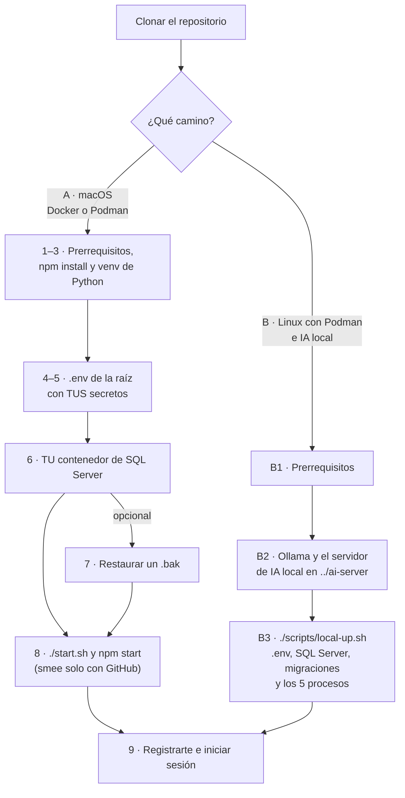

# Primer arranque sin `.env`

**En una frase:** cómo pasar de un `git clone` a TaskMate corriendo en tu máquina, con **tus propios** secretos, cuando nadie te pasó una `.env`: en macOS con `./start.sh` o en Linux con `./scripts/local-up.sh`, que además levanta la IA local.



## Qué hace
- Deja corriendo el frontend (`:3000`), la API (`:9000`), el servicio Python del chat (`127.0.0.1:8001`) y SQL Server (`127.0.0.1:1433`).
- Cada desarrollador genera sus secretos: nada se copia de la máquina de otro.
- GitHub, CI/CD, Vercel y el servidor de IA local son opcionales: sin ellos funciona todo lo demás.
- Hay dos caminos:

| | A · `./start.sh` | B · `./scripts/local-up.sh` |
|---|---|---|
| Sistema | macOS (Docker Desktop o Podman) | Linux con Podman (probado en Fedora) |
| `.env` | La creas tú (pasos 4–5) | La genera o completa el script |
| SQL Server | Creas tú el contenedor (paso 6) | Construye la imagen y crea el contenedor |
| Migraciones | Las trae la imagen; las nuevas, a mano | Aplica las pendientes (`npm run db:migrate`) |
| Chat | Groq (`LLM_PROVIDER=groq`, el valor por defecto) | Modelo local: Gemma 4 en Ollama (`LLM_PROVIDER=ollama`) |
| Servidor de IA local (`:8000`) | No | Sí, si está clonado en `../ai-server` |
| Frontend | `npm start` en otra terminal | Lo arranca el script (`--no-web` lo omite) |
| Detener | `Ctrl+C` / cerrar las terminales | `./scripts/local-down.sh` |

## Cómo funciona

### Camino A · macOS con `./start.sh`

**1. Prerrequisitos.** Node.js 18+ con npm, Python 3.9+, Docker Desktop o Podman, `git`, `openssl`, `lsof` y `nc`.
- El venv probado usa Python 3.9.6, que ya no tiene soporte ([limitaciones](../01-proyecto/cierre-del-proyecto.md#dependencias-y-entorno)).
- `./start.sh` usa Podman si está instalado y responde; si no, Docker. Si Docker no responde, abre Docker Desktop con `open`; donde no existe `open` (Linux) termina con error. En Linux usa el camino B.

**2. Clonar e instalar Node** (la raíz instala también el workspace `taskmate-api`):
```bash
git clone https://github.com/PabloP150/proyecto-is-cc6.git && cd proyecto-is-cc6
npm install
```
- Lo más nuevo (la línea de Christian) está en la rama `test/e2e`: `git checkout test/e2e`.

**3. Entorno de Python** (`start.sh` usa `taskmate-api/mcp/venv/bin/python`):
```bash
cd taskmate-api/mcp && python3 -m venv venv
./venv/bin/pip install -r requirements-dev.txt   # incluye requirements.txt y pytest
cd ../..
```

**4. Crear la `.env` en la raíz:** `cp taskmate-api/.env.example .env`. Es la única ubicación soportada: la leen `start.sh`, `scripts/local-up.sh`, la API, el servicio Python del chat y el frontend.

**5. Llenar las variables.** Solo estas; el resto se queda como en la plantilla.

| Variable | ¿Obligatoria? | Cómo obtenerla | Si falta o es débil |
|---|---|---|---|
| `JWT_SECRET` | Sí | `openssl rand -base64 48` | La API no arranca |
| `MCP_SHARED_SECRET` | Sí | `openssl rand -base64 48` (la API y el servicio Python leen el mismo valor) | El servicio Python no arranca y el chat dice «The AI service is not available right now.» |
| `DB_PASSWORD` | Sí | Una contraseña fuerte que **tú** eliges; va igual en el `docker run` del paso 6 | La API no conecta a la BD |
| `MIGRATION_DB_PASSWORD` | Con `start.sh`, opcional; con `local-up.sh`, obligatoria | La contraseña de `SA` que eliges en el paso 6 (`local-up.sh` la usa como `SA_PASSWORD` al crear el contenedor) | Falla `npm run db:migrate`; `local-up.sh` no arranca |
| `LLM_PROVIDER` | No | `groq` (por defecto) u `ollama` (modelo local; lo pone `local-up.sh`) | Con un valor desconocido avisa y usa `groq` |
| `GROQ_API_KEY` | Solo con `LLM_PROVIDER=groq` | Tu propia llave, gratis en [console.groq.com/keys](https://console.groq.com/keys) | El chat «AI Bot» y «Analyze with AI» fallan; «Propose with AI» usa la propuesta detectada. El resto funciona |
| `OLLAMA_MODEL` y demás `OLLAMA_*` | Solo con `LLM_PROVIDER=ollama` | Por defecto `gemma4:e2b-it-qat` en `http://127.0.0.1:11434` | El chat responde «The AI assistant is temporarily unavailable…»; el log del servicio Python dice que falta el modelo (`ollama pull …`) |
| `AI_SERVER_URL`, `AI_SERVER_SECRET` | Opcionales | `http://127.0.0.1:8000` y el mismo `AI_SERVER_SECRET` del `.env` de `../ai-server` (`local-up.sh` los pone y copia el secreto) | «Audit», «Generate tests» y «Review PR» responden 503 `AI_SERVER_DISABLED`; el chat funciona sin el conocimiento del proyecto |
| `VERCEL_WEBHOOK_SECRET` | Solo para el monitoreo de Vercel | `openssl rand -hex 20` (lo genera `local-up.sh`); el mismo valor va en el webhook de Vercel | Todo webhook de Vercel responde 401 |
| `ALLOW_LAN_ORIGINS` | No (solo desarrollo) | `true` para abrir la app desde otro equipo de tu red (`http://<IP privada>:3000`) | Solo se acepta el origen de `FRONTEND_URL`. Nunca en producción |
| `GITHUB_APP_ID`, `GITHUB_APP_SLUG`, `GITHUB_APP_CLIENT_ID`, `GITHUB_APP_CLIENT_SECRET`, `GITHUB_APP_PRIVATE_KEY`, `GITHUB_WEBHOOK_SECRET` | Opcionales | **A)** Tu propia App: [guía de la GitHub App](guia-github-app.md), pasos 2–6. **B)** El dueño te comparte las credenciales de la App de desarrollo por un gestor de contraseñas, nunca por git ni chat | Al pulsar «Connect repository» en `/github` sale «The GitHub integration is not configured on the server.» (503 `GITHUB_NOT_CONFIGURED`). No hay GitHub ni CI/CD; el resto funciona |

- Si no usarás GitHub, deja **vacías** las seis `GITHUB_*` (por ejemplo `GITHUB_APP_ID=`): los valores de ejemplo de la plantilla no sirven.
- Con la App compartida (opción B) pide también la URL de su canal de smee (es su *Webhook URL*). Solo podrás conectar repositorios donde esa App esté instalada y tengas permiso de escritura.
- Contraseñas de la BD: 8+ caracteres con mayúsculas, minúsculas, números o símbolos (política de SQL Server). Evita `#`, comillas, espacios y `$`; si una lleva `#`, ponla entre comillas simples en la `.env`.
- Si el puerto 8001 está ocupado: `MCP_PORT=8011` y `LLM_WEBSOCKET_URL=ws://127.0.0.1:8011/ws`.
- Valores por defecto de todas las variables: [guía técnica, §7](guia-tecnica.md#7-variables-de-entorno).

**6. Crear TU contenedor de SQL Server** (nombre obligatorio `taskmate-sql`; detalle en [SQL Server en Docker](base-de-datos-docker.md)):
```bash
docker build -t taskmate-sql taskmate-api
docker run -d --name taskmate-sql -e ACCEPT_EULA=Y \
  -e SA_PASSWORD='<tu-password-de-sa>' -e DB_PASSWORD='<el DB_PASSWORD de tu .env>' \
  -p 127.0.0.1:1433:1433 taskmate-sql
docker logs -f taskmate-sql   # esperar "Setup complete. Keeping container running."
```
- Con Podman, los mismos comandos con `podman` en lugar de `docker`.
- `127.0.0.1:` publica el puerto solo en tu máquina. Nunca uses `-p 1433:1433`.
- En Apple Silicon agrega `--platform linux/amd64` a `docker build` y a `docker run`.
- El primer arranque crea la BD `taskmate-db`, el login `sqladmin` (mínimo privilegio) y las 29 tablas (migraciones 001–011).

**7. (Opcional) Restaurar un respaldo `.bak`** para tener datos. Quien lo comparte lo genera en su máquina y tú lo restauras en la tuya, **con la API detenida**. Cada uno usa su propia contraseña de `SA`:
```bash
read -s "SQLCMDPASSWORD?Contraseña SA: "; echo; export SQLCMDPASSWORD   # zsh (bash: read -s -p "…" SQLCMDPASSWORD)
sa() { docker exec -e SQLCMDPASSWORD taskmate-sql /opt/mssql-tools/bin/sqlcmd -S localhost -U SA -b "$@"; }
# Quien comparte: crear el respaldo y sacarlo del contenedor
sa -Q "BACKUP DATABASE [taskmate-db] TO DISK = N'/var/opt/mssql/data/taskmate.bak' WITH COPY_ONLY, INIT"
docker cp taskmate-sql:/var/opt/mssql/data/taskmate.bak ./taskmate.bak
# Tú: copiarlo, restaurarlo, enlazar el usuario sqladmin con TU login y reiniciar (aplica migraciones pendientes)
docker cp ./taskmate.bak taskmate-sql:/var/opt/mssql/data/taskmate.bak
docker exec -u 0 taskmate-sql chown mssql /var/opt/mssql/data/taskmate.bak
sa -Q "RESTORE DATABASE [taskmate-db] FROM DISK = N'/var/opt/mssql/data/taskmate.bak' WITH REPLACE"
sa -d taskmate-db -Q "ALTER USER [sqladmin] WITH LOGIN = [sqladmin]"
docker restart taskmate-sql; unset SQLCMDPASSWORD; unset -f sa
```
- Los usuarios del respaldo conservan sus contraseñas; si no las conoces, regístrate con uno nuevo (paso 9).
- Los repositorios vinculados en el respaldo son de la App de quien lo generó: con otra App, desconéctalos y conéctalos de nuevo.
- Al reiniciar, el contenedor solo aplica las migraciones que trae su imagen. Si el respaldo viene de una BD más nueva o más vieja, corre después `npm run db:migrate` ([SQL Server en Docker, §5](base-de-datos-docker.md#5-migrar-una-bd-que-ya-existía)).

**8. Arrancar** (en dos terminales):
```bash
./start.sh      # Docker o Podman, taskmate-sql, servicio Python del chat y API (logs en /tmp/taskmate-*.log)
npm start       # frontend en http://localhost:3000
```
- `start.sh` siempre imprime «✓ Todo listo». Confirma en `/tmp/taskmate-backend.log`: `API running on PORT 9000` y `[LLMService] WebSocket connection established.`
- `start.sh` solo hace `start` del contenedor: **no aplica migraciones**. Tras un `git pull` que traiga migraciones nuevas (o con un contenedor de una imagen anterior al 18 nov 2026, que no trae 009–011), corre `npm run db:migrate` ([SQL Server en Docker, §5](base-de-datos-docker.md#5-migrar-una-bd-que-ya-existía)).
- `start.sh` no levanta Ollama ni el servidor de IA local: el chat usa Groq y, con `AI_SERVER_URL` vacío, «Audit», «Generate tests» y «Review PR» responden 503 `AI_SERVER_DISABLED`. El arranque automático de la IA local solo existe en Linux (camino B).
- Solo con GitHub, en una tercera terminal: `npx smee-client --url https://smee.io/<canal> --target http://localhost:9000/api/github/webhook`.

Sigue en el [paso 9](#al-final-los-dos-caminos).

### Camino B · Linux con Podman e IA local (`./scripts/local-up.sh`)

Probado en Fedora. Usa herramientas de Linux (`ss`, `setsid`, `sed -i` de GNU y `systemctl --user`), así que no sirve en macOS. Más detalle, tiempos medidos y cómo simular un webhook de Vercel: [ENTORNO-LOCAL.md](../09-linea-christian/ENTORNO-LOCAL.md).

**B1. Prerrequisitos.** `podman`, `node` (18+) con `npm`, `python3`, `curl`, `ss` y `openssl` (el script se detiene si falta alguno), más `git` para clonar.
- Clona TaskMate y corre `npm install` como en el paso 2 (rama `test/e2e`). El venv no hace falta: lo crea el script.
- El `npm install` inicial sí hace falta: según el código, `local-up.sh` aplica las migraciones (2/5) antes de su paso de dependencias, y sin `node_modules` se detiene con «migrations failed».

**B2. IA local: Ollama, el modelo local y el servidor de IA.** El servidor de IA local es el repositorio aparte de Christian, `taskmate-ai-server` (privado: pídele acceso). Va **junto** a TaskMate, en `../ai-server` (otra ruta con `AI_SERVER_DIR`):
```bash
git clone https://github.com/Sirk02/taskmate-ai-server.git ../ai-server && cd ../ai-server
cp .env.example .env
python3 -m venv .venv && ./.venv/bin/pip install -e ".[dev]"    # Python 3.12 o más
./scripts/install-ollama.sh                                     # Ollama sin root en ~/.local/ollama, como servicio systemctl --user
~/.local/ollama/bin/ollama pull gemma4:e2b-it-qat               # modelo de chat, 4.3 GB
~/.local/ollama/bin/ollama pull embeddinggemma:300m             # embeddings, 621 MB
cd -
```
- Pide unos 10 GB de disco. Funciona en CPU; `./scripts/enable-gpu.sh` (NVIDIA, con `sudo` y reinicio) lo acelera. Se probó con una GPU de 4 GB.
- No arranques nada a mano: `local-up.sh` llama a `../ai-server/scripts/up.sh`, que levanta Ollama (`127.0.0.1:11434`), Postgres 17 + pgvector (`127.0.0.1:5432`, contenedor `taskmate-ai-db`, con sus migraciones) y la API del servidor de IA (`127.0.0.1:8000`, Swagger en `/docs`).
- `up.sh` genera `AI_SERVER_SECRET` en `../ai-server/.env` (32+ caracteres; sin él el servidor no arranca) y `local-up.sh` lo copia a la `.env` de TaskMate.
- Sin `../ai-server`, el script solo arranca Ollama (Ollama sigue siendo obligatorio, en `~/.local/ollama/bin/ollama` u `OLLAMA_BIN`): el chat funciona sin el conocimiento del proyecto, y «Audit», «Generate tests» y «Review PR» fallan porque no hay servidor en `:8000`.
- Opcional, para que el chat conozca los documentos y el código de TaskMate: con el servidor arriba, indexa el repositorio una vez desde `../ai-server`: `./.venv/bin/python scripts/taskmate.py --project TaskMate ingest-repo ../proyecto-is-cc6`.

**B3. Arrancar todo:**
```bash
./scripts/local-up.sh            # IA local, SQL Server, servicio Python del chat, API y web
./scripts/local-up.sh --no-web   # todo menos el frontend
./scripts/local-down.sh          # detenerlo (no borra datos: el contenedor se detiene, no se elimina)
./scripts/local-down.sh --all    # también la IA local (API del servidor de IA, Postgres y Ollama)
```
En orden, `local-up.sh`:
1. **`.env`:** si no existe, la genera (con `chmod 600`) con valores de desarrollo y contraseñas aleatorias de la BD. Si existe, **nunca la sobrescribe**: solo agrega las claves que falten (`JWT_SECRET`, `MCP_SHARED_SECRET`, `LLM_PROVIDER=ollama`, `OLLAMA_MODEL`, `AI_SERVER_URL`, `AI_SERVER_PROJECT`, `VERCEL_WEBHOOK_SECRET`…). La única que reemplaza es `AI_SERVER_SECRET`, para igualarla con la de `../ai-server`. No agrega `GROQ_API_KEY`, `GITHUB_*` ni `ALLOW_LAN_ORIGINS`: para GitHub, llénalas como en el paso 5.
2. **IA local (1/5):** corre `../ai-server/scripts/up.sh`, descarga el modelo de chat si falta y lo precalienta.
3. **SQL Server (2/5):** construye la imagen `taskmate-sql` si no existe, crea el contenedor en `127.0.0.1:1433` (con `MIGRATION_DB_PASSWORD` como contraseña de `SA`) o lo inicia, y aplica las migraciones pendientes con `npm run db:migrate`. Un `git pull` nunca obliga a reconstruir la imagen.
4. **Dependencias:** `npm install` y el venv de `taskmate-api/mcp` (con `requirements.txt`) solo si faltan o cambiaron.
5. **Servicio Python del chat (3/5, `127.0.0.1:8001`), API (4/5, `:9000`) y web (5/5, `:3000`).**
- Es idempotente: al repetirlo solo reinicia sus propios procesos (pids en `.local/run/`) y se detiene si otro programa ocupa un puerto.
- Logs en `.local/logs/` (`mcp.log`, `api.log`, `web.log`, `ai-server-up.log`, `migrate.log`…). `.local/` está en `.gitignore`.

### Al final (los dos caminos)

**9. Registrarte e iniciar sesión.** En `http://localhost:3000` → «Create Account».
- Usuario de 3 a 20 caracteres (letras, números y `_`); contraseña de 6 a 50.
- A los 2 s vuelves a «Sign In»: entra con esa cuenta. El registro crea también tu grupo personal.
- Qué hacer en cada pantalla: [guía de uso](guia-de-uso.md).

## Reglas
- La `.env` **nunca** se sube a git (`.gitignore` la ignora). Revisa `git status` antes de cada commit.
- Cada desarrollador tiene **sus propios** secretos y su propio contenedor. No copies la `.env` de otro.
- Credenciales compartidas (la App de desarrollo): solo por gestor de contraseñas. Nunca en git, chat ni correo.
- Para compartir datos se comparte un `.bak` (paso 7), por un canal privado: contiene usuarios y sus contraseñas cifradas con bcrypt.
- `ALLOW_LAN_ORIGINS=true` es solo para probar en tu red local. La API y el servidor de desarrollo de React escuchan en todas las interfaces; el servicio Python, SQL Server, Ollama, Postgres y el servidor de IA local quedan en `127.0.0.1`.

## Problemas comunes

| Síntoma | Qué hacer |
|---|---|
| `FATAL: JWT_SECRET must be a random value…` en `/tmp/taskmate-backend.log`, o `MCP_SHARED_SECRET is not set` / `must be a random value…` en `/tmp/taskmate-mcp.log` | Generar ese secreto con `openssl rand -base64 48` y volver a correr `./start.sh` |
| `FATAL: Could not initialize DB connection pool` | El contenedor no corre (`docker ps`) o `DB_PASSWORD` no es el del `docker run`. Igualarlos; si no recuerdas la contraseña, `docker rm -f taskmate-sql` y repetir el paso 6 (borra los datos) |
| El contenedor se detiene justo después de crearlo | Contraseña que no cumple la política: ver `docker logs taskmate-sql`, borrarlo y crearlo de nuevo |
| `start.sh`: «no se pudo iniciar el contenedor taskmate-sql» | El contenedor no existe o tiene otro nombre: crearlo como `taskmate-sql` |
| `start.sh`: «'open' no está disponible…» | Docker no responde y no estás en macOS: iniciar Docker o Podman a mano, o usar el camino B |
| `start.sh`: «el puerto 8001 está ocupado por …» | `MCP_PORT=8011` y `LLM_WEBSOCKET_URL=ws://127.0.0.1:8011/ws` en la `.env` |
| La API responde 500 con «Invalid column name…» o «Invalid object name…» (por ejemplo, `/tasks` o «Task files» no cargan) | La BD está atrasada respecto al código: `npm run db:migrate` ([SQL Server en Docker, §5](base-de-datos-docker.md#5-migrar-una-bd-que-ya-existía)) |
| `local-up.sh`: «Ollama not found at …» | Instalarlo con `../ai-server/scripts/install-ollama.sh` o indicar su ruta en `OLLAMA_BIN` |
| `local-up.sh`: «SQL Server is up but rejects the app login…» | El contenedor se creó con otras contraseñas que las de la `.env`. `podman rm -f taskmate-sql` (borra los datos) y volver a correr el script |
| `local-up.sh`: «port N is held by something that is not TaskMate» | Liberar ese puerto; el script no mata procesos ajenos |
| Con `LLM_PROVIDER=ollama`, el chat responde «The AI assistant is temporarily unavailable. Please try again in a moment.» | Ver `.local/logs/mcp.log` (o `/tmp/taskmate-mcp.log`). Si dice «The local model … is not installed (ollama pull …)»: `~/.local/ollama/bin/ollama pull <modelo>` con el `OLLAMA_MODEL` de la `.env`. Si dice «Could not reach the local model (is Ollama running?)»: arrancar Ollama (`../ai-server/scripts/up.sh`) |
| «Audit», «Generate tests» o «Review PR» fallan | 503 `AI_SERVER_DISABLED`: falta `AI_SERVER_URL`. 502 `AI_SERVER_UNAVAILABLE`: el servidor de IA local no corre (`../ai-server/scripts/up.sh`). 502 `AI_SERVER_AUTH`: `AI_SERVER_SECRET` distinto en las dos `.env` (volver a correr `local-up.sh` lo copia) |
| Errores CORS o el chat no conecta | Abrir `http://localhost:3000` (no `127.0.0.1`), o poner ese origen exacto en `FRONTEND_URL`. Desde otro equipo de la red: `ALLOW_LAN_ORIGINS=true` y reiniciar la API |
| Una pestaña nueva pide iniciar sesión otra vez | Es por diseño: cada pestaña nueva empieza sin sesión |

Más casos: [guía de la GitHub App, §10](guia-github-app.md#10-solución-de-problemas) y [SQL Server en Docker](base-de-datos-docker.md).

## Dónde está en el código

| Archivo | Qué hace |
|---|---|
| `taskmate-api/.env.example` | Plantilla: cada variable, su valor por defecto y quién la lee |
| `start.sh` | Camino A: inicia `taskmate-sql` (Podman o Docker), el servicio Python del chat y la API; avisa si falta `MCP_SHARED_SECRET` |
| `scripts/local-up.sh` · `scripts/local-down.sh` | Camino B: genera o completa la `.env`, levanta la IA local, SQL Server (con migraciones), el chat, la API y la web; y lo detiene |
| `taskmate-api/Dockerfile` · `taskmate-api/setup-db.sh` | Imagen de SQL Server 2019 y arranque idempotente (BD, login, esquema, migraciones) |
| `taskmate-api/server.js` | Rechaza un `JWT_SECRET` débil y abre el pool de la BD |
| `taskmate-api/mcp/server.py` · `taskmate-api/mcp/llm_service.py` | El primero rechaza un `MCP_SHARED_SECRET` débil; el segundo elige Groq u Ollama según `LLM_PROVIDER` |
| `taskmate-api/mcp/knowledge.py` · `taskmate-api/services/aiServer/client.js` | Llamadas al servidor de IA local: búsqueda de conocimiento del chat y comandos `audit`, `generate-tests` y `review-pr` |
| `taskmate-api/middleware/cors.js` | Orígenes permitidos: `FRONTEND_URL` y, con `ALLOW_LAN_ORIGINS=true`, los de IPv4 privada |
| `taskmate-api/services/github/githubApp.js` | Responde `GITHUB_NOT_CONFIGURED` sin las variables de la App |
| `../ai-server/scripts/up.sh` · `down.sh` | (Repo aparte) Levantan y detienen Ollama, Postgres + pgvector y el servidor de IA local en `:8000` |

## Para saber más
- Todas las variables, con sus valores por defecto: [guía técnica, §7](guia-tecnica.md#7-variables-de-entorno).
- El entorno Linux con IA local, según Christian: [ENTORNO-LOCAL.md](../09-linea-christian/ENTORNO-LOCAL.md) y [chat sobre la IA local](../09-linea-christian/CHATBOT-IA-LOCAL.md).
- Qué hace el servidor de IA local dentro de TaskMate: [IA sobre el código](../02-arquitectura/10-ia-sobre-el-codigo.md).
- Correr las pruebas: [pruebas](pruebas.md).
- Limitaciones y pendientes: [cierre de la línea de Pablo y estado](../01-proyecto/cierre-del-proyecto.md#limitaciones-conocidas).
