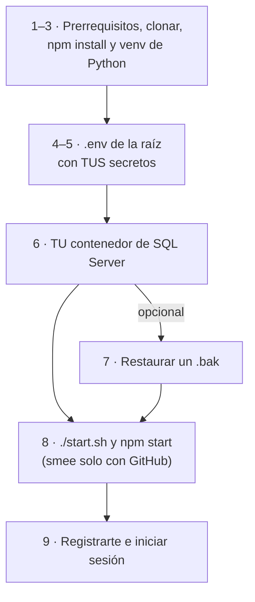

# Primer arranque sin `.env`

**En una frase:** cómo pasar de un `git clone` a TaskMate corriendo en tu máquina, con **tus propios** secretos, cuando nadie te pasó una `.env`.



## Qué hace
- Deja corriendo el frontend (`:3000`), la API (`:9000`), el servidor de IA (`127.0.0.1:8001`) y SQL Server en Docker (`127.0.0.1:1433`).
- Cada desarrollador genera sus secretos: nada se copia de la máquina de otro.
- GitHub y CI/CD son opcionales: sin ellos funciona todo lo demás.

## Cómo funciona

**1. Prerrequisitos.** Node.js 18+ con npm, Python 3.9+, Docker Desktop, `git` y `openssl`.
- El venv probado usa Python 3.9.6, que ya no tiene soporte ([limitaciones](../01-proyecto/cierre-del-proyecto.md#dependencias-y-entorno)).
- `./start.sh` es solo para macOS. En otro sistema, arranca cada proceso a mano ([guía de la App, §8](guia-github-app.md#8-arrancar-todo)).

**2. Clonar e instalar Node** (la raíz instala también el workspace `taskmate-api`):
```bash
git clone https://github.com/PabloP150/proyecto-is-cc6.git && cd proyecto-is-cc6
npm install
```

**3. Entorno de Python** (`start.sh` usa `taskmate-api/mcp/venv/bin/python`):
```bash
cd taskmate-api/mcp && python3 -m venv venv
./venv/bin/pip install -r requirements-dev.txt   # incluye requirements.txt y pytest
cd ../..
```

**4. Crear la `.env` en la raíz:** `cp taskmate-api/.env.example .env`. Es la única ubicación soportada: la leen `start.sh`, la API, el servidor de IA y el frontend.

**5. Llenar las variables.** Solo estas; el resto se queda como en la plantilla.

| Variable | ¿Obligatoria? | Cómo obtenerla | Si falta o es débil |
|---|---|---|---|
| `JWT_SECRET` | Sí | `openssl rand -base64 48` | La API no arranca |
| `MCP_SHARED_SECRET` | Sí | `openssl rand -base64 48` (la API y el servidor de IA leen el mismo valor) | El servidor de IA no arranca y el chat dice «El servicio de IA no está disponible…» |
| `DB_PASSWORD` | Sí | Una contraseña fuerte que **tú** eliges; va igual en el `docker run` del paso 6 | La API no conecta a la BD |
| `MIGRATION_DB_PASSWORD` | Opcional | La contraseña de `SA` que eliges en el paso 6 | Solo falla `npm run db:migrate`; un contenedor nuevo se migra solo |
| `GROQ_API_KEY` | Para la IA | Tu propia llave, gratis en [console.groq.com/keys](https://console.groq.com/keys) | El chat «AI Bot» y «Analizar con IA» fallan; «Proponer con IA» usa la propuesta detectada. El resto funciona |
| `GITHUB_APP_ID`, `GITHUB_APP_SLUG`, `GITHUB_APP_CLIENT_ID`, `GITHUB_APP_CLIENT_SECRET`, `GITHUB_APP_PRIVATE_KEY`, `GITHUB_WEBHOOK_SECRET` | Opcionales | **A)** Tu propia App: [guía de la GitHub App](guia-github-app.md), pasos 2–6. **B)** El dueño te comparte las credenciales de la App de desarrollo por un gestor de contraseñas, nunca por git ni chat | Al pulsar «Conectar repositorio» en `/github` sale «La integración con GitHub no está configurada en el servidor.» (503 `GITHUB_NOT_CONFIGURED`). No hay GitHub ni CI/CD; el resto funciona |

- Si no usarás GitHub, deja **vacías** las seis `GITHUB_*` (por ejemplo `GITHUB_APP_ID=`): los valores de ejemplo de la plantilla no sirven.
- Con la App compartida (opción B) pide también la URL de su canal de smee (es su *Webhook URL*). Solo podrás conectar repositorios donde esa App esté instalada y tengas permiso de escritura.
- Contraseñas de la BD: 8+ caracteres con mayúsculas, minúsculas, números o símbolos (política de SQL Server). Evita `#`, comillas, espacios y `$`.
- Si el puerto 8001 está ocupado: `MCP_PORT=8011` y `LLM_WEBSOCKET_URL=ws://127.0.0.1:8011/ws`.

**6. Crear TU contenedor de SQL Server** (nombre obligatorio `taskmate-sql`; detalle en [SQL Server en Docker](base-de-datos-docker.md)):
```bash
docker build -t taskmate-sql taskmate-api
docker run -d --name taskmate-sql -e ACCEPT_EULA=Y \
  -e SA_PASSWORD='<tu-password-de-sa>' -e DB_PASSWORD='<el DB_PASSWORD de tu .env>' \
  -p 127.0.0.1:1433:1433 taskmate-sql
docker logs -f taskmate-sql   # esperar "Setup complete. Keeping container running."
```
- `127.0.0.1:` publica el puerto solo en tu máquina. Nunca uses `-p 1433:1433`.
- En Apple Silicon agrega `--platform linux/amd64` a `docker build` y a `docker run`.
- El primer arranque crea la BD `taskmate-db`, el login `sqladmin` (mínimo privilegio) y las 24 tablas (migraciones 001–008).

**7. (Opcional) Restaurar un respaldo `.bak`** para tener datos. Quien lo comparte lo genera en su máquina y tú lo restauras en la tuya, **con la API detenida**. Cada uno usa su propia contraseña de `SA`:
```bash
read -s "SQLCMDPASSWORD?Contraseña SA: "; echo; export SQLCMDPASSWORD   # zsh (bash: read -s -p "…" SQLCMDPASSWORD)
sa() { docker exec -e SQLCMDPASSWORD taskmate-sql /opt/mssql-tools/bin/sqlcmd -S localhost -U SA -b "$@"; }
# Quien comparte: crear el respaldo y sacarlo del contenedor
sa -Q "BACKUP DATABASE [taskmate-db] TO DISK = N'/var/opt/mssql/data/taskmate.bak' WITH COPY_ONLY, INIT"
docker cp taskmate-sql:/var/opt/mssql/data/taskmate.bak ./taskmate.bak
# Tú: copiarlo, restaurarlo, enlazar el usuario sqladmin con TU login y reiniciar (aplica migraciones pendientes)
docker cp ./taskmate.bak taskmate-sql:/var/opt/mssql/data/taskmate.bak
docker exec -u 0 taskmate-sql chown mssql /var/opt/mssql/data/taskmate.bak
sa -Q "RESTORE DATABASE [taskmate-db] FROM DISK = N'/var/opt/mssql/data/taskmate.bak' WITH REPLACE"
sa -d taskmate-db -Q "ALTER USER [sqladmin] WITH LOGIN = [sqladmin]"
docker restart taskmate-sql; unset SQLCMDPASSWORD; unset -f sa
```
- Los usuarios del respaldo conservan sus contraseñas; si no las conoces, regístrate con uno nuevo (paso 9).
- Los repositorios vinculados en el respaldo son de la App de quien lo generó: con otra App, desconéctalos y conéctalos de nuevo.

**8. Arrancar** (en dos terminales):
```bash
./start.sh      # Docker, taskmate-sql, servidor de IA y API (logs en /tmp/taskmate-*.log)
npm start       # frontend en http://localhost:3000
```
- `start.sh` siempre imprime «✓ Todo listo». Confirma en `/tmp/taskmate-backend.log`: `API running on PORT 9000` y `[LLMService] WebSocket connection established.`
- Solo con GitHub, en una tercera terminal: `npx smee-client --url https://smee.io/<canal> --target http://localhost:9000/api/github/webhook`.

**9. Registrarte e iniciar sesión.** En `http://localhost:3000` → «Create Account».
- Usuario de 3 a 20 caracteres (letras, números y `_`); contraseña de 6 a 50.
- A los 2 s vuelves a «Sign In»: entra con esa cuenta. El registro crea también tu grupo personal.
- Qué hacer en cada pantalla: [guía de uso](guia-de-uso.md).

## Reglas
- La `.env` **nunca** se sube a git (`.gitignore` la ignora). Revisa `git status` antes de cada commit.
- Cada desarrollador tiene **sus propios** secretos y su propio contenedor. No copies la `.env` de otro.
- Credenciales compartidas (la App de desarrollo): solo por gestor de contraseñas. Nunca en git, chat ni correo.
- Para compartir datos se comparte un `.bak` (paso 7), por un canal privado: contiene usuarios y sus contraseñas cifradas con bcrypt.

## Problemas comunes

| Síntoma | Qué hacer |
|---|---|
| `FATAL: JWT_SECRET must be a random value…` en `/tmp/taskmate-backend.log`, o `MCP_SHARED_SECRET is not set` / `must be a random value…` en `/tmp/taskmate-mcp.log` | Generar ese secreto con `openssl rand -base64 48` y volver a correr `./start.sh` |
| `FATAL: Could not initialize DB connection pool` | El contenedor no corre (`docker ps`) o `DB_PASSWORD` no es el del `docker run`. Igualarlos; si no recuerdas la contraseña, `docker rm -f taskmate-sql` y repetir el paso 6 (borra los datos) |
| El contenedor se detiene justo después de crearlo | Contraseña que no cumple la política: ver `docker logs taskmate-sql`, borrarlo y crearlo de nuevo |
| `start.sh`: «no se pudo iniciar el contenedor taskmate-sql» | El contenedor no existe o tiene otro nombre: crearlo como `taskmate-sql` |
| `start.sh`: «el puerto 8001 está ocupado por …» | `MCP_PORT=8011` y `LLM_WEBSOCKET_URL=ws://127.0.0.1:8011/ws` en la `.env` |
| Errores CORS o el chat no conecta | Abrir `http://localhost:3000` (no `127.0.0.1`), o poner ese origen exacto en `FRONTEND_URL` |
| Una pestaña nueva pide iniciar sesión otra vez | Es por diseño: cada pestaña nueva empieza sin sesión |

Más casos: [guía de la GitHub App, §10](guia-github-app.md#10-solución-de-problemas) y [SQL Server en Docker](base-de-datos-docker.md).

## Dónde está en el código

| Archivo | Qué hace |
|---|---|
| `taskmate-api/.env.example` | Plantilla: cada variable, su valor por defecto y quién la lee |
| `start.sh` | Arranca Docker, `taskmate-sql`, el servidor de IA y la API; avisa si falta `MCP_SHARED_SECRET` |
| `taskmate-api/Dockerfile` · `taskmate-api/setup-db.sh` | Imagen de SQL Server 2019 y arranque idempotente (BD, login, esquema, migraciones) |
| `taskmate-api/server.js` | Rechaza un `JWT_SECRET` débil y abre el pool de la BD |
| `taskmate-api/mcp/server.py` · `taskmate-api/mcp/llm_service.py` | El primero rechaza un `MCP_SHARED_SECRET` débil; el segundo lee `GROQ_API_KEY` |
| `taskmate-api/services/github/githubApp.js` | Responde `GITHUB_NOT_CONFIGURED` sin las variables de la App |

## Para saber más
- Todas las variables, con sus valores por defecto: [guía técnica, §7](guia-tecnica.md#7-variables-de-entorno).
- Correr las pruebas: [pruebas](pruebas.md).
- Limitaciones y pendientes: [cierre del proyecto](../01-proyecto/cierre-del-proyecto.md#limitaciones-conocidas).
