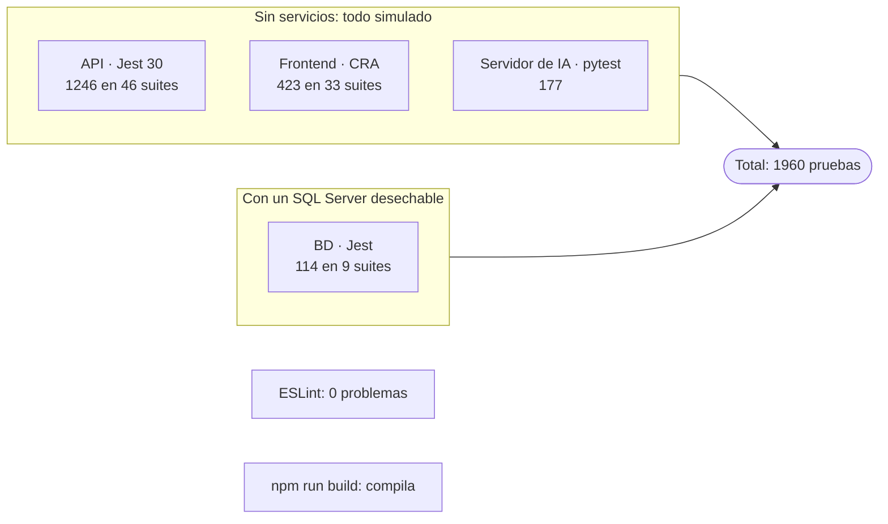

# Pruebas

**En una frase:** cómo correr las cuatro suites de TaskMate (API, frontend, servidor de IA y base de datos), el lint y el build, y dónde vive cada prueba.



## Qué hace
- Tres suites corren sin BD, sin GitHub y sin Groq: usan dobles de prueba.
- La suite de BD corre migraciones arriba y abajo contra un SQL Server **desechable**, nunca contra `taskmate-sql`.
- Resultado al 5 nov 2026: **1960 pruebas en verde** (al cerrar la Fase 3 eran 1353).

## Cómo funciona

| Capa | Comando | Resultado al 5 nov 2026 |
|---|---|---|
| API (Jest 30 + supertest) | `cd taskmate-api && npm test` | **1246/1246**, 46 suites |
| Frontend (Jest de react-scripts + Testing Library) | `CI=true npm test -- --watchAll=false` (desde la raíz) | **423/423**, 33 suites |
| Servidor de IA (pytest) | `cd taskmate-api/mcp && ./venv/bin/python -m pytest` | **177/177** |
| BD real | `cd taskmate-api && TEST_DB_ENV_FILE="$HOME/taskmate-testdb.env" npm run test:db` | **114/114**, 9 suites |
| Lint | `npx eslint src --ext .js,.jsx` (desde la raíz) | 0 problemas |
| Build | `npm run build` (desde la raíz) | Compila |

- pytest necesita el venv con `requirements-dev.txt` ([primer arranque, paso 3](primer-arranque.md)).
- De las 1246 de la API, 10 no comprueban nada sin `NODE_ENV=integration-test`: las 5 de `performance.test.js` y las 5 de `integration/analytics-integration.test.js`. `npm run test:performance` activa las de rendimiento y necesita un SQL Server real.
- `npm test -- --coverage` deja el reporte en `taskmate-api/coverage/`, que `.gitignore` no ignora: no lo subas.

**Correr solo una parte:**
```bash
cd taskmate-api && npm test -- tests/github                 # una carpeta (o un patrón: npm test -- UserSession)
CI=true npm test -- --watchAll=false src/components/github  # frontend, desde la raíz
cd taskmate-api/mcp && ./venv/bin/python -m pytest tests/test_server.py
```

**Suite de BD, en tres pasos** (comandos completos en [SQL Server en Docker, §6](base-de-datos-docker.md#6-bd-desechable-para-pruebas)):
1. Construir `taskmate-sql:test` y crear el contenedor `taskmate-sql-test` en `127.0.0.1:14333`, con contraseñas propias.
2. Guardar las `TEST_DB_*` en un archivo **fuera del repositorio** (`chmod 600`) y pasarlo con `TEST_DB_ENV_FILE`.
3. Correr `npm run test:db` y después borrar el contenedor y la imagen de prueba.

La conexión sale solo de `TEST_DB_*` (nunca de `DB_*` ni de la `.env`). Si falta alguna obligatoria, no corre nada.

## Dónde están las pruebas

| Capa | Carpeta | Qué cubre |
|---|---|---|
| API | `taskmate-api/tests/*.test.js` (15 suites) | Servicios y modelos: analytics, LLMService, sesiones del chat, ProjectService, hub `/events` |
| API | `taskmate-api/tests/api/` (8) | La app Express con supertest: JWT, acceso por grupo, validación, límites, WebSockets |
| API | `taskmate-api/tests/github/` (19) | Fases 3 y 4 con un GitHub falso: App, instalación, ramas, webhooks, pipeline, Actions y deploys |
| API | `taskmate-api/tests/integration/` (1) · `tests/db/transaction.test.js` (1) | Integración de analytics (solo con `NODE_ENV=integration-test`) y `withTransaction` sin BD |
| BD | `taskmate-api/tests/db/*.dbtest.js` (9) | Migraciones 001–008 y triggers, transacciones, tareas, grupos, proyecto, analytics, Unicode, GitHub y CI/CD |
| Frontend | `src/__tests__/` (4) | Rutas de `App.js` (`/github`, rutas desconocidas y las 5 pruebas de `/register`, `/flow` y `/create-group`) y guardas estáticas del código |
| Frontend | `src/components/__tests__/` (9) | Tareas, grupos, chat, analytics, hitos, límites de formularios, grupo activo |
| Frontend | `src/components/github/__tests__/` (9) · `github/cicd/__tests__/` (5) | Página GitHub, explorador, ramas, plan del repositorio y pestaña CI/CD |
| Frontend | `src/api/`, `src/hooks/`, `src/components/realtime/`, `src/components/ui/` (`__tests__/`: 1, 1, 1, 3) | Cliente HTTP, `useWebSocket`, avisos en vivo y componentes del design system |
| Servidor de IA | `taskmate-api/mcp/tests/` (6 archivos) | Servidor `/ws`, orquestador, agentes de analytics, repositorio y pipeline, cliente de Groq |

## Reglas
- Cada cambio trae su prueba en la capa que toca.
- Las pruebas de BD solo contra un contenedor desechable. Nunca contra la BD de desarrollo.
- Ninguna prueba llama a GitHub ni a Groq de verdad.

## Dónde está en el código

| Archivo | Qué hace |
|---|---|
| `taskmate-api/jest.config.js` | Configuración de `npm test` (API) |
| `taskmate-api/jest.db.config.js` · `tests/db/setupEnv.js` · `tests/db/globalSetup.js` | Configuración de `npm run test:db`: copia `TEST_DB_*` sobre `DB_*` y aplica 001–008 una vez por corrida |
| `taskmate-api/tests/github/helpers/fakeGitHub.js` | GitHub falso para las Fases 3 y 4 |
| `taskmate-api/mcp/pytest.ini` · `taskmate-api/mcp/tests/conftest.py` | Configuración de pytest |

## Para saber más
- Organización y detalle de las suites de la API: [taskmate-api/tests/README.md](../../taskmate-api/tests/README.md).
- Estado verificado al cierre: [cierre del proyecto](../01-proyecto/cierre-del-proyecto.md#estado-verificado-al-3-nov-2026).
- Huecos de cobertura conocidos: [limitaciones de pruebas](../01-proyecto/cierre-del-proyecto.md#pruebas).
