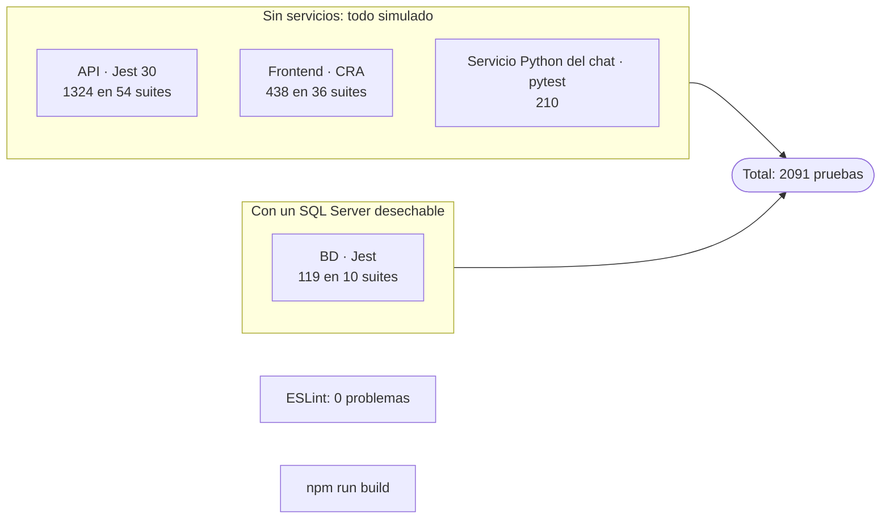

# Pruebas

**En una frase:** cómo correr las cuatro suites de TaskMate (API, frontend, servicio Python del chat y base de datos), el lint y el build, y dónde vive cada prueba.



## Qué hace
- Tres suites corren sin BD, sin GitHub, sin Ollama, sin Groq y sin el servidor de IA local: usan dobles de prueba.
- La suite de BD corre migraciones arriba y abajo contra un SQL Server **desechable**, nunca contra `taskmate-sql`.
- Resultado al 26 nov 2026, en `test/e2e` con los arreglos de `fix/christian-bugs` (todo en `master` desde el 26 nov): **2091 pruebas en verde, 0 fallando**. El 25 nov eran 2087; al 5 nov, 1960 (1246 + 423 + 177 + 114); al cerrar la Fase 3, 1353.
- Las 131 de más (saldo neto frente al 5 nov) son de la línea de Christian: monitoreo de Vercel, archivos por tarea, IA sobre el código, chat con modelo local y streaming, selector de grupo del navbar y CORS en la red local. 4 de ellas (2 de API y 2 de BD) llegaron el 26 nov con los arreglos del webhook de Vercel y de la revisión de PR.
- La suite de BD de esta línea se corrió por primera vez el 26 nov, contra un SQL Server desechable: las 117 del 25 nov salían de contar las pruebas en el código; con las 2 nuevas, 119.

## Cómo funciona

| Capa | Comando | Resultado al 26 nov 2026 |
|---|---|---|
| API (Jest 30 + supertest) | `cd taskmate-api && npm test` | **1324/1324**, 54 suites |
| Frontend (Jest de react-scripts + Testing Library) | `CI=true npm test -- --watchAll=false` (desde la raíz) | **438/438**, 36 suites |
| Servicio Python del chat (pytest) | `cd taskmate-api/mcp && ./venv/bin/python -m pytest` | **210/210** |
| BD real | `cd taskmate-api && TEST_DB_ENV_FILE="$HOME/taskmate-testdb.env" npm run test:db` | **119/119**, 10 suites |
| Lint | `npx eslint src --ext .js,.jsx` (desde la raíz) | **0 problemas**. El 25 nov daba 1 error en `NavGroupSelector.test.jsx` (`testing-library/render-result-naming-convention`), corregido el 26 nov desestructurando el resultado de `renderSelector` |
| Build | `npm run build` (desde la raíz) | Compilaba al 5 nov; no se volvió a medir el 25 nov |

- pytest necesita el venv con `requirements-dev.txt` ([primer arranque, paso 3](primer-arranque.md)). `scripts/local-up.sh` instala solo `requirements.txt`, sin las dependencias de prueba.
- De las 1324 de la API, 10 no comprueban nada sin `NODE_ENV=integration-test`: las 5 de `performance.test.js` y las 5 de `integration/analytics-integration.test.js`. `npm run test:performance` activa las de rendimiento y necesita un SQL Server real.
- `npm test -- --coverage` deja el reporte en `taskmate-api/coverage/`, que `.gitignore` no ignora: no lo subas.
- Las 89 funciones de prueba del servidor de IA local (repo aparte de Christian, `taskmate-ai-server`) no entran en estas cifras y no se corrieron.

**Correr solo una parte:**
```bash
cd taskmate-api && npm test -- tests/github                 # una carpeta (o un patrón: npm test -- UserSession)
CI=true npm test -- --watchAll=false src/components/github  # frontend, desde la raíz
cd taskmate-api/mcp && ./venv/bin/python -m pytest tests/test_server.py
```

**Suite de BD, en tres pasos** (comandos completos en [SQL Server en Docker, §6](base-de-datos-docker.md#6-bd-desechable-para-pruebas)):
1. Construir `taskmate-sql:test` y crear el contenedor `taskmate-sql-test` en `127.0.0.1:14333`, con contraseñas propias.
2. Guardar las `TEST_DB_*` en un archivo **fuera del repositorio** (`chmod 600`) y pasarlo con `TEST_DB_ENV_FILE`.
3. Correr `npm run test:db` y después borrar el contenedor y la imagen de prueba.

La conexión sale solo de `TEST_DB_*` (nunca de `DB_*` ni de la `.env`). Si falta alguna obligatoria, no corre nada.

## Dónde están las pruebas

| Capa | Carpeta | Qué cubre |
|---|---|---|
| API | `taskmate-api/tests/*.test.js` (16 suites) | Servicios y modelos: analytics, LLMService, sesiones del chat (streaming por petición y contexto del proyecto elegido), ProjectService, hub `/events` |
| API | `taskmate-api/tests/api/` (9) | La app Express con supertest: JWT, acceso por grupo, validación, límites, WebSockets |
| API | `taskmate-api/tests/github/` (20) | Fases 3 y 4 con un GitHub falso: App, instalación, ramas, webhooks, pipeline, Actions y deploys; archivos de la tarea (`taskFileService`) |
| API | `taskmate-api/tests/deploy/` (3) | Monitoreo de Vercel: firma HMAC-SHA1, traducción de eventos y webhook `POST /api/deploy/webhook/vercel` |
| API | `taskmate-api/tests/aiServer/` (3) | IA sobre el código: cliente del servidor de IA local, auditar, generar pruebas y revisión de PR |
| API | `taskmate-api/tests/middleware/` (1) | CORS con `ALLOW_LAN_ORIGINS` (red local) |
| API | `taskmate-api/tests/integration/` (1) · `tests/db/transaction.test.js` (1) | Integración de analytics (solo con `NODE_ENV=integration-test`) y `withTransaction` sin BD |
| BD | `taskmate-api/tests/db/*.dbtest.js` (10) | Migraciones 001–011 y triggers, transacciones, tareas, grupos, proyecto, analytics, Unicode, GitHub, CI/CD y `AiReviews` |
| Frontend | `src/__tests__/` (4) | Rutas de `App.js` (`/github`, rutas desconocidas y las 5 pruebas de `/register`, `/flow` y `/create-group`) y guardas estáticas del código |
| Frontend | `src/components/__tests__/` (11) | Tareas, grupos, chat (también streaming), analytics, hitos, límites de formularios, grupo activo y selector de grupo del navbar (`NavGroupSelector`) |
| Frontend | `src/components/github/__tests__/` (10) · `github/cicd/__tests__/` (5) | Página GitHub, explorador, ramas, plan del repositorio, grupo del chat (`ChatProjectInfo`), panel «AI on the branch» (`TaskAiPanel`) y pestaña CI/CD |
| Frontend | `src/api/`, `src/hooks/`, `src/components/realtime/`, `src/components/ui/` (`__tests__/`: 1, 1, 1, 3) | Cliente HTTP, `useWebSocket`, avisos en vivo y componentes del design system |
| Servicio Python del chat | `taskmate-api/mcp/tests/` (8 archivos) | Servidor `/ws` (también streaming), orquestador, agentes de analytics, repositorio y pipeline, proveedor Ollama, el modelo local (`test_local_provider`), cliente de Groq, el respaldo y conocimiento del servidor de IA local (`test_knowledge`) |

**Qué cubren los archivos nuevos (línea de Christian):**

| Archivo | Pruebas | Qué comprueba |
|---|---|---|
| `tests/deploy/deploySignature.test.js` | 8 | Firma de Vercel en `x-vercel-signature`: HMAC-SHA1 en hex sin prefijo; rechaza cuerpo alterado, otro secreto, cabecera ausente o mal formada, falta de secreto y una firma SHA-256 |
| `tests/deploy/vercelEvents.test.js` | 11 | Qué evento es de despliegue y cómo se traduce a una fila: estado, error, producción o preview, SHA inválido, sin metadatos de git |
| `tests/deploy/deployWebhookHandler.test.js` | 12 | El webhook con supertest: `processed`, `duplicate`, `ignored`, `failed`, 401 sin firma, 400 sin JSON, 500 (y no una petición colgada) si la BD falla al reclamar la entrega; y la regresión del montaje `(req, res, next)` |
| `tests/aiServer/client.test.js` | 8 | URL `/commands/<name>`, cabecera `x-ai-server-secret` y cómo cada error HTTP se vuelve un código `AI_SERVER_*` |
| `tests/aiServer/taskAi.test.js` | 7 | Auditar, generar pruebas y revisar a mano: base del diff, `TASK_NO_BRANCH`, `NOTHING_TO_REVIEW`, `AI_ANALYSIS_DISABLED`, `NO_OPEN_PR` |
| `tests/aiServer/prReview.test.js` | 11 | Revisión publicada como COMMENT, una por commit, reintento sin comentarios ante un 422, `no_permission` sin *Pull requests: write*, `AI_SERVER_DISABLED` sin reclamar el commit si falta `AI_SERVER_URL`, y qué PR del webhook se revisan |
| `tests/github/taskFileService.test.js` | 6 | Guardar la lista de archivos del PR de una tarea sin lanzar errores |
| `tests/middleware/cors.test.js` | 2 | Orígenes aceptados con y sin `ALLOW_LAN_ORIGINS` |
| `tests/db/aiReview.dbtest.js` | 5 | `AiReviews` (011): una revisión por tarea y commit, Unicode y los CHECK; una `failed` o una `pending` de más de 15 min se reclaman de nuevo, una `done` no |
| `src/components/__tests__/ChatPageStreaming.test.jsx` | 6 | Una burbuja por petición que crece con los trozos y la respuesta final que la reemplaza |
| `src/components/__tests__/NavGroupSelector.test.jsx` | 2 | Cambiar de grupo desde el navbar y pedir uno si no hay |
| `src/components/github/__tests__/ChatProjectInfo.test.jsx` | 3 | El chat muestra el grupo del navbar y su repositorio, o «No repository» |
| `src/components/github/__tests__/TaskAiPanel.test.jsx` | 6 | «Audit», «Generate tests» y «Review PR» (solo con PR abierto); sin consentimiento no aparece «Audit»; error del servidor; aviso de «Pull requests: write» |
| `mcp/tests/test_local_provider.py` | 9 | Proveedor Ollama con `httpx.MockTransport`: opciones, JSON, streaming, 404 con «ollama pull» y Ollama caído |
| `mcp/tests/test_knowledge.py` | 7 | Búsqueda en el servidor de IA local: desactivada sin URL, filtro por similitud, errores silenciados y cabecera del secreto |

Además crecieron `UserSession.test.js` (67 → 78: streaming y chat con el proyecto elegido), `test_orchestrator.py` (32 → 47) y `test_server.py` (26 → 28). `ChatProjectSelector` se borró junto con su prueba.

**Sin prueba propia** (según el código): las rutas `/api/deploy` y las 6 nuevas de `/api/github/tasks/:tid` por HTTP, el disparo de la revisión desde `webhookHandler`, los modelos de despliegues y `TaskFiles` contra BD, y `DeploymentPanel` y `TaskFilesDialog` en el frontend. Ver [limitaciones de pruebas](../01-proyecto/cierre-del-proyecto.md#pruebas).

## Reglas
- Cada cambio trae su prueba en la capa que toca.
- Las pruebas de BD solo contra un contenedor desechable. Nunca contra la BD de desarrollo.
- Ninguna prueba llama de verdad a GitHub, Groq, Ollama ni al servidor de IA local. La excepción son dos pruebas de Python que conectan a `127.0.0.1:9`, un puerto cerrado, para simular el servicio caído.
- `conftest.py` fija `LLM_PROVIDER=groq` (con una llave falsa), `AI_SERVER_URL` vacío y `LLM_STREAM_CHAT=1`, para que la `.env` local (la que escribe `local-up.sh`, con `LLM_PROVIDER=ollama`) no se meta en las pruebas. Las del modelo local usan su propio doble de Ollama.

## Dónde está en el código

| Archivo | Qué hace |
|---|---|
| `taskmate-api/jest.config.js` | Configuración de `npm test` (API) |
| `taskmate-api/jest.db.config.js` · `tests/db/setupEnv.js` · `tests/db/globalSetup.js` | Configuración de `npm run test:db`: copia `TEST_DB_*` sobre `DB_*` y aplica todas las migraciones pendientes (001–011) una vez por corrida |
| `taskmate-api/tests/github/helpers/fakeGitHub.js` | GitHub falso para las Fases 3 y 4 |
| `taskmate-api/mcp/pytest.ini` · `taskmate-api/mcp/tests/conftest.py` | Configuración de pytest y variables fijas de prueba |

## Para saber más
- Organización y detalle de las suites de la API: [taskmate-api/tests/README.md](../../taskmate-api/tests/README.md).
- Estado verificado: [al 26 nov 2026](../01-proyecto/cierre-del-proyecto.md#estado-verificado-al-26-nov-2026) y [al 3 nov 2026](../01-proyecto/cierre-del-proyecto.md#estado-verificado-al-3-nov-2026).
- Huecos de cobertura conocidos: [limitaciones de pruebas](../01-proyecto/cierre-del-proyecto.md#pruebas).
