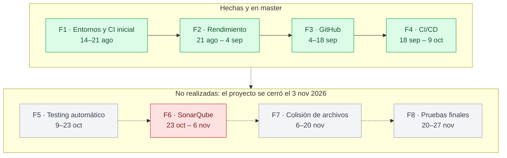

# 08 · Fases

**En una frase:** un capítulo por cada fase que se hizo (1–4), con sus fechas, su PR y sus resultados; las Fases 5–8 no tienen capítulo porque no se realizaron.

Verde: hecha y en `master` · gris: no se realizará · rojo: cancelada en la etapa de plan. Las fechas del diagrama son las **planificadas** y no cambian.

## Las 8 fases

| # | Fase | Planificada | Real | Estado | Capítulo |
|---|---|---|---|---|---|
| 1 | Entornos, repositorio y CI inicial | 14–21 ago | Setup 10–12 mar 2026; documentada 31 ago | ✅ PR #2 (`7e1610f`) | [Fase 1](fase-01-entornos-repositorio-ci/README.md) |
| 2 | Optimización y rendimiento | 21 ago – 4 sep | Código 10–12 mar 2026; benchmarks 28 ago | ✅ PR #2 (`7e1610f`); mejoras estimadas | [Fase 2](fase-02-optimizacion-rendimiento/README.md) |
| 3 | Integración con GitHub | 4–18 sep | 10–11 sep; E2E real 5–6 oct | ✅ PR #4 (`183f1cb`), 6 oct | [Fase 3](fase-03-integracion-github/README.md) |
| 4 | Pipeline CI/CD completo | 18 sep – 9 oct | 9–22 oct; E2E real 22 oct | ✅ PR #5 (`56f7136`), 22 oct | [Fase 4](fase-04-pipeline-cicd/README.md) |
| 5 | Testing automático | 9–23 oct | — | ❌ No se realizará | [Cierre](../01-proyecto/cierre-del-proyecto.md#qué-no-se-hizo) |
| 6 | Integración con SonarQube | 23 oct – 6 nov | Plan el 23 oct, sin código | 🚫 Cancelada en la etapa de plan | [Cierre](../01-proyecto/cierre-del-proyecto.md#qué-no-se-hizo) |
| 7 | Colisión de archivos (con Christian Martínez) | 6–20 nov | — | ❌ No se realizará | [Cierre](../01-proyecto/cierre-del-proyecto.md#qué-no-se-hizo) |
| 8 | Pruebas finales | 20–27 nov | — | ❌ No se realizará | [Cierre](../01-proyecto/cierre-del-proyecto.md#qué-no-se-hizo) |

Todas las fechas son de 2026. Detalle de fechas y ramas: [calendarización](../01-proyecto/calendarizacion.md).

## Capítulos y anexos

Cada capítulo abre con «En una frase» y un «Resumen en 1 minuto»; lo demás es el anexo.

| Documento | Qué tiene |
|---|---|
| [Fase 1](fase-01-entornos-repositorio-ci/README.md) | Monorepo de tres capas, plantilla `.env`, scripts de desarrollo y de pruebas |
| [Fase 2](fase-02-optimizacion-rendimiento/README.md) | Las 7 optimizaciones, sus commits y por qué sus mejoras son estimaciones |
| ↳ [Tabla comparativa rápida](fase-02-optimizacion-rendimiento/TABLA-COMPARATIVA-RAPIDA.md) | Los números de cada cambio en una tabla |
| ↳ [Análisis detallado de impacto](fase-02-optimizacion-rendimiento/ANALISIS-DETALLADO-IMPACTO.md) | Cada cambio explicado a fondo |
| ↳ [Resumen visual](fase-02-optimizacion-rendimiento/RESUMEN-VISUAL.md) | Gráficos en texto de las mejoras |
| ↳ [Código lado a lado](fase-02-optimizacion-rendimiento/CODIGO-LADO-A-LADO.md) | El código antes y después |
| ↳ [Cómo leer esta documentación](fase-02-optimizacion-rendimiento/COMO-LEER-ESTA-DOCUMENTACION.md) | Qué leer de la Fase 2 según tu perfil |
| [Fase 3](fase-03-integracion-github/README.md) | GitHub App, explorador, rama por tarea, PR que completa la tarea, IA sobre el repositorio, E2E |
| ↳ [Seguridad y base de datos](fase-03-integracion-github/SEGURIDAD-Y-BASE-DE-DATOS.md) | Modelo de seguridad, diseño de la BD (3FN, transacciones) y riesgos residuales |
| [Fase 4](fase-04-pipeline-cicd/README.md) | Pipeline, ejecuciones en vivo, staging, producción con aprobación, rollback, avisos, E2E |
| [Plantilla de fase](_plantilla-fase.md) | La estructura que siguieron los capítulos 1–4 (se conserva como referencia) |

## Búsqueda rápida por tema

- **N+1 corregidas:** [tabla comparativa](fase-02-optimizacion-rendimiento/TABLA-COMPARATIVA-RAPIDA.md#4️⃣-getworkloaddistribution--eliminar-n1).
- **Paralelización (`Promise.all`):** [código lado a lado](fase-02-optimizacion-rendimiento/CODIGO-LADO-A-LADO.md#3️⃣-paralelización--promiseall) y [resumen visual](fase-02-optimizacion-rendimiento/RESUMEN-VISUAL.md#-gráfico-4-paralelización--crear-proyecto).
- **Bundle y `React.lazy`:** [tabla comparativa](fase-02-optimizacion-rendimiento/TABLA-COMPARATIVA-RAPIDA.md#8️⃣-code-splitting-frontend--reactlazy).
- **Medición de rendimiento (28 ago 2026):** [Fase 2, antes vs. ahora](fase-02-optimizacion-rendimiento/README.md#antes-vs-ahora); son tiempos absolutos, sin medición «antes».
- **El workflow generado, job por job:** [Fase 4](fase-04-pipeline-cicd/README.md#el-workflow-generado-job-por-job).
- **Revisión y correcciones de la Fase 4:** [Fase 4](fase-04-pipeline-cicd/README.md#revisión-verificación-y-correcciones).
- **Permisos de la GitHub App:** [guía de la GitHub App, §4](../07-guias/guia-github-app.md#4-registrar-la-github-app).

## Ramas

- `master` tiene todo el trabajo. `feature/fase-4-cicd-github-actions` sigue existiendo (local y en `origin`), ya fusionada con el PR #5.
- Quedan `feature/fase-5-testing-automatico`, `feature/fase-6-sonarqube` y `feature/fase-7-colision-archivos`: vacías, creadas desde `master` el 6 oct 2026 (`fe9d87d`). Se pueden borrar cuando Pablo lo decida. La Fase 8 nunca tuvo rama.

## Diagramas e imágenes

- Los diagramas de estas páginas son bloques Mermaid (los de la Fase 2 en `RESUMEN-VISUAL.md` son texto).
- Su copia en PNG está en una carpeta `imagenes/` junto a cada página, con el nombre `<página>-<n>.png`: [`imagenes/`](imagenes/) para este índice y la plantilla, y `imagenes/` dentro de los capítulos de las Fases 2, 3 y 4.

## Para saber más

- Limitaciones y pendientes de todas las fases: [cierre del proyecto](../01-proyecto/cierre-del-proyecto.md#pendientes-todo).
- [Índice de la documentación](../README.md).
