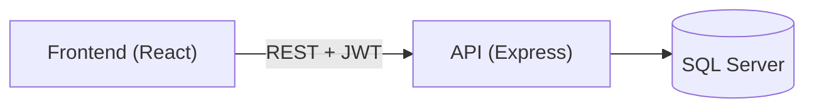
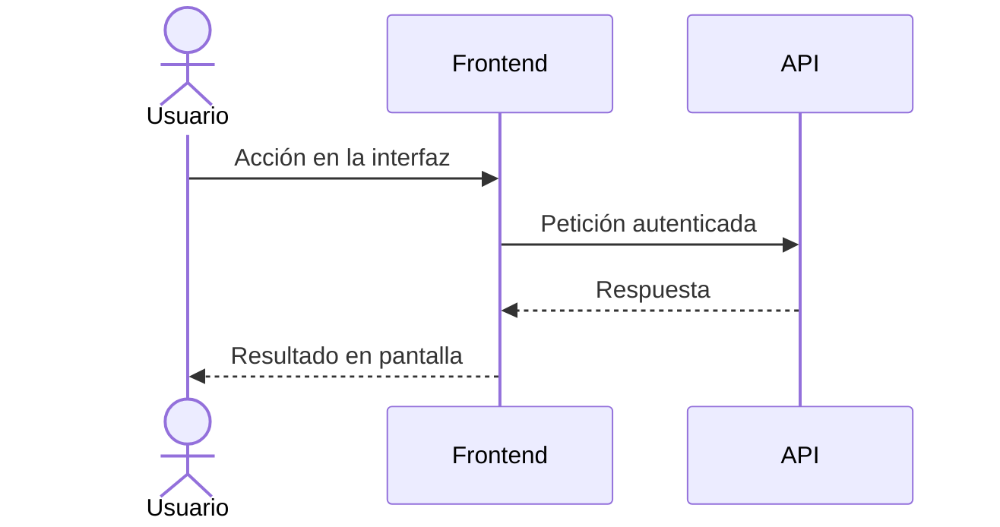

# Fase N: [Nombre de la Fase]

**Plantilla reutilizable para cada capítulo de fase**

> Plantilla usada en las Fases 1–4. El proyecto cerró en la Fase 4 (3 nov 2026); se conserva solo como referencia por si se retoma (ver [cierre del proyecto](../01-proyecto/cierre-del-proyecto.md#cómo-retomar-el-proyecto)).

---

## Metadata

| Campo | Valor |
|-------|-------|
| **Fase** | N |
| **Nombre** | [Nombre descriptivo] |
| **Complejidad** | [Baja/Media/Alta/Muy Alta] |
| **Fechas Planificadas** | [Inicio] — [Fin] |
| **Fechas Reales** | [Inicio] — [Fin] (si aplica) |
| **Estado** | [⏳ Planificada / 🔄 En Curso / ✅ Completada / ❌ No realizada / 🚫 Cancelada] |
| **Rama Git** | `feature/fase-N-...` o rama actual; al fusionar: PR #N y merge `<hash>` |
| **Responsable** | [Nombre] |

---

## Objetivo

¿Por qué se hace esta fase? Contexto y motivación.

### Problemas que Resuelve
- Problema 1
- Problema 2
- Problema 3

### Impacto Esperado
- Métrica 1: X% mejora (objetivo o estimación: márcalo como tal; no se inventan mediciones)
- Métrica 2: Y ahorrado
- Métrica 3: Z enablement

---

## Qué Se Hizo

### Tabla de Commits

| Hash | Mensaje | Archivos | Fecha |
|------|---------|----------|-------|
| `abc1234` | feat: descripcción del cambio | src/file1.js, src/file2.js | 1 sep |
| `def5678` | perf: otra mejora | src/file3.js | 2 sep |

### Narrativa por Cambio

#### Cambio 1: [Descripción]
**Problema:** [Qué no funcionaba bien]  
**Solución:** [Qué cambió]  
**Archivos afectados:** `src/file.js`  
**Commits relacionados:** `abc1234`

```javascript
// ANTES
const oldCode = () => {
  // ...
};

// DESPUÉS
const newCode = () => {
  // ...
};
```

---

## Antes vs. Ahora

| Funcionalidad | Antes | Después | Mejora | Medición |
|---------------|-------|---------|--------|----------|
| [Feature 1] | Métrica A | Métrica B | Cambio | Real/Estimada |
| [Feature 2] | Métrica A | Métrica B | Cambio | Real/Estimada |

---

## Diagramas

Reemplaza estos ejemplos mínimos por los diagramas de la fase. Para que rendericen: pon entre comillas las etiquetas con paréntesis o caracteres especiales, no uses `;` ni `#` dentro de los mensajes de un diagrama de secuencia y evita ids reservados como `end`.

### Diagrama 1: [Concepto] (ejemplo de flujo)



### Diagrama 2: [Otro concepto] (ejemplo de secuencia)



---

## Cómo Reproducir / Verificar

### Pasos para Validar los Cambios

1. **Revisar commits:**
   ```bash
   git show abc1234
   git show def5678
   ```

2. **Ejecutar tests:**
   ```bash
   npm test
   npm run test:performance  # si aplica
   ```

3. **Verificar en UI:**
   - Paso 1
   - Paso 2
   - Paso 3

### Requisitos
- Dependencias: [list]
- Variables de entorno: [list]
- BD: [si requiere]

---

## Commits Relacionados

- `abc1234` — [Descripción]
- `def5678` — [Descripción]

**Ver todos** (rango del PR de la fase; sigue funcionando aunque se borre la rama):
```bash
git log --oneline <merge>^1..<merge>^2
# Fases 1 y 2: 7e1610f (PR #2) · Fase 3: 183f1cb (PR #4) · Fase 4: 56f7136 (PR #5)
```

---

## Pendientes

- [ ] Tarea 1 (bloqueador)
- [ ] Tarea 2 (no-bloqueador)
- [ ] Tarea 3 (opcional)

**Notas:**
- Las tareas marcadas como no-bloqueador fueron documentadas explícitamente y no afectan el go-live de esta fase.
- Al cierre del proyecto (3 nov 2026) los pendientes de las Fases 1–4 se consolidaron en una sola lista: [cierre del proyecto](../01-proyecto/cierre-del-proyecto.md#pendientes-todo). Si el proyecto se retoma, cada fase nueva agrega allí los suyos.

---

## Referencias Relacionadas

- [Fase anterior]
- [Fase siguiente]
- [Documento de arquitectura]

---

**Documento generado:** [Fecha]  
**Autor:** [Nombre]
