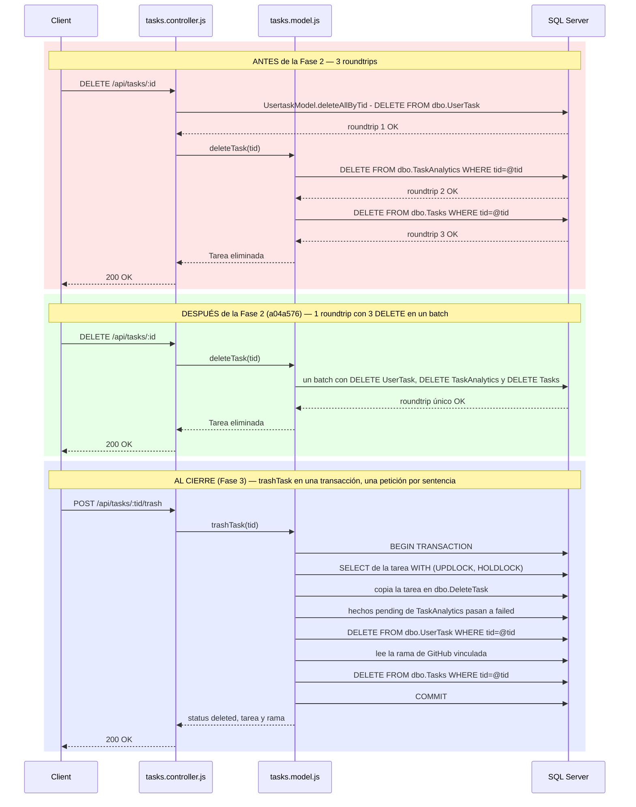
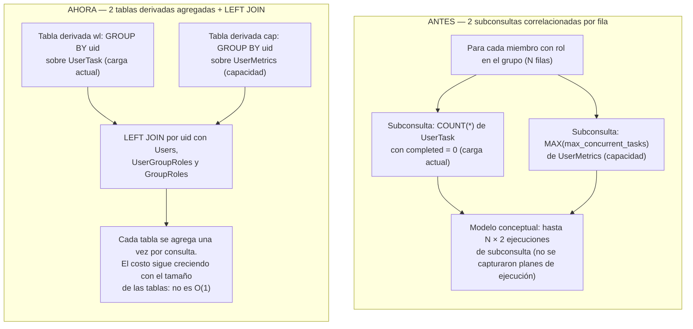

# Fase 2 — Optimización y mejora del rendimiento

**En una frase:** 7 optimizaciones del código (entre ellas, borrados en lote, paralelismo, consultas sin N+1 y carga diferida de las vistas) con mejoras estimadas, no medidas; la Fase 3 reemplazó parte de ellas por transacciones.

> **Resumen en 1 minuto**
> - **Qué agregó:** 7 optimizaciones del código (10–12 mar 2026): borrados en lote, comprobación e `INSERT` en una sola sentencia, operaciones independientes en paralelo (`Promise.all`), consultas sin N+1, corrección de filas multiplicadas en `UserMetrics`, carga diferida de las vistas (`React.lazy`) y menos logging. Además, el heartbeat que cierra las conexiones WebSocket colgadas.
> - **Las mejoras son estimaciones, no mediciones:** -71 % de latencia, -97,5 % de operaciones de BD y -65 % de bundle. La única medición (28 ago 2026) toma tiempos de lecturas que la fase no cambió.
> - **Qué cambió después:** la Fase 3 reemplazó los borrados en lote y las inserciones en paralelo por transacciones ACID.
> - **Cómo usarlo:** no hay nada que activar: es código interno. El código exacto de cada cambio se ve con `git show <hash>` ([tabla de commits](#tabla-de-commits)).
> - **Estado:** ✅ código completo; mejoras sin medir. **PR:** [#2](https://github.com/PabloP150/proyecto-is-cc6/pull/2) (Fases 1 y 2), merge `7e1610f` en `master` (6 oct 2026).
> - **Pruebas:** las cifras de esta fase son las de su cierre: API y frontend, con 155 pruebas de las que 52 fallaban (las corrigió la Fase 3). Las del cierre del proyecto (1919) están en el [estado verificado](../../01-proyecto/cierre-del-proyecto.md#estado-verificado-al-3-nov-2026).
> - **Dónde está el detalle:** el resto de esta página y los 5 documentos de la carpeta son el anexo ([cómo leerlos](COMO-LEER-ESTA-DOCUMENTACION.md)); limitaciones y pendientes en el [cierre del proyecto](../../01-proyecto/cierre-del-proyecto.md).

> **Nota de cierre (3 nov 2026).** El proyecto se cerró después de la Fase 4; esta fase está completa. Al leer este capítulo y los otros cinco de la carpeta conviene tener presente:
> - **Todas las mejoras son estimaciones estructurales, no mediciones.** Nadie midió el «antes» ni el «después» de ningún cambio. La única medición (28 ago 2026) toma tiempos de lecturas que la Fase 2 no modificó; ver [Medición real (benchmarks)](#-medición-real-benchmarks).
> - **Los extractos de código** de este README siguen los diffs reales. Los de los documentos complementarios se corrigieron al cierre, pero son resúmenes; el código exacto se ve con `git show <hash>`.
> - **La Fase 3 reemplazó parte de este trabajo** (`285bf14` y `349aa02`, PR #4). Los DELETE en un solo roundtrip pasaron a ser transacciones de varias sentencias. Las inserciones en paralelo de `createProjectFromPlan()` y de *populate-assignments* ahora corren en serie dentro de una transacción. La reparación de administradores pasó a la migración `004`. Se cambiaron roundtrips por atomicidad. Cada sección lo indica con una «Nota (estado al cierre)».
> - **Los commits** llegaron a `master` con el PR #2 (merge `7e1610f`, 6 oct 2026); la rama `refactor/cleanup` se eliminó después.
>
> Las limitaciones conocidas y lo que quedó sin hacer están en [cierre del proyecto](../../01-proyecto/cierre-del-proyecto.md).

## Metadata

| Campo | Valor |
|---|---|
| Complejidad | Media |
| Fechas planificadas | 21 ago – 4 sep 2026 |
| Fechas reales del código | 10–12 mar 2026 (documentado retroactivamente) |
| Benchmarks ejecutados | 28 ago 2026 (solo tiempos absolutos de lecturas que la fase no cambió; no miden las mejoras) |
| Estado | ✅ Código de optimización completado · Mejoras estimadas, no medidas |
| Rama de trabajo | `refactor/cleanup`, fusionada en `master` con el PR #2 (merge `7e1610f`, 6 oct 2026) y eliminada después |

### Nota de transparencia

El trabajo de código de esta fase se realizó y completó antes de la formalización de la calendarización del curso (10–12 de marzo 2026 vs. ventana planificada 21 ago–4 sep 2026). Este documento mapea esos cambios retroactivamente a la Fase 2 de la línea de trabajo de Pablo, sirviendo simultáneamente como capítulo ejemplo y plantilla para las fases posteriores. Los commits mencionados se fusionaron en `master` con el PR #2.

## Objetivo / Por qué

Antes de construir un pipeline CI/CD robusto (Fase 4) y un ciclo de testing automático exhaustivo (planificado como Fase 5, que no se realizó), era crítico:

1. **Eliminar overhead de producción detectado**: un `console.log` en cada request HTTP (I/O en el hot path), imports estáticos de 12 componentes (11 páginas y el `Navbar`) que inflaban el bundle inicial de React, y un leak de la `LLM_API_KEY` en los logs de arranque del servidor.
2. **Corregir patrones de acceso a datos ineficientes** antes de que la complejidad creciente del pipeline amplifique el costo de refactorizar después: roundtrips redundantes a la BD, subconsultas correlacionadas por fila (patrón N+1 dentro de una consulta SQL), falta de paralelización donde era posible, conexiones WebSocket que no se limpiaban cuando se colgaban.
3. **Corregir un bug de exactitud de datos** detectado durante la optimización: el join directo a la tabla `UserMetrics` en `getTeamAnalyticsSummary` multiplicaba filas y causaba conteos inflados de tareas.

El resultado buscado es una base de código más rápida y predecible antes de escalar con automatización. La ganancia no se midió.

## Qué se hizo

Cinco commits en secuencia (10–12 de marzo 2026), hechos en `refactor/cleanup` y fusionados en `master` con el PR #2:

### Tabla de commits

| # | Commit | Mensaje | Archivos principales | Fecha |
|---|--------|---------|----------------------|-------|
| 1 | `2589b55` | perf: lazy load all routes, remove dev routes, fix API key log leak | `src/App.js`, `taskmate-api/server.js` | 2026-03-10 |
| 2 | `4969894` | perf: remove excessive console.logs and per-request HTTP logging | `taskmate-api/server.js`, `taskmate-api/controllers/analytics.controller.js` | 2026-03-10 |
| 3 | `d7bf277` | perf: optimize db queries and parallelize independent operations | `taskmate-api/models/group.model.js`, `taskmate-api/models/tasks.model.js`, `taskmate-api/services/AnalyticsService.js`, `taskmate-api/services/ProjectService.js` | 2026-03-12 |
| 4 | `a04a576` | perf: reduce db roundtrips, terminate zombie ws connections, parallelize batch ops | `taskmate-api/controllers/tasks.controller.js`, `taskmate-api/models/tasks.model.js`, `taskmate-api/server.js`, `taskmate-api/services/AnalyticsService.js`, `taskmate-api/services/WebSocketServer.js` | 2026-03-12 |
| 5 | `a4148dd` | perf: batch deletes, remove unused import, fix UserMetrics join row explosion | `taskmate-api/controllers/nodes.controller.js`, `taskmate-api/models/nodes.model.js`, `taskmate-api/models/groupRoles.model.js`, `taskmate-api/services/AnalyticsService.js` | 2026-03-12 |

### Narrativa por commit

#### Commit 1 — `2589b55` — perf: lazy load all routes, remove dev routes, fix API key log leak

**Frontend (React bundle)**

Antes, `src/App.js` importaba estáticamente 12 componentes de `./components/`: `AnalyticsDashboard`, `BlockDiagram`, `CalendarView`, `ChatPage`, `CreateGroup`, `Flow`, `GroupsView`, `HomePage`, `Login`, `Navbar`, `Recordatorios` y `Register`. Webpack empaquetaba el código de **todas las páginas en el bundle inicial**, incluso si el usuario solo visitaba la página de login.

Ahora cada componente se carga bajo demanda con `React.lazy()` y todo va dentro de un `<Suspense>` cuyo fallback es `PageLoader` (un `CircularProgress` de MUI):

```javascript
const AnalyticsDashboard = lazy(() => import('./components/AnalyticsDashboard'));
const BlockDiagram = lazy(() => import('./components/BlockDiagram'));
// … los otros 10 componentes, igual …

<Suspense fallback={<PageLoader />}>
  {user && <Navbar user={user} onLogout={handleLogout} />}
  <Routes>…</Routes>
</Suspense>
```

El resultado es code-splitting real: el navegador descarga el JavaScript de cada página cuando la visita. El commit también quitó el `ReactFlowProvider` global, que no se usaba.

**Seguridad**

1. `src/App.js` tenía dos rutas de desarrollo de React, `/websocket-test` y `/theme-test` (componentes `WebSocketTest` y `ThemeTest`), accesibles en el build de producción. Se quitaron las rutas; los archivos se borraron después (`4383f63`, `5855bb3`).
2. `taskmate-api/server.js` tenía dos `console.log` que imprimían `LLM_PROVIDER`, `LLM_API_KEY` y `LLM_TEMPERATURE` al arrancar, lo que exponía el secreto si los logs eran accesibles. Se eliminaron. (Para entonces el LLM ya era Groq: `12ee245`, el mismo día.)

**Impacto (estimado, no medido)**: carga inicial del frontend más liviana, menos superficie de ataque, secretos fuera de los logs.

> **Nota (estado al cierre, 3 nov 2026):** vigente: las páginas siguen cargándose con `React.lazy()` (la Fase 3 agregó `GitHubPage`). Con las [correcciones del cierre](../../01-proyecto/cierre-del-proyecto.md#correcciones-del-cierre-3-nov-2026), `App.js` ya no carga `CreateGroup` (se borró) ni `Flow` (`/flow` y `/create-group` redirigen; `Flow` se sigue cargando dentro de `BlockDiagram`). El build de producción del 3 nov 2026, ya con esas correcciones, genera `main.js` de 373 KB minificado (119 KB gzip) más 24 chunks bajo demanda. No hay medición de marzo para comparar.

---

#### Commit 2 — `4969894` — perf: remove excessive console.logs and per-request HTTP logging

**Middleware de logging por request**

`taskmate-api/server.js` tenía un middleware que se ejecutaba en **cada** request HTTP:

```javascript
app.use((req, res, next) => {
    console.log(`Request client URL: ${req.get('host')}${req.originalUrl} >>>> ${SERVER_TAG}`);
    next();
});
```

En Node, escribir en stdout puede ser síncrono (por ejemplo, cuando la salida va a un archivo, como hace `start.sh` con el log de la API). Una escritura por request suma trabajo al hot path. El costo real no se midió.

**Logs de debug en analytics**

`taskmate-api/controllers/analytics.controller.js` tenía 18 líneas `console.log` / `console.error` en el flujo de recomendaciones de IA (`POST /api/analytics/recommendations`; el mensaje del commit dice 15):
- El cuerpo del request, los datos enviados al servidor de IA y la respuesta completa.
- Traces de ejecución del agente MCP (conexión, ID de sesión, timeout, eventos).
- Errores con su stack.

Útil durante desarrollo, pero innecesario en producción y genera ruido.

**Cambio**

Se eliminó el middleware y esas 18 líneas, y se agregó un único `console.error('Error getting task recommendations:', error.message)`. El mismo commit hizo que `getTaskRecommendations` use el usuario del JWT en lugar de un `requesterId` del body.

**Impacto (estimado, no medido)**: una escritura a stdout menos por request y logs más limpios.

> **Nota (estado al cierre, 3 nov 2026):** vigente; la API no tiene middleware de logging por request.

---

#### Commit 3 — `d7bf277` — perf: optimize db queries and parallelize independent operations

Este commit toca el backend profundamente, corrigiendo múltiples patrones de acceso a datos:

**1. `taskmate-api/models/group.model.js::getGroupsByUserId()` — UPDATE sin filtro de usuario**

Cada llamada a `getGroupsByUserId()` (la lista de grupos del usuario) ejecutaba primero una consulta de "reparación" para los grupos huérfanos: grupos cuyo `adminId` ya no era miembro del grupo. Les asignaba como admin al primer miembro restante por `username`. Antes del commit, el UPDATE recorría **todos los grupos de la tabla** en cada request.

El commit agrega un `INNER JOIN` que restringe el UPDATE a los grupos del usuario solicitante:

```sql
UPDATE g SET g.adminId = (
    SELECT TOP 1 ug2.uid
    FROM dbo.UserGroups ug2
    INNER JOIN dbo.Users u2 ON u2.uid = ug2.uid
    WHERE ug2.gid = g.gid
    ORDER BY u2.username
)
FROM dbo.Groups g
INNER JOIN dbo.UserGroups ug_user ON ug_user.gid = g.gid AND ug_user.uid = @uid   -- línea nueva
WHERE NOT EXISTS (
    SELECT 1 FROM dbo.UserGroups ug WHERE ug.uid = g.adminId AND ug.gid = g.gid
)
AND EXISTS (
    SELECT 1 FROM dbo.UserGroups ug WHERE ug.gid = g.gid
)
```

**Mejora (estructural)**: de O(número total de grupos en la BD) a O(número de grupos del usuario).

> **Nota (estado al cierre, 3 nov 2026):** reemplazado en la Fase 3 (`285bf14`). La reparación ya no corre en cada request: es la migración única `004_repair_group_admins.sql`, y `getGroupsByUserId()` es un `SELECT` puro. Los admins huérfanos no pueden volver a aparecer, porque `leaveGroup` / `removeMemberFromGroup` traspasan el rol de admin en la misma transacción.

**2. `taskmate-api/models/tasks.model.js::deleteTask()` — 2 roundtrips → 1 roundtrip**

Antes, `deleteTask()` hacía dos llamadas separadas a la BD:

```javascript
// Clear FK-constrained rows before deleting the task
await execWriteCommand(`DELETE FROM dbo.TaskAnalytics WHERE tid=@tid`, param);
return execWriteCommand(`DELETE FROM dbo.Tasks WHERE tid=@tid`, param);
```

Ahora se batchean en una sola llamada:

```javascript
// Clear FK-constrained rows and delete task in a single batch
return execWriteCommand(
    `DELETE FROM dbo.TaskAnalytics WHERE tid=@tid; DELETE FROM dbo.Tasks WHERE tid=@tid`,
    param
);
```

**Mejora (estructural)**: `deleteTask()` pasa de 2 roundtrips a 1. Como el controller llamaba antes a `UsertaskModel.deleteAllByTid()`, el borrado completo pasó de 3 roundtrips a 2; el commit 4 lo deja en 1.

> **Nota (estado al cierre, 3 nov 2026):** reemplazado en la Fase 3 (`349aa02`). `deleteTask()` y la ruta `DELETE /api/tasks/:id` ya no existen. El «borrar» de la UI es `POST /api/tasks/:tid/trash` → `trashTask(tid)`, una sola transacción con varias sentencias: lectura con bloqueo, copia en `DeleteTask`, cierre de los hechos pendientes de `TaskAnalytics` como `'failed'` (ya no se borran), `DELETE` de `UserTask` y de `Tasks`. Ver el [Diagrama 1](#diagramas).

**3. `taskmate-api/services/AnalyticsService.js::recordTaskAssignment()` — check-then-insert → INSERT...WHERE NOT EXISTS**

Antes, registrar una asignación en `TaskAnalytics` (evitando duplicar un hecho pendiente) se hacía con dos roundtrips y una ventana de carrera:

```javascript
// Check if assignment already exists (prevent duplicates)
const existingQuery = `
    SELECT id FROM dbo.TaskAnalytics
    WHERE tid = @tid AND uid = @uid AND success_status = 'pending'
`;
const existing = await execReadCommand(existingQuery, existingParams);
if (existing && existing.length > 0) {
    return { success: true, message: 'Assignment already recorded' };
}
// Ventana de carrera: otra petición podría insertar entre el SELECT y el INSERT
await execWriteCommand(insertQuery, insertParams);   // INSERT ... VALUES (...)
```

Ahora se resuelve en una sola sentencia:

```javascript
// Insert only if no pending assignment already exists (single roundtrip)
const insertQuery = `
    INSERT INTO dbo.TaskAnalytics (tid, uid, gid, task_category, assigned_at)
    SELECT @tid, @uid, @gid, @category, GETDATE()
    WHERE NOT EXISTS (
        SELECT 1 FROM dbo.TaskAnalytics
        WHERE tid = @tid AND uid = @uid AND success_status = 'pending'
    )
`;
const rowsInserted = await execWriteCommand(insertQuery, insertParams);
if (rowsInserted === 0) {
    return { success: true, message: 'Assignment already recorded' };
}
```

La comprobación y el INSERT van en la misma sentencia, lo que estrecha mucho la ventana de carrera. No la cierra del todo: no hay índice único sobre los hechos `'pending'` de `(tid, uid)` ni pistas `UPDLOCK, HOLDLOCK`. Con el nivel de aislamiento por defecto, dos sentencias simultáneas todavía podrían insertar las dos.

**Mejora (estructural)**: 2 roundtrips → 1.

> **Nota (estado al cierre, 3 nov 2026):** vigente. Además exige que la tarea exista (`AND EXISTS (SELECT 1 FROM dbo.Tasks WHERE tid = @tid)`), y una prueba de BD cubre el dedupe (`tests/db/analytics.dbtest.js`).

**4. Paralelización en `_updateUserMetrics()`: `_updateUserExpertise()` + `_updateDailyMetrics()`**

Antes, dentro de `AnalyticsService._updateUserMetrics(taskId)`:

```javascript
// Update or create UserExpertise record
await this._updateUserExpertise(uid, task_category, completion_time_hours, success_status);
// Update daily UserMetrics
await this._updateDailyMetrics(uid);
```

Secuencial. Las dos operaciones escriben en tablas distintas (`UserExpertise` y `UserMetrics`) sin dependencias entre sí, pero el código esperaba una y luego la otra.

Ahora:

```javascript
// Run both updates in parallel — they write to different tables
await Promise.all([
    this._updateUserExpertise(uid, task_category, completion_time_hours, success_status),
    this._updateDailyMetrics(uid)
]);
```

Ambas corren en paralelo, limitadas por el pool de conexiones a la BD. Si cada operación tarda ~t ms, el tiempo total pasaría de ~2t a ~t (estimación, no medida).

> **Nota (estado al cierre, 3 nov 2026):** vigente. Hoy `_updateUserMetrics()` lanza en un mismo `Promise.all` una actualización de experticia por cada fila de la tarea y una de métricas diarias por cada usuario.

**5. `taskmate-api/services/AnalyticsService.js::getWorkloadDistribution()` — subconsultas correlacionadas**

Este es el patrón N+1 clásico, pero dentro de una sola consulta SQL. Antes:

```sql
SELECT
    u.uid,
    u.username,
    MIN(gr.gr_name) as role_name, -- Use MIN to get a single representative role
    (SELECT COUNT(*) FROM dbo.UserTask WHERE uid = u.uid AND completed = 0) as current_workload,
    (SELECT MAX(max_concurrent_tasks) FROM dbo.UserMetrics WHERE uid = u.uid) as capacity
FROM dbo.Users u
INNER JOIN dbo.UserGroupRoles ugr ON u.uid = ugr.uid
INNER JOIN dbo.GroupRoles gr ON gr.gr_id = ugr.gr_id
WHERE ugr.gid = @gid
GROUP BY u.uid, u.username
ORDER BY u.username;
```

Cada subconsulta `(SELECT ... WHERE uid = u.uid)` está correlacionada con la fila de afuera: conceptualmente se evalúa una vez por cada miembro del grupo. (El optimizador de SQL Server puede reescribir algunas subconsultas como joins; no se capturaron planes de ejecución para saber qué hacía aquí.)

Ahora las subconsultas se pre-agregan en tablas derivadas:

```sql
SELECT
    u.uid,
    u.username,
    MIN(gr.gr_name) as role_name,
    ISNULL(wl.cnt, 0) as current_workload,
    cap.max_cap as capacity
FROM dbo.Users u
INNER JOIN dbo.UserGroupRoles ugr ON u.uid = ugr.uid
INNER JOIN dbo.GroupRoles gr ON gr.gr_id = ugr.gr_id
LEFT JOIN (
    SELECT uid, COUNT(*) as cnt
    FROM dbo.UserTask
    WHERE completed = 0
    GROUP BY uid
) wl ON wl.uid = u.uid
LEFT JOIN (
    SELECT uid, MAX(max_concurrent_tasks) as max_cap
    FROM dbo.UserMetrics
    GROUP BY uid
) cap ON cap.uid = u.uid
WHERE ugr.gid = @gid
GROUP BY u.uid, u.username, wl.cnt, cap.max_cap
ORDER BY u.username;
```

Cada tabla derivada se agrega una vez por consulta y se une por `uid`; el motor ya no necesita una subconsulta por fila.

**Mejora (estructural, no medida)**: de una subconsulta por miembro y por columna a un número fijo de agregaciones. Ojo: las tablas derivadas agregan **toda** `UserTask` y **toda** `UserMetrics` (sin filtro por grupo). El costo sigue creciendo con el tamaño de esas tablas; no es O(1).

> **Nota (estado al cierre, 3 nov 2026):** vigente. Desde `349aa02` (Fase 3) la carga cuenta todas las asignaciones de tareas existentes (`UserTask` unida a `Tasks`), sin el filtro `completed = 0`, porque `UserTask.completed` no indica si la tarea se completó. Una prueba de BD lo cubre.

**6. `taskmate-api/services/ProjectService.js::createProjectFromPlan()` — loop secuencial → Promise.all**

Antes, al crear un proyecto desde el plan de la IA, las tareas y los hitos se insertaban uno por uno:

```javascript
for (let i = 0; i < projectData.tasks.length; i++) {
    const task = projectData.tasks[i];
    // … calcula la fecha y arma taskData …
    await taskModel.addTask(taskData);
}
// … y otro for igual para los milestones (nodeModel) …
```

N inserts secuenciales = N × t_insert.

Ahora:

```javascript
await Promise.all(projectData.tasks.map(async (task, i) => {
    // … igual …
    await taskModel.addTask(taskData);
}));
// … y otro Promise.all igual para los milestones …
```

Paralelización en dos tandas (tareas, luego hitos): tiempo total ≈ 2 × t_insert, limitado por el pool de conexiones (estimación, no medida).

> **Nota (estado al cierre, 3 nov 2026):** reemplazado en la Fase 3. Hoy `createProjectFromPlan()` crea el grupo, el creador, los roles, las tareas y los hitos dentro de una sola `withTransaction()`. El `Promise.all` sigue en el código, pero las sentencias se encolan en orden (FIFO) sobre la única conexión de la transacción (`helpers/transaction.js`), así que los INSERT vuelven a ir en serie. A cambio, el proyecto se crea completo o no se crea.

**Impacto del commit 3 (estimado, no medido)**: menos roundtrips de BD, sin subconsultas por fila y paralelización donde era posible.

---

#### Commit 4 — `a04a576` — perf: reduce db roundtrips, terminate zombie ws connections, parallelize batch ops

Expansión del anterior:

**1. `taskmate-api/models/tasks.model.js::deleteTask()` — extensión: 2 roundtrips → 1 roundtrip (3 tablas batcheadas)**

El commit 3 ya había batcheado TaskAnalytics + Tasks. Pero `tasks.controller.js` hacía una llamada separada antes:

```javascript
await UsertaskModel.deleteAllByTid(tid);  // roundtrip 1
const result = await TasksModel.deleteTask(tid);   // roundtrip 2 (que ya batchea 2 DELETEs)
```

Ahora el modelo batchea **las 3 tablas en una sola llamada**:

```sql
DELETE FROM dbo.UserTask WHERE tid=@tid; DELETE FROM dbo.TaskAnalytics WHERE tid=@tid; DELETE FROM dbo.Tasks WHERE tid=@tid
```

Y el controller deja de llamar a `UsertaskModel.deleteAllByTid()`, que quedó como código muerto hasta que se borró en `2c9673e` (31 ago 2026).

**Impacto (estructural)**: de 2 roundtrips a 1 (de 3 a 1 contando el commit 3).

> **Nota (estado al cierre, 3 nov 2026):** reemplazado en la Fase 3 por `trashTask()` en una transacción (ver la nota del commit 3, punto 2).

**2. WebSocket heartbeat — terminación de conexiones zombie**

Las conexiones WebSocket son persistentes. Si un cliente (navegador) se cuelga (network interrupt, dev tools cerrados forzosamente, etc.) **sin cerrar gracefully**, la conexión TCP puede quedar abierta en el servidor indefinidamente, consumiendo un file descriptor y memoria.

Antes: `WebSocketServer.js` hacía `ws.ping()` cada 30s a cada cliente abierto, pero no verificaba si recibía un `pong` de vuelta.

Ahora se agrega el patrón estándar WebSocket heartbeat con `isAlive`:

```javascript
// Al conectar
ws.isAlive = true;
ws.on('pong', () => { ws.isAlive = true; });

// setupHeartbeat()
this.heartbeatInterval = setInterval(() => {
    this.wss.clients.forEach((ws) => {
        if (ws.readyState !== WebSocket.OPEN) return;
        if (ws.isAlive === false) {
            ws.terminate();  // Cierra la conexión muerta
            return;
        }
        ws.isAlive = false;
        ws.ping();
    });
}, 30000);
```

Funcionamiento: en cada tick del heartbeat (cada 30s), si el cliente no respondió al ping anterior (`isAlive === false`), se termina la conexión. Si respondió (`isAlive === true`), se marca como `false` y se envía un nuevo ping. El cliente debe responder con `pong` en los próximos 30s.

**Impacto (por diseño; no se probó con carga)**: las conexiones muertas se cierran en ≤60s (2 ciclos de heartbeat) en lugar de acumularse indefinidamente. No se observó ni se midió un leak de memoria.

> **Nota (estado al cierre, 3 nov 2026):** vigente (`services/WebSocketServer.js`).

**3. `/api/utils/populate-assignments/:groupId` — paralelización de batch populate**

Endpoint de utilidad (entonces en `server.js`) que asigna las tareas sin asignar de un grupo a miembros al azar. Antes: loop secuencial de 2N INSERTs (N tareas × 2 INSERTs por tarea: UserTask + TaskAnalytics).

Ahora: `Promise.all` anidado que paraleliza tanto entre tasks como dentro de cada task.

**Impacto (estimado, no medido)**: batch populate más rápido.

> **Nota (estado al cierre, 3 nov 2026):** reemplazado en la Fase 3. La ruta vive en `controllers/utils.controller.js`, exige ser admin del grupo y llama a `UsertaskModel.populateAssignmentsForGroup()`. Esa función corre en una transacción que bloquea el grupo (no puede asignar dos veces en paralelo), y cada tarea envía sus dos INSERT en un solo batch. El `Promise.all` se encola en la conexión de la transacción, así que las tareas van en serie.

**4. `AnalyticsService.js::batchUpdateUserMetrics()` — paralelización**

Similar a `createProjectFromPlan()`: el `for...of` sobre los usuarios activos, que llamaba a `_updateDailyMetrics(user.uid)` uno por uno, pasa a `Promise.all(activeUsers.map(...))`. La función no recibe argumentos: recorre todos los usuarios activos.

> **Nota (estado al cierre, 3 nov 2026):** vigente; hoy además corre la actualización de los puntajes de experticia en paralelo con las métricas diarias.

---

#### Commit 5 — `a4148dd` — perf: batch deletes, remove unused import, fix UserMetrics join row explosion

**1. `taskmate-api/models/nodes.model.js::deleteNode()` — 2 roundtrips → 1 roundtrip**

Antes: el controller llamaba a `deleteEdgesByNode()` (roundtrip 1) y luego `deleteNode()` (roundtrip 2).

Ahora: una sola query que batchea ambos DELETEs:

```sql
DELETE FROM dbo.Edges WHERE sourceId=@nid OR targetId=@nid; DELETE FROM dbo.Nodes WHERE nid=@nid
```

**Impacto (estructural)**: -50% roundtrips. El import `deleteEdgesByNode` se elimina del controller; la función quedó muerta hasta que se borró en `2c9673e` (31 ago 2026).

**2. `taskmate-api/models/groupRoles.model.js::deleteGroupRole()` — 2 roundtrips → 1 roundtrip**

Ídem pattern: batchear `DELETE FROM dbo.UserGroupRoles` + `DELETE FROM dbo.GroupRoles` en una sola query.

> **Nota (estado al cierre, 3 nov 2026):** `deleteNode()` y `deleteGroupRole()` se reemplazaron en la Fase 3 (`285bf14`). Cada una corre ahora en una transacción con dos `tx.write` (primero la tabla con la FK, después la fila principal): dos roundtrips en vez de uno, pero atómicos.

**3. `taskmate-api/services/AnalyticsService.js::getTeamAnalyticsSummary()` — Fix de row explosion (bug + performance)**

Este es el cambio más crítico en términos de **corrección** (además de performance).

Antes, la consulta hacía un LEFT JOIN directo a la tabla `UserMetrics`:

```sql
SELECT
    u.uid,
    u.username,
    COUNT(CASE WHEN ta.success_status = 'pending' THEN 1 END) as active_tasks,
    COUNT(CASE WHEN ta.success_status = 'completed' THEN 1 END) as completed_tasks,
    COUNT(CASE WHEN ta.success_status = 'failed' THEN 1 END) as failed_tasks,
    AVG(CASE WHEN ta.completion_time_hours IS NOT NULL THEN ta.completion_time_hours END) as avg_completion_time,
    MAX(um.max_concurrent_tasks) as historical_capacity
FROM dbo.Users u
JOIN dbo.UserGroups ug ON u.uid = ug.uid
LEFT JOIN dbo.TaskAnalytics ta ON u.uid = ta.uid AND ta.gid = @gid
LEFT JOIN dbo.UserMetrics um ON u.uid = um.uid   -- ← PROBLEMA: M filas por usuario
WHERE ug.gid = @gid
GROUP BY u.uid, u.username
ORDER BY u.username
```

`UserMetrics` guarda una fila por usuario y por día. Si un usuario tiene **M filas** ahí, el LEFT JOIN repite M veces cada una de sus filas de `TaskAnalytics` (fan-out de un join 1-a-N). Ejemplo:
- El usuario tiene 5 hechos `'pending'` en `TaskAnalytics`.
- Tiene 3 filas en `UserMetrics` (3 días distintos).
- El join produce 5 × 3 = 15 filas antes del `GROUP BY`.
- `COUNT(CASE WHEN ta.success_status = 'pending' …)` cuenta **15**, no 5: los conteos salían multiplicados por M. El `AVG` y el `MAX` no cambiaban, porque todas las filas se repiten el mismo número de veces.

Ahora se pre-agrega `UserMetrics` en una tabla derivada (`um_max`):

```sql
SELECT
    u.uid,
    u.username,
    COUNT(CASE WHEN ta.success_status = 'pending' THEN 1 END) as active_tasks,
    -- … completed_tasks, failed_tasks y avg_completion_time, igual …
    um_max.max_cap as historical_capacity
FROM dbo.Users u
JOIN dbo.UserGroups ug ON u.uid = ug.uid
LEFT JOIN dbo.TaskAnalytics ta ON u.uid = ta.uid AND ta.gid = @gid
LEFT JOIN (
    SELECT uid, MAX(max_concurrent_tasks) as max_cap
    FROM dbo.UserMetrics
    GROUP BY uid
) um_max ON u.uid = um_max.uid
WHERE ug.gid = @gid
GROUP BY u.uid, u.username, um_max.max_cap
ORDER BY u.username
```

Ahora `UserMetrics` aporta una sola fila por `uid` y los `COUNT` cuentan cada hecho una vez.

**Impacto**:
- **Corrección**: los conteos ya no se multiplican por el número de filas históricas de `UserMetrics`.
- **Performance (estructural, no medida)**: el resultado intermedio (antes del GROUP BY) es M veces más chico por usuario.
- **Validación**: el SQL no tiene una prueba contra la BD; el test unitario de `AnalyticsService` simula `execQuery`.

> **Nota (estado al cierre, 3 nov 2026):** vigente; es la consulta de hoy. La Fase 3 cambió `TaskAnalytics` (sus hechos se cierran como `'completed'` o `'failed'` en vez de borrarse).

---

### Resumen de cambios

| Nivel | Cambio | Commits | Estado al cierre (3 nov 2026) |
|---|---|---|---|
| **Frontend** | Code-splitting con `React.lazy`+`Suspense` (12 componentes) | 1 | Vigente |
| **Seguridad** | Quitar las rutas dev de React y el log de `LLM_API_KEY` | 1 | Vigente |
| **Backend: Logging** | Quitar el middleware de logging por request y 18 líneas `console.*` de analytics | 2 | Vigente |
| **Backend: BD (alcance)** | Reparación de admins acotada a los grupos del usuario en `getGroupsByUserId` | 3 | Reemplazado: migración `004` (Fase 3) |
| **Backend: BD (roundtrips)** | Borrar una tarea (3→1), `deleteNode` (2→1), `deleteGroupRole` (2→1) | 3, 4, 5 | Reemplazado: transacciones (Fase 3) |
| **Backend: BD (roundtrips)** | Dedupe de `recordTaskAssignment` con `INSERT…WHERE NOT EXISTS` (2→1) | 3 | Vigente |
| **Backend: BD (paralelización)** | `Promise.all` en `_updateUserMetrics` y `batchUpdateUserMetrics` | 3, 4 | Vigente |
| **Backend: BD (paralelización)** | `Promise.all` en `createProjectFromPlan` y populate-assignments | 3, 4 | Reemplazado: una transacción, en serie (Fase 3) |
| **Backend: BD (N+1)** | Corregir getWorkloadDistribution (subqueries correlacionadas → pre-agregación) | 3 | Vigente |
| **Backend: BD (exactitud + perf)** | Corregir getTeamAnalyticsSummary (row explosion por UserMetrics) | 5 | Vigente |
| **Backend: WebSocket** | Heartbeat `isAlive`/`pong` para limpiar conexiones zombie | 4 | Vigente |

---

## Antes vs. Ahora

«Ahora» es el estado al terminar la Fase 2 (12 mar 2026). La última columna dice qué cambió después. Ninguna mejora se midió: todas son estimaciones deducidas de la estructura del código y del SQL, sin planes de ejecución capturados.

| Funcionalidad | Antes | Ahora (Fase 2) | Mejora estimada (no medida) | Estado al cierre (3 nov 2026) |
|---|---|---|---|---|
| **Bundle inicial React** | 12 componentes (11 páginas + `Navbar`) en imports estáticos | `React.lazy()` + `Suspense` (fallback `PageLoader`) | Bundle inicial más pequeño, carga bajo demanda | Vigente (la Fase 3 agregó `GitHubPage`). Build del 3 nov: `main.js` 373 KB (119 KB gzip) + 24 chunks; sin medición «antes» |
| **Logging por request** | `console.log` en el 100% del tráfico + 18 `console.*` en analytics | Middleware y logs de debug eliminados | Una escritura a stdout menos por request | Vigente |
| **Seguridad: rutas dev** | `/websocket-test`, `/theme-test` (rutas de React) en el build de producción | Eliminadas | Menor superficie de ataque (cualitativo) | Vigente; archivos borrados en `4383f63` y `5855bb3` |
| **Seguridad: API key leak** | `LLM_API_KEY` impresa en stdout al arrancar | Eliminada | Secreto fuera de los logs (cualitativo) | Vigente |
| **`getGroupsByUserId()` — reparación de admins** | UPDATE sobre todos los grupos en cada request | UPDATE acotado con JOIN + `@uid` | De O(tabla completa) a O(grupos del usuario) | Reemplazado: migración `004` y `SELECT` puro (Fase 3) |
| **`_updateUserExpertise` + `_updateDailyMetrics`** | Secuencial (`await`, `await`) | `Promise.all` (paralelo) | De ~2t a ~t | Vigente |
| **`getWorkloadDistribution()` — N+1** | 2 subconsultas correlacionadas por miembro | 2 tablas derivadas agregadas + LEFT JOIN | Número fijo de agregaciones en vez de una subconsulta por fila; el costo sigue creciendo con el tamaño de las tablas | Vigente; sin filtro `completed = 0` desde `349aa02` |
| **`createProjectFromPlan()`** | `for...await` secuencial por tarea y por hito | `Promise.all` en 2 tandas | De N × t_insert a ~2 × t_insert | Reemplazado: una transacción, INSERT en serie (Fase 3) |
| **`batchUpdateUserMetrics()`** | Loop secuencial por usuario | `Promise.all` | De N × t a ~t (limitado por el pool) | Vigente |
| **`populate-assignments/:groupId`** | Loop secuencial de 2N INSERTs | `Promise.all` anidado | De 2N × t a ~t (limitado por el pool) | Reemplazado: una transacción con bloqueo del grupo, en serie (Fase 3) |
| **WebSocket conexiones zombie** | Sin límite si el cliente se cuelga sin cerrar | Heartbeat `isAlive`/`pong`; cierre en ≤60s | Acotado a ~60s vs. indefinido (por diseño; sin prueba de carga) | Vigente |
| **Borrar una tarea** | 3 roundtrips (`UserTask` desde el controller, `TaskAnalytics`, `Tasks`) | 1 roundtrip (3 DELETE en un batch) | -2 roundtrips | Reemplazado: `trashTask()` en una transacción (Fase 3) |
| **`deleteNode()`, `deleteGroupRole()`** | 2 roundtrips cada una | 1 roundtrip batcheado | -50% roundtrips | Reemplazado: transacción con 2 sentencias (Fase 3) |
| **`recordTaskAssignment()` — dedupe** | SELECT + INSERT (ventana de carrera) | `INSERT...SELECT...WHERE NOT EXISTS` (1 roundtrip) | -50% roundtrips; ventana de carrera mucho menor (no cerrada) | Vigente; además `AND EXISTS` de la tarea y prueba de BD |
| **`getTeamAnalyticsSummary()` — row explosion** | LEFT JOIN a `UserMetrics` multiplica los conteos por M | Pre-agregación `um_max` antes del JOIN | Conteos correctos; resultado intermedio M veces menor | Vigente; sin prueba contra la BD |

### 📏 Medición real (benchmarks)

La única medición de esta fase es la corrida de `npm run test:performance` del 28 ago 2026 (`48ddea4`), con `NODE_ENV=integration-test` y SQL Server local:

| Prueba | Qué ejecuta | Resultado |
|---|---|---|
| Query individual | 1 llamada a `AnalyticsService.getUserAnalyticsSummary()` | 30 ms |
| Batch (10 en paralelo) | 10 llamadas a `getUserAnalyticsSummary()` con `Promise.all` | 17 ms |
| Concurrentes (20) | 20 llamadas a `getUserAnalyticsSummary()` | 10 ms |
| Memoria | 50 llamadas a `getCurrentWorkload()` en paralelo | +4.39 MB de heap |
| Recomendaciones | Generador *mock* dentro del propio test, sin BD, equipos de 5–20 | 0–1 ms |

Estos números **no dicen nada de las mejoras de la Fase 2**:
- `getUserAnalyticsSummary()` y `getCurrentWorkload()` no se modificaron en la Fase 2 (`getUserAnalyticsSummary` es de nov 2025, `a2a7633`).
- Los IDs de usuario son GUID sintéticos que el test nunca inserta, así que las consultas devuelven resultados vacíos.
- No hay una corrida «antes» para comparar, y ninguna prueba ejecuta los caminos de escritura optimizados.

## Diagramas

### Diagrama 1 — Secuencia del borrado de una tarea: antes, después y al cierre

Histórico: la Fase 3 (`349aa02`) reemplazó `deleteTask()` y la ruta `DELETE /api/tasks/:id` por `trashTask()`. El tercer bloque muestra el flujo de hoy.



### Diagrama 2 — `getWorkloadDistribution()`: patrón N+1 corregido

Etiquetas según `d7bf277`. Desde `349aa02` la tabla derivada de carga cuenta `UserTask` unida a `Tasks`, sin el filtro `completed = 0`.



## Cómo reproducir / verificar

### Ver los diffs exactos de cada commit

```bash
# Commit 1: lazy load, rutas dev, API key leak
git show 2589b55

# Commit 2: logging
git show 4969894

# Commit 3: optimizaciones DB y paralelización
git show d7bf277

# Commit 4: roundtrips, zombie WS, batch ops
git show a04a576

# Commit 5: más batch deletes, row explosion fix
git show a4148dd

# Fase 3: transacciones que reemplazaron parte de lo anterior
git show --stat 285bf14 349aa02
```

### Correr benchmarks reales (requiere SQL Server local)

Los benchmarks están integrados a Jest mediante el gate `NODE_ENV=integration-test`. Si tu SQL Server local no está disponible, puedes saltarte este paso y ejecutarlo más adelante. Recuerda qué miden: tiempos absolutos de lecturas que la Fase 2 no tocó (ver [Medición real](#-medición-real-benchmarks)).

```bash
cd taskmate-api

# Verificar que la sintaxis de performance.test.js es válida
node -c tests/performance.test.js

# Correr los benchmarks (requiere NODE_ENV=integration-test y SQL Server accesible)
npm run test:performance

# Esto imprimirá:
# - Duración de queries individuales (ms)
# - Duración de batches paralelos (ms)
# - Duración de queries concurrentes (ms)
# - Aumento de memoria (MB)
# - Generación de recomendaciones (ms)
```

### Verificar el estado actual del código

Desde la raíz del repositorio:

```bash
# Las funciones muertas ya no existen (se borraron en 2c9673e): sin resultados
git grep -n -E "deleteAllByTid|deleteEdgesByNode" -- taskmate-api

# Borrado de tareas al cierre: trashTask en una transacción (Fase 3)
grep -n -E "const trashTask|DELETE FROM dbo.UserTask" taskmate-api/models/tasks.model.js

# Cambios de la Fase 2 que siguen vigentes
grep -n -E "WHERE NOT EXISTS|um_max|Promise.all" taskmate-api/services/AnalyticsService.js
grep -n "isAlive" taskmate-api/services/WebSocketServer.js
grep -n "lazy(" src/App.js      # una carga lazy por página
```

## Pendientes / trabajo futuro

Estado de cada pendiente **al cierre del proyecto (3 nov 2026)**:

- **Ejecutar `npm run test:performance` contra SQL Server local y reemplazar los `N/A`**: se ejecutó el 28 ago 2026 (`48ddea4`), pero mide lecturas que la Fase 2 no cambió y no tiene una línea base «antes». Medir las mejoras de verdad: **No se realizará (proyecto cerrado el 3 nov 2026)**.
- **Limpiar el código muerto** (`deleteAllByTid` de `usertask.model.js` y `deleteEdgesByNode` de `edges.model.js`): **Hecho** en `2c9673e` (31 ago 2026).
- **Validar bajo carga el heartbeat WebSocket** con clientes que se cuelgan sin cerrar: **No se realizará (proyecto cerrado el 3 nov 2026)**; las pruebas automáticas de la Fase 5 tampoco se hicieron.
- **Confirmar la equivalencia funcional del fix de `getTeamAnalyticsSummary`** en el frontend (`AnalyticsDashboard` muestra esos conteos): nunca se verificó formalmente, y la Fase 3 rehízo los hechos de `TaskAnalytics` (`285bf14`). **No se realizará (proyecto cerrado el 3 nov 2026)**.

Las limitaciones conocidas y lo que quedó sin hacer en todo el proyecto están en [cierre del proyecto](../../01-proyecto/cierre-del-proyecto.md).

---

## Commits relacionados

Toda la información de los commits mencionados se puede consultar con:

```bash
git log --oneline --graph --all | grep -E "(perf:|2589b55|4969894|d7bf277|a04a576|a4148dd)"
```

- **Código de la fase:** `2589b55`, `4969894`, `d7bf277`, `a04a576`, `a4148dd` (10–12 mar 2026).
- **Benchmarks y documentación:** `48ddea4`, `e959fc0`, `b34a0ee`, `887bfea`, `ba3f1cf`, `2531272` (28 ago 2026); `2c9673e` (31 ago 2026, que también borró el código muerto); `8d3201b` (6 oct 2026).
- **Fusión:** PR #2 (merge `7e1610f`, 6 oct 2026). La rama `refactor/cleanup` ya no existe.
- **Cambios posteriores que reemplazaron parte de esta fase:** `285bf14` y `349aa02` (Fase 3, PR #4).

---

**Última actualización**: 3 nov 2026 (cierre del proyecto; versión original del 28 ago 2026)  
**Autor**: Pablo Pineda  
**Revisión**: Fase 2 de la línea de trabajo de Pablo Pineda, documentada retroactivamente.
