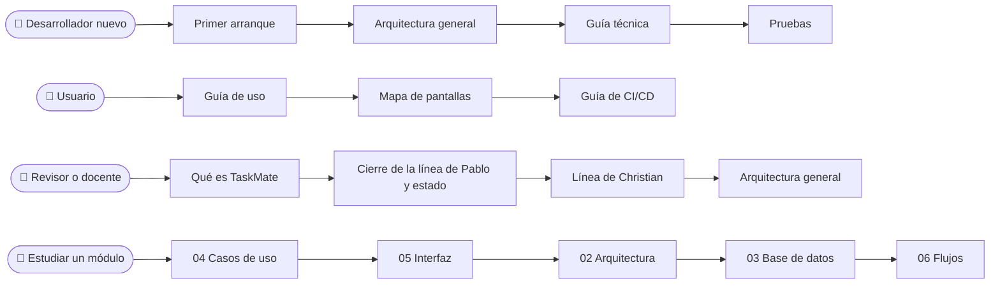

# Documentación de TaskMate

**En una frase:** el mapa de toda la documentación de TaskMate: qué hay en cada carpeta, por dónde empezar según quién seas y dónde está cada módulo.

**Estado al 26 nov 2026:**

- **Línea de Pablo:** cerró el 3 nov 2026 con las Fases 1–4, en `master` → [cierre de la línea de Pablo y estado](01-proyecto/cierre-del-proyecto.md).
- **Línea de Christian:** siguió con sus fechas corridas. Puntos 1–7 completos; la 8 (colisión de archivos) está pospuesta con la base hecha y la 9 (pruebas finales), pendiente → [línea de Christian](09-linea-christian/README.md).
- Lo nuevo entró por la rama `test/e2e`, que se fusionó en `master` el 26 nov 2026 con tres arreglos (webhook de Vercel, revisión de PR fallida y ESLint). Hay 2091 pruebas en verde (26 nov 2026), 29 tablas y las migraciones 001–011.

## Qué hay en cada carpeta

| Carpeta | Qué tiene |
|---|---|
| [01-proyecto](01-proyecto/README.md) | Qué es TaskMate, sus funcionalidades, la calendarización, el documento formal y el cierre |
| [02-arquitectura](02-arquitectura/README.md) | Cómo se conectan las piezas: vista general, despliegue, capas del código, seguridad y un diagrama por módulo |
| [03-base-de-datos](03-base-de-datos/README.md) | Las 29 tablas: modelo general, campos, migraciones y triggers, y las tablas de cada módulo |
| [04-casos-de-uso](04-casos-de-uso/README.md) | Quién hace qué: actores, permisos por rol, recorridos de usuario y casos de cada módulo |
| [05-interfaz](05-interfaz/README.md) | Las pantallas con capturas: mapa de navegación y una página por módulo |
| [06-flujos](06-flujos/README.md) | El paso a paso de cada operación (secuencias y estados) y qué ve el usuario si algo falla |
| [07-guias](07-guias/README.md) | Primer arranque, guía de uso, pruebas, SQL Server en Docker, GitHub App, CI/CD y guía técnica |
| [08-fases](08-fases/README.md) | Un capítulo por cada fase hecha de la línea de Pablo (1–4), con fechas, PRs y resultados |
| [09-linea-christian](09-linea-christian/README.md) | Línea de Christian Martínez: servidor de IA local (repo aparte), monitoreo de Vercel, archivos por tarea, `audit`, generar pruebas, revisión de PR con IA, chatbot con IA local, interfaz en inglés y el arranque en Linux (`scripts/local-up.sh`) |

## ¿Por dónde empiezo?

| Si eres… | Lee, en este orden |
|---|---|
| **Desarrollador nuevo** (primer arranque) | [Primer arranque](07-guias/primer-arranque.md) → [arquitectura general](02-arquitectura/00-general.md) → [guía técnica](07-guias/guia-tecnica.md) → [pruebas](07-guias/pruebas.md) |
| **Usuario** de la app | [Guía de uso por rol](07-guias/guia-de-uso.md) → [mapa de pantallas](05-interfaz/00-general.md) → [guía de CI/CD](07-guias/guia-cicd.md) |
| **Revisor o docente** | [Qué es TaskMate](01-proyecto/que-es-taskmate.md) → [cierre de la línea de Pablo y estado](01-proyecto/cierre-del-proyecto.md) → [línea de Christian](09-linea-christian/README.md) → [arquitectura general](02-arquitectura/00-general.md) → [funcionalidades](01-proyecto/funcionalidades.md) |
| **Quien estudia un módulo** | Su fila en la tabla de abajo, de izquierda a derecha: qué se puede hacer, cómo se ve, cómo está hecho y paso a paso |

## Módulos × carpetas

| Módulo | Casos de uso | Interfaz | Arquitectura | Base de datos | Flujos |
|---|---|---|---|---|---|
| 1 · Usuarios y acceso | [ver](04-casos-de-uso/01-usuarios-y-acceso.md) | [ver](05-interfaz/01-usuarios-y-acceso.md) | [ver](02-arquitectura/01-usuarios-y-acceso.md) | [ver](03-base-de-datos/01-usuarios-y-acceso.md) | [ver](06-flujos/01-usuarios-y-acceso.md) |
| 2 · Grupos y roles | [ver](04-casos-de-uso/02-grupos-y-roles.md) | [ver](05-interfaz/02-grupos-y-roles.md) | [ver](02-arquitectura/02-grupos-y-roles.md) | [ver](03-base-de-datos/02-grupos-y-roles.md) | [ver](06-flujos/02-grupos-y-roles.md) |
| 3 · Tareas | [ver](04-casos-de-uso/03-tareas.md) | [ver](05-interfaz/03-tareas.md) | [ver](02-arquitectura/03-tareas.md) | [ver](03-base-de-datos/03-tareas.md) | [ver](06-flujos/03-tareas.md) |
| 4 · Hitos y calendario | [ver](04-casos-de-uso/04-hitos-y-calendario.md) | [ver](05-interfaz/04-hitos-y-calendario.md) | [ver](02-arquitectura/04-hitos-y-calendario.md) | [ver](03-base-de-datos/04-hitos-y-calendario.md) | [ver](06-flujos/04-hitos-y-calendario.md) |
| 5 · Chat con IA | [ver](04-casos-de-uso/05-chat-ia.md) | [ver](05-interfaz/05-chat-ia.md) | [ver](02-arquitectura/05-chat-ia.md) | [ver](03-base-de-datos/05-chat-ia.md) | [ver](06-flujos/05-chat-ia.md) |
| 6 · Analytics | [ver](04-casos-de-uso/06-analytics.md) | [ver](05-interfaz/06-analytics.md) | [ver](02-arquitectura/06-analytics.md) | [ver](03-base-de-datos/06-analytics.md) | [ver](06-flujos/06-analytics.md) |
| 7 · GitHub | [ver](04-casos-de-uso/07-github.md) | [ver](05-interfaz/07-github.md) | [ver](02-arquitectura/07-github.md) | [ver](03-base-de-datos/07-github.md) | [ver](06-flujos/07-github.md) |
| 8 · CI/CD | [ver](04-casos-de-uso/08-cicd.md) | [ver](05-interfaz/08-cicd.md) | [ver](02-arquitectura/08-cicd.md) | [ver](03-base-de-datos/08-cicd.md) | [ver](06-flujos/08-cicd.md) |
| 9 · Tiempo real y avisos | [ver](04-casos-de-uso/09-tiempo-real-y-avisos.md) | [ver](05-interfaz/09-tiempo-real-y-avisos.md) | [ver](02-arquitectura/09-tiempo-real-y-avisos.md) | [sin tablas propias](03-base-de-datos/00-general.md#tablas-por-módulo) | [ver](06-flujos/09-tiempo-real-y-avisos.md) |
| 10 · IA sobre el código | [ver](04-casos-de-uso/10-ia-sobre-el-codigo.md) | [ver](05-interfaz/10-ia-sobre-el-codigo.md) | [ver](02-arquitectura/10-ia-sobre-el-codigo.md) | [ver](03-base-de-datos/10-ia-sobre-el-codigo.md) | [ver](06-flujos/10-ia-sobre-el-codigo.md) |

Cada carpeta de 02 a 06 empieza con sus páginas generales (`00-*.md`) y sigue con una página por módulo (`01-*` a `10-*`).

Dónde cae lo de la línea de Christian: el chat con el modelo local va en el 5, los archivos por tarea en el 7, el monitoreo de Vercel en el 8, y el servidor de IA local con «Audit», «Generate tests» y «Review PR» en el 10.

## Cómo están hechas las páginas

- Cada página abre con **«En una frase»** y sus diagramas, y sigue con «Qué hace», «Cómo funciona», «Dónde está en el código» y «Para saber más».
- Los diagramas son bloques Mermaid. Cada carpeta guarda su copia en PNG en `imagenes/`.
- La arquitectura con íconos se dibuja desde `02-arquitectura/fuentes/*.mmd`.
- Las docs están en español, pero los textos de la app se citan en inglés, tal como los muestra la interfaz desde el 19 nov 2026. Las capturas de `05-interfaz/capturas/` se retomaron el 26 nov 2026 y ya muestran la interfaz en inglés y el selector de grupo.
- Las limitaciones y los pendientes viven en un solo lugar: el [cierre de la línea de Pablo y estado](01-proyecto/cierre-del-proyecto.md#limitaciones-conocidas).
- Si algo no coincide con el código, manda el código.

## Dónde está en el código

| Código | Dónde se explica |
|---|---|
| `src/` (frontend React) | [05-interfaz](05-interfaz/README.md) y [capas del código](02-arquitectura/00-capas-del-codigo.md) |
| `taskmate-api/controllers/`, `services/`, `middleware/` | [02-arquitectura](02-arquitectura/README.md), [permisos por rol](04-casos-de-uso/00-permisos-por-rol.md) y [06-flujos](06-flujos/README.md) |
| `taskmate-api/services/deploy/`, `controllers/deploy.controller.js` (monitoreo de Vercel) | [CI/CD](02-arquitectura/08-cicd.md) |
| `taskmate-api/taskmate_tables.sql`, `migrations/` (001–011; la 009 crea las tablas de despliegues, la 010 `TaskFiles` y la 011 `AiReviews`) | [03-base-de-datos](03-base-de-datos/README.md) |
| `taskmate-api/mcp/` (servicio Python del chat) | [chat con IA](02-arquitectura/05-chat-ia.md) y [analytics](02-arquitectura/06-analytics.md) |
| `taskmate-api/services/aiServer/` y el servidor de IA local (repo aparte `taskmate-ai-server`, en `../ai-server`) | [IA sobre el código](02-arquitectura/10-ia-sobre-el-codigo.md) y [línea de Christian](09-linea-christian/README.md) |
| `start.sh`, `taskmate-api/.env.example`, `Dockerfile` | [primer arranque](07-guias/primer-arranque.md) y [SQL Server en Docker](07-guias/base-de-datos-docker.md) |
| `scripts/local-up.sh`, `scripts/local-down.sh` (Linux con Podman e IA local) | [primer arranque](07-guias/primer-arranque.md) y [levantar TaskMate en local](09-linea-christian/ENTORNO-LOCAL.md) |

## Para saber más

- [README de la raíz](../README.md): resumen del proyecto y arranque rápido.
- [Calendarización](01-proyecto/calendarizacion.md): fechas planificadas (no cambian) y reales, de la línea de Pablo y de la de Christian.
- [Funcionalidades](01-proyecto/funcionalidades.md): todo lo que se puede hacer, por módulo y rol.
- [Pruebas de la API](../taskmate-api/tests/README.md): cómo están organizadas.
